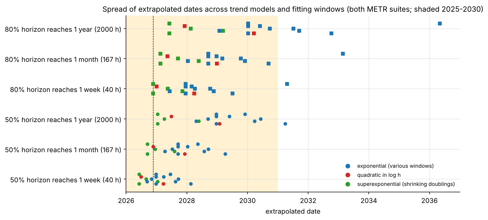
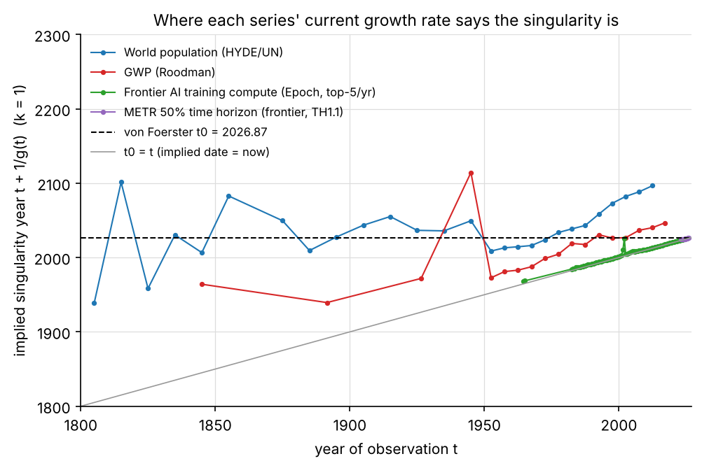

# Fast exponentials pull AGI forecasts toward 2027

Written by Claude for Kaarel Hänni.

20 November 2026. The computations behind every number labelled "analysis A–E" are in [`../analysis/`](../analysis/README.md); [../analysis/README.md](../analysis/README.md) gives the data provenance, the pinned commits and the one-line reproduction (`bash run_all.sh`). The research notes this report synthesizes are in [`../research_notes/Steelmanning AGI timeline arguments/`](../research_notes/Steelmanning%20AGI%20timeline%20arguments/).

The 2020 step from "log loss keeps falling" to "AGI around 2027–28" never ran through a loss threshold in the versions that produced near-term dates. Proponents used the loss curves as a **no-wall certificate**: straight lines across seven orders of magnitude showed that a generic learner turns compute into general competence smoothly. They took the date from two other inputs, effective compute growing about 10× a year and an openly intuitive calibration ("a jump this much larger [than GPT-2→GPT-3] feels … like it could result in human-level performance", [Anthropic 2023](https://www.anthropic.com/news/core-views-on-ai-safety)). Read that way, the argument survives the end of pure pretraining scale-up, because RL and inference compute are exactly what "effective compute" was meant to absorb. It survives only by drawing on a paradigm succession that no scaling law predicted, and its decisive step is still judgment, not measurement. The compute-anchored forecasts of 1993–2009 (Moravec, Kurzweil, Vinge, Bostrom, Legg) landed near 2025–2030 because two omissions cancelled. They left out the ~10⁹-second training multiplier, and they also left out the growth of spending from $10³ to $10⁸–10¹⁰. In addition, at ×5/yr frontier-compute growth, four orders of magnitude of disagreement about the brain collapse into about six calendar years. METR's time horizon held or beat its ~4-month doubling into spring 2026 and then outgrew the task suite that measures it. The AI Futures Project now puts every author's median for a superhuman AI researcher in May–November 2027, resting on lab-reported, partly redacted acceleration evidence rather than on horizons. Von Foerster's 13 November 2026 is not robust even within the population data: about one in twelve fits a 1960 analyst could have made lands in 2025–2030, and no series has grown at the required 1/(2026.87 − t) rate since 1960. On luck, any single near-2027 hit is unremarkable (7–25% per forecaster), and four independent hits would be remarkable (p ≈ 0.002–0.015). But the hits share one method and were picked out of a pool expected to contain 5–10 chance hits, so the cluster reflects method plus the year the forecast was made, not foresight. None of it counts as a success until AGI actually arrives.

## The short answers to each question

**What the 2020 inference was.** The working inference had four premises. The first, supported by the loss curves, was that capability is a smooth, wall-free, monotone function of compute for a generic learner. The second was that training compute was growing about 10× a year. The third was a calibration: each ~2–2.5 OOM had bought one GPT-2→GPT-3-sized qualitative jump. The fourth was a judgment that a few more such jumps reach human level, or in later versions automated AI research, after which feedback takes over. The loss curve entered only through the first premise. Henighan's reading of reducible loss as KL ("bits … that 'remain to be understood'") also blocked the obvious objection that a flattening curve means flattening value ([Henighan et al. 2020](https://arxiv.org/abs/2010.14701)). The Direct Approach is the one serious attempt to turn loss directly into a date, and the user is right that it does not work as a ruler. It inverts a tiny residual of an ill-identified decomposition. Two fits of Chinchilla's own data agree on total loss to ~0.04 nats but disagree by ~60% on the reducible part, and halving that part costs 10²–10⁶× more compute depending on an exponent known only to ±0.05.

**Whether it can be saved.** The literal version, in which a specific pretraining loss marks the date, cannot: no map from loss to capability can be derived. The version "smoothness + effective-compute growth + calibration → date" can be saved. It made a roughly correct directional call, rapid compute-driven gains through the 2020s. Its anchored variants (Bio Anchors, ~2050) were too slow, and its calibrated variants (Amodei and Aschenbrenner, 2026–27) were somewhat too fast or are still pending. Its best steelman treats pretraining as the first implementation of a growing aggregate. Pretraining was the binding input until the base model crossed an elicitation threshold around GPT-4 class (2023–24), and RL and test-time compute then became the margin. The weakness is that this succession was discovered (o1, September 2024), not forecast.

**Why the compute forecasts landed near the right date.** They had the right driver and the wrong channel. Kurzweil assumed price-performance doubling yearly; the realized rate is ≈2.2 years, which puts "$1000 buys 10¹⁶ FLOP/s" around 2040, not 2023. Yet frontier *training* compute crossed his brain-rate × 10⁹-second anchor in 2023 with GPT-4, the year he gave for the $1000 machine. This is a cancellation, not a coincidence. By an accounting identity, a "$1000 PC matches the brain in real time" date is the date at which a ~$10⁸ cluster can train a brain-lifetime-equivalent model at ~1000× inefficiency, and the two criteria coincide in 2023 terms at k ≈ 670. Spending growth paid for the difference.

**Time horizons.** The steelman is METR's and the AI Futures Project's own. The horizon measures the missing ingredient, coherent long-task agency, in human labour-time on the tasks that matter for takeoff. It follows a clean exponential across ~4 OOM, and it has a natural endpoint, since AGI implies an unbounded horizon. On METR's raw data a 1-month 50% horizon falls between 2026.7 and 2029.3 across 16 fits (median 2027.7). As of 20 November 2026 the last robust measurement is Claude Opus 4.6 at about 12 h (February 2026). The highest published value is ≥16 h for an early Claude Mythos Preview, "at the upper end of what we can measure". METR has published no usable headline horizon since May, because saturation, cheating and evaluation awareness ended the series. The forecast shortened anyway: the AI Futures Project moved its SAR medians to May–November 2027 on METR's estimate of 1.9× AI-R&D acceleration at Anthropic. So the measurable trend is on or ahead of schedule, while the bridge from horizon to automation is untested and the evidence base has become less independent.

**Von Foerster and the ChatGPT answer.** Every factual claim in the quoted answer checks out. Roodman's median is 2047, GWP has not accelerated since 1960, compute grows as regime-wise exponentials, Kremer's model and the φ + β > 1 blow-up condition are stated correctly, Bloom et al. do find falling research productivity, and the 1.5/3.7/14.6/53% figures are right for k = 1. The answer understates two things. First, the date is fragile: refitting 1960-vintage windows to modern compilations gives a median t0 of 2036, with a 10–90% range of 1985–2127. Second, the arithmetic has run out: no constant-rate exponential can follow a hyperbola to its pole, and even frontier compute growing 150%/yr falls below the required rate in 2026.2. The proxy steelman, with R = N·f·h + M as research input, is the software-intelligence-explosion argument in other notation. Its live parameter is a 2026 estimate that AI's return to AI-R&D productivity is ~9%, against a 15% threshold for self-sustaining acceleration ([Cunningham et al. 2026](https://arxiv.org/abs/2609.15802)). That is a conditional mechanism, not a vindicated date.

**Other arguments of this variety.** The other quantitative families mostly recycle three exponentials: compute ×4–5/yr, algorithms ~×3/yr and lab revenue ×3–4/yr. They are revenue-to-GDP extrapolation (≈2031), capex as revealed belief (a boom window in 2028–29), Todd's "by ~2030 or much later" compute deadline, AI-R&D takeoff models (2027–2034), benchmark and capability-index extrapolation, and milestone-acceleration hyperbolas (Panov, Korotayev, Bellina et al.: 2027–2029). Through 2026 their mechanistic inputs ran on or ahead of trend, and none of them measures the step to AGI. The late-pointing quantitative families (bond yields, semi-informative priors, Hanson's fraction-of-the-way) are the mirror image: if AGI arrives around 2027, they are the badly wrong ones.

**Prescient and wrong models.** Errors flipped direction around 2000. Before 1980 they were early by decades (Dartmouth, Simon, Good, Minsky). From about 2000 to 2023, surveys, priors, markets and Bio Anchors erred late, by 12–40 years for HLMI and by 90–140 years for full automation of labour. Superforecasters did worse than domain experts on resolved AI questions. That the direction of error flips with the era suggests forecasters were tracking, and lagging, something real.

**Luck.** "They got lucky" is true of *which names we remember*: the famous hits are a fame-selected subset of a pool in which 5–10 chance hits were expected. It is false of the *cluster*. In a hand-built list, 4 of 6 hardware extrapolations land in 2025–2032, against 0 of 7 judgment forecasts. The method mechanically outputs the 2020s for anyone writing in 1998–2009. Two tests point away from a stopped clock: Kurzweil and Legg held fixed calendar years for decades, and the direction of error flipped as compute growth sped up.

## Scorecard: what each family assumed and what actually happened

| Family | Representative claims (who, when → date) | Mechanism assumed | What happened by Nov 2026 | Luck or skill |
|---|---|---|---|---|
| Pretraining loss threshold | Gwern 2020; Sutskever 2023; Direct Approach 2023 (median ~2033 as of Mar 2026) | Small enough KL to human text ⇒ human-level | Loss law held; value per pretraining FLOP disappointed (GPT-4.5) | No date was ever derivable; survives only as an upper bound |
| Compute + qualitative calibration | Anthropic 2023 (>10% within a decade); Aschenbrenner 2024 (2027); Anthropic 2025 (late 2026/early 2027) | Jumps per OOM of effective compute | Effective compute ~10×/yr; RL and inference became the margin | Skill on the driver; the date rests on intuition and an unforecast paradigm switch |
| Compute + brain anchor (modern) | Cotra 2020 (~2050), 2022 (~2040); Davidson 2023 (~2040) | ~1e36 effective FLOP with 2020 algorithms | Too late; algorithmic progress ran at ~3×/yr, not ~1.3×/yr | Right variable, wrong rate |
| Brain-rate hardware | Vinge 1993 (2005–2030); Moravec 1998 (hardware in the 2020s; robots 2040); Kurzweil 1999 (2029); Bostrom 1998 (≤2033, <50%); Legg 2009 (mode 2025, mean 2028) | $1000 PC matches a brain; brain reverse-engineering | Hardware curve too fast (Kurzweil); real channel was $10⁸–10¹⁰ clusters; omissions cancelled | Method plus timing; hits correlated and selected |
| Time horizons | METR 2025 (1 month by ~mid-2029, "as soon as early 2027" on the 2024–25 trend); AI 2027 (SC 2027 scenario); AIFP Nov 2026 (SAR medians May–Nov 2027) | Horizon → AI R&D automation → feedback | Slope held or steepened to ≥16 h, then the suite saturated | Unresolved; the near-term date is mechanical given level and slope; the bridge is untested |
| Hyperbolic growth | von Foerster 1960 (13 Nov 2026); Roodman 2020 (2047) | Cooperation; Kremer ideas loop | Population left the curve in the 1960s–70s; no series follows 1/(t0 − t) | Date ≈ a 1-in-12 draw; the mechanism claim is conditional |
| Other trend families | Revenue (~end-2031); capex (2028–29); Todd (≤~2030 or slowdown); takeoff models (2027–2034) | Mixed | Inputs mostly on or ahead of trend | Shared inputs; the step to AGI is untested |

## Much of the 2026 evidence rests on search summaries

The session that produced the notes could reach GitHub, arXiv and package registries, and little else. metr.org, epoch.ai, lesswrong.com, alignmentforum.org, metaculus.com, aiimpacts.org, ourworldindata.org, gwern.net, astralcodexten.com, situational-awareness.ai, dwarkesh.com, nickbostrom.com, jetpress.org, longbets.org, science.org and nber.org were blocked, and the shared web-search budget ran out partway through.

Some numbers were therefore recomputed from raw data and are verified. METR horizons up to February 2026 were recomputed from METR's raw runs on GitHub; Opus 4.6 comes out at 11.98 h, against the published ≈11h59m. The population and GWP fits use Roodman's GitHub archive and OWID's GitHub dataset repository.

The rest is weaker. Epoch compute data come from a third-party GitHub snapshot that ends in September 2024. The MIRI/Armstrong–Sotala predictions dataset could not be downloaded, so the base-rate analyses (D, E) use a hand-built, fame-selected list of 13 predictions whose citations were transcribed from memory. Kurzweil's and Moravec's brain estimates, forecast years and assumed doubling times in analysis B were also transcribed from memory, and are flagged in the data file. Everything about 2026 after February rests on search-result summaries and secondary press: Mythos, GPT-5.6 Sol, Opus 5.5, METR's 5 November assessment, the AI Futures Project's Q3.5 update, Anthropic's S-1 amendments and lab revenue. Model names are given as the 2026 sources give them. Quotes from blocked hosts (Gwern, Aschenbrenner, Dwarkesh transcripts, LessWrong posts, ACX) use the search-summary wording.

The report marks such claims inline. "Search summary" means the page itself was not read. "Secondary" means an aggregator or the press. "From memory" means transcribed without re-checking. "Unverified" means the source itself flags a conflict or weakness. Treat any number carrying one of these labels as provisional.

## Scaling laws licensed smoothness, never a loss threshold

**(a) As argued.** Neither founding paper states an AGI date. Kaplan et al. (January 2020) found straight power laws with "no signs of deviation". They conjectured that the crossing of their compute-optimal and data-limited laws marks "maximal performance". That crossing sits at C* ≈ 10⁴ PF-days (≈8.6×10²³ FLOP, only 2.75× GPT-3's 3.14×10²³), N* ≈ 10¹² parameters and L* ≈ 1.7 nats/token, with L* estimating the entropy of language. They also remarked that near a noise floor "even a small decrease in this distance [could represent] a significant boost in qualitative performance" ([Kaplan et al. 2020](https://arxiv.org/abs/2001.08361); [Brown et al. 2020](https://arxiv.org/abs/2005.14165)). Henighan et al. (October 2020) identified reducible loss with D_KL(True‖Model), "the number of bits of information that 'remain to be understood'". They added that "many capabilities simply lie on a spectrum that can be continuously unlocked with increasing scale" ([Henighan et al. 2020](https://arxiv.org/abs/2010.14701)).

Three families of inference were built on these papers. The *loss-threshold* family includes Gwern's "The Scaling Hypothesis" (2020) and Sutskever's 2023 claim that "predicting the next token well means that you understand the underlying reality that led to the creation of that token" (both search summary) ([Gwern](https://gwern.net/scaling-hypothesis); [Dwarkesh 2023](https://www.dwarkesh.com/p/ilya-sutskever)). Epoch's Direct Approach (Barnett & Besiroglu 2023) formalized it in five steps. Scaling laws forecast per-token KL. KL fixes how many tokens an ideal discriminator needs to tell model text from human text. A "human slowdown factor" turns that into a horizon of indistinguishable text. Demanding paper-length indistinguishability gives a compute requirement. Spending projections turn that into a date. The authors framed the result as a "soft ceiling", and Barnett warned it "may be far above the actual requirements, which could render the Direct Approach fairly useless". Its median was ~2033 as of March 2026 ([Epoch](https://epoch.ai/blog/the-direct-approach), search summary; [Barnett](https://www.lesswrong.com/posts/4ufbirCCLsFiscWuY/a-proposed-method-for-forecasting-transformative-ai), search summary; [RAND 2026](https://arxiv.org/abs/2604.22766)).

The *compute-calibration* family produced the near-term dates. Its clearest primary statement is footnote 3 of Anthropic's "Core Views" (8 March 2023). GPT-2→GPT-3 "resulted mostly from about a 250x increase in compute". Another ~50× separates GPT-3 from 2023 models, and ~1000× more was expected within five years. "A jump that is this much larger feels to many of us like it could result in human-level performance across most tasks. This requires that we use intuition – albeit informed intuition". The bottom line was ">10%" within a decade, "ignor[ing] algorithmic progress" ([Anthropic 2023](https://www.anthropic.com/news/core-views-on-ai-safety)). The same structure gave Amodei's "as early as 2026" (October 2024) and Anthropic's "late 2026 or early 2027" for Nobel-level systems (March 2025) ([Anthropic OSTP submission](https://www.anthropic.com/news/anthropic-s-recommendations-ostp-u-s-ai-action-plan)). It also gave Aschenbrenner's "AGI by 2027 is strikingly plausible" (June 2024). His inputs were ~0.5 OOM/yr of compute, ~0.5 OOM/yr of algorithms and "unhobbling", calibrated by "GPT-2 to GPT-4 took us from ~preschooler to ~smart high-schooler" (search summary) ([Situational Awareness](https://situational-awareness.ai/from-gpt-4-to-agi/)).

A third, *anchored* family used scaling laws only to convert a parameter count into a data requirement, and rested its capability claim on brain anchors. It includes Cotra's Bio Anchors (2020; median ~2050, ~2040 after her 2022 update), Kokotajlo's "+12 OOMs" (2021; "more like 80%" likely to suffice) and Davidson's compute-centric model (2023; 1e36 FLOP with 2020 algorithms). This family was objective-agnostic from the start; Bio Anchors' long-horizon anchors amount to RL training ([EA Forum on Cotra's update](https://forum.effectivealtruism.org/posts/M6NwNYBMkgn7eyZZR/ajeya-s-tai-timeline-shortened-from-2050-to-2040), search summary; [Kokotajlo](https://www.lesswrong.com/posts/rzqACeBGycZtqCfaX/fun-with-12-ooms-of-compute), search summary; [GATE](https://arxiv.org/abs/2503.04941)). The "~2028" the user remembers matches no scaling-law author found. Its likeliest source is Shane Legg's 50% by 2028, which dates from 2009 and predates scaling laws.

**Why the loss step is uncompelling: the inversion is ill-conditioned.** The user's reaction to the Direct Approach is correct, and the problem is numerical before it is philosophical. The decisive quantity is the *reducible* loss, a small residual of a poorly identified decomposition. Hoffmann et al. fit a floor of E = 1.69 nats ([Chinchilla](https://arxiv.org/abs/2203.15556)); Besiroglu et al.'s replication on the same data fits 1.8172 ([Besiroglu et al. 2024](https://arxiv.org/abs/2404.10102)). At Chinchilla's own scale the two fits agree on the observable total to ~0.04 nats (1.94 against 1.97). They disagree by ~60% on the distance to the floor (0.25 against 0.16 nats), and that distance is the quantity any loss→AGI argument must extrapolate (arithmetic in the scaling-law notes). Exponent errors compound on top of this. Reducible loss falls roughly as C^−0.05 to C^−0.15, so halving it costs 2^20 ≈ 10⁶ or 2^6.7 ≈ 10² times more compute, and a ±0.05 error in the exponent moves the requirement by orders of magnitude.

Average KL is also the wrong functional. Indistinguishability turns on the most diagnostic tokens, such as a wrong proof step or an incoherent plan, and token losses are highly heterogeneous ([Rho-1](https://arxiv.org/abs/2404.07965)). Suppose only 10⁻³–10⁻² of tokens are reasoning-critical (illustrative fractions, not measurements). Then large changes in the capability that matters move average loss by thousandths of a nat, less than the uncertainty in E. Human text, moreover, records outputs, not process. Matching a research paper over k tokens implicitly requires doing the research, which is acceptable for an upper bound but says nothing about when a cheaper route appears. Data may also stop the descent: public human text runs out between 2026 and 2032, median 2028, at ~4×10¹⁴ tokens, corresponding to ~5×10²⁸ FLOP for non-overtrained models ([Villalobos et al.](https://arxiv.org/abs/2211.04325)). Kaplan's one concrete landmark failed too. C* was an artifact of his own data allocation (D ∝ C^0.26). Under Chinchilla's tokens ∝ parameters the contradiction disappears, and frontier training passed 8.6×10²³ FLOP within about two years without loss stopping at L*.

The partial bridge that does exist confirms the diagnosis. Du et al. show that models with equal pretraining loss perform alike downstream, and that abilities emerge when loss falls below a task-specific threshold that "cannot be predicted by merely extrapolating" from higher-loss models ([Du et al. 2024](https://arxiv.org/abs/2403.15796)). **Loss is a good state variable and a useless ruler:** scaling laws predict *when* a given loss arrives, and nothing predicts *which* loss an unseen capability needs. Aggregates are more tractable. Extrapolating BIG-Bench Hard one OOM ahead errs by ~6 pp, against ~18 pp for individual tasks ([Owen 2024](https://arxiv.org/abs/2401.04757)), which Ganguli et al. summarize as "predictable loss … and unpredictable specific capabilities" ([Ganguli et al. 2022](https://arxiv.org/abs/2202.07785)).

**(b) Steelman.** The strongest version reads the 2020 inference as four premises and needs no loss→capability map.

The first premise is that scaling laws are evidence that capability is a smooth, wall-free function of effective compute for a generic learner. The exponents were "nearly universal across all data domains", and the laws suggest "a shift in perspective away from the particularities of … loss functions, and training algorithms" ([Henighan et al.](https://arxiv.org/abs/2010.14701)). Anthropic's 2023 track-record clause adds that multimodality and logical reasoning, once candidate "walls", "have fallen".

The second premise is that effective compute grows about an order of magnitude a year. Frontier training compute grows ~4–5×/yr ([Sevilla et al.](https://arxiv.org/abs/2202.05924); [IASR 2026](https://arxiv.org/abs/2602.21012)), and algorithmic efficiency multiplies on top of that, with the compute needed for fixed performance halving every ~8 months ([Ho et al. 2024](https://arxiv.org/abs/2403.05812)).

The third premise is a calibration the field had observed directly: one GPT-2→GPT-3-sized jump per ~2–2.5 OOM.

The fourth premise is that the target is automated AI research, not "AGI". Cotra's 2022 update and Amodei's stated mechanism both lower the bar this way, and Davidson's model compresses what remains because partial automation feeds back ([Future Matters #4](https://forum.effectivealtruism.org/posts/XQbhnKgXiRTv4vfxt/future-matters-4-ai-timelines-agi-risk-and-existential-risk), search summary; [RAND 2026](https://arxiv.org/abs/2604.22766)).

Within this structure the loss curve does one job: it lowers the hazard that a wall sits in the next 2–3 OOM, while Henighan's KL reading blocks the "curve is flattening" objection. The date comes from the other three premises. On this reading the 2024 turn to RL and inference compute is not a refutation. It is the predicted behaviour of a regime where effective compute can be spent in exchangeable ways: "increasing inference compute … by 1 order of magnitude often improves performance as much as increasing pre-training compute by 0.5 to 1 orders of magnitude" ([Ord 2025](https://arxiv.org/abs/2503.05705), citing Jones 2021). Amodei says the same: "every once in a while, the underlying thing that is being scaled changes a bit" (quoted in [Ord 2025](https://arxiv.org/abs/2503.05705)).

A second rescue strengthens the first premise against the objection that pretraining alone failed. **Pretraining was the binding input until the base model crossed an elicitation threshold.** DeepSeek's 7B dense and 16B MoE bases "consistently failed" at pure RL, while 32B–671B bases succeeded ([DeepSeek-R1](https://arxiv.org/abs/2501.12948)). RLVR's reasoning paths "are already included in the base models' sampling distribution" ([Yue et al. 2025](https://arxiv.org/abs/2504.13837)). Qwen beats Llama under identical RL until Llama gets reasoning-heavy continued pretraining ([Gandhi et al. 2025](https://arxiv.org/abs/2503.01307)), and spurious rewards help only on suitable bases ([Shao et al. 2025](https://arxiv.org/abs/2506.10947)). Once the base is good, elicitation is cheap: 1,000 traces suffice for s1 ([Muennighoff et al. 2025](https://arxiv.org/abs/2501.19393)). The threshold base, GPT-4 class (2023–24), arrived roughly when naive compute extrapolation said it would, so the pretraining law dated a *necessary condition* correctly, with evolution in the role of pretraining and lifetime learning in the role of RL.

**(c) Where it breaks.** The literal reading fails on the evidence. GPT-4.5 achieved "technical improvements consistent with scaling laws" yet was discontinued, and GPT-5 beat it on GPQA Diamond while "likely trained with less compute" ([IASR 2026](https://arxiv.org/abs/2602.21012)). Unnamed lab staff reported in November 2024 that scaling pretraining well beyond GPT-4 brought "only modest gains" (Reuters, via [Ord 2025](https://arxiv.org/abs/2503.05705)). Since late 2024, "many of the biggest gains … have come from innovations during the post-training phase" ([IASR Key Update, October 2025](https://arxiv.org/abs/2510.13653)). **The loss law did not break; the loss→value map did,** which is exactly the step the user doubts. Whether pretraining *alone* would have reached AGI by 2030 cannot be tested cleanly. Frontier training mixes are undisclosed, the four largest training runs were all in 2025 ([IASR Key Update](https://arxiv.org/abs/2510.13653)), and the Direct Approach's ~2033 is still consistent with "eventually, at much more compute". Data limits make "alone" doubtful in practice.

The steelman breaks at four points. First, the smoothness premise was evidenced only for pretraining. RL scaling is sigmoidal, with an asymptote that depends on the recipe ([Khatri et al. 2025](https://arxiv.org/abs/2510.13786)), and the switch to RL (o1, September 2024) was a discovery that no scaling law predicted. The steelman thus borrows its success from a paradigm succession it did not forecast, the same structure as Kurzweil's "law of accelerating returns" and the hyperbola rescue below. Second, the calibration is intuition by the authors' own account: "the vast majority of internal disagreement here is in the intuition for extrapolating subsequent capabilities jumps" ([Anthropic 2023](https://www.anthropic.com/news/core-views-on-ai-safety)). Aschenbrenner's "unhobbling" term has no scaling law and can absorb almost any shortfall. Third, algorithmic progress is measured as perplexity-equivalent compute, so it carries the loss→capability gap into "effective compute" ([Ho et al.](https://arxiv.org/abs/2403.05812)). Fourth, capabilities are "jagged" ([IASR 2026](https://arxiv.org/abs/2602.21012)), and inference-heavy scaling changes the economics of deployment ([Ord 2025](https://arxiv.org/abs/2503.05705)).

**(d) Track record and verdict.** The intermediate predictions held up. "~1000× in five years" from 2023 needs ~4×/yr, and a largest 2026 run of ~10²⁷ FLOP against GPT-4's ~2×10²⁵ is ~50× in three years, on schedule. The 10²⁷ figure rests on tracker pages and is unverified ([FutureSearch](https://futuresearch.ai/app/p/a/rsi-largest-training-compute)). Qualitative jumps continued: IMO-gold-level performance, >60% on SWE-bench Verified and multi-hour agent tasks all arrived in 2025 ([IASR Key Update](https://arxiv.org/abs/2510.13653)).

The dates split two ways. The anchored variants were too slow. Bio Anchors assumed ~30%/yr algorithmic progress against ~200% realized, and with realized inputs plugged into the compute-centric framework it gives ~2030, not 2040–2050 ([ACX 2026](https://www.astralcodexten.com/p/what-happened-with-bio-anchors), search summary; [RAND 2026](https://arxiv.org/abs/2604.22766)). The calibrated variants are pending or slipping: Amodei's "late 2026 or early 2027" is inside its window with no verified Nobel-level system, and Kokotajlo moved from ~2027 to ~2030 in late 2025 and back to a May 2027 SAR median in November 2026.

**Verdict: skill on the driver, and something closer to luck on the date.** The driver was an aggregate named in advance, effective compute, that stayed on its exponential through the switch from pretraining to RL. The date rests on intuition plus an unpriced bet on paradigm succession. That bet has paid off so far, and it is the part of the argument closest to luck. The user's suspicion of the literal reading is justified; the operative reading never needed it.

## Brain-compute forecasts hit because two omissions cancelled

**(a) As argued.** Almost every forecast in this family uses one skeleton: estimate the brain's processing rate, extrapolate price-performance to the year a cheap machine matches it, and add a modest software lag.

Vinge (1993) gave the loosest version: "Within thirty years, we will have the technological means to create superhuman intelligence … I'll be surprised if this event occurs before 2005 or after 2030" ([Vinge 1993 via Walsh](https://arxiv.org/pdf/1602.06462); [transcript](https://github.com/yuxi-liu-wired/yuxi.ml/blob/HEAD/source/docs/posts/1993-vernor-vinge/index.qmd)).

Moravec's 1988 book put human equivalence at ~10¹³ ops/s, with readings of his dates that conflict: supercomputers in 2000–2005 or by 2010, and personal computers around 2030 ([Wikiversity](https://en.wikiversity.org/wiki/Book_Reviews/Mind_Children); [AI Magazine review](https://ojs.aaai.org/aimagazine/index.php/aimagazine/article/view/1472/1371)). In 1998 he scaled the retina's ~1,000 MIPS by brain size to ~10⁸ MIPS (~10¹⁴ ops/s), noted that the power available to AI programs had "doubled yearly" since 1990, and predicted the hardware "in cheap machines in the 2020s" ([JET 1998](https://www.jetpress.org/volume1/moravec.htm), search summary). His own 1999 *capability* schedule nonetheless put human-scale robots in 2040 ([SciAm 1999](https://faculty.umb.edu/gary_zabel/Courses/Bodies,%20Souls,%20and%20Robots/Texts/AI%20and%20Robotics/Rise%20of%20the%20Robots,%20Moravec,%20Scientific%20American,%20December%201999.htm), search summary).

Bostrom (1998) put the brain at 10¹⁴–10¹⁷ ops and dated the hardware to 2004–2024 under 12–18-month doubling. He made "the case" for superintelligence "within the first third of the next century", while a later postscript gave it under 50% by 2033 ([IEET copy](https://archive.ieet.org/articles/bostrom1998.html), search summary; [Uncertain Future Q6](https://github.com/kanzure/uncertainfuture/blob/HEAD/web/ufHelp/Q6.html)).

Kurzweil predicted Turing-test passing by 2029. He made the prediction in 1999, staked it in Long Bet #1 against Kapor in 2002, and restated it in 2024. His 2001 essay put "one Human Brain capability (2 × 10¹⁶ cps) for $1,000 around the year 2023" ([Kurzweil Library](https://www.thekurzweillibrary.com/max-more-and-ray-kurzweil-on-the-singularity-2), search summary). *The Singularity Is Near* (2005) used 10¹⁶ cps and software from reverse-engineering the brain ([AI Impacts](https://aiimpacts.org/preliminary-prices-for-human-level-hardware/), search summary; [Wikipedia](https://en.wikipedia.org/wiki/The_Singularity_Is_Nearer)).

Legg (2009–2011) gave the cleanest dated forecast: a log-normal "with a mean of 2028 and a mode of 2025", and "an impressive proto-AGI within the next 8 years" ([vetta.org, December 2011](https://www.vetta.org/2011/12/goodbye-2011-hello-2012/), quoted verbatim in [arXiv 1605.04232](https://arxiv.org/pdf/1605.04232)). His 2011 10/50/90% points were 2018/2028/2050 ([LessWrong Q&A](https://www.lesswrong.com/posts/No5JpRCHzBrWA4jmS/q-and-a-with-shane-legg-on-risks-from-ai), search summary). He anchored on supercomputers rather than PCs (10¹⁸ FLOPS "around 2018", 10²⁰ "before 2030") and treated the brain as "a fairly sensible looking AGI design" ([vetta.org, December 2009](https://www.vetta.org/2009/12/tick-tock-tick-tock-bing/), search summary). He reaffirmed it in December 2025: "I've publicly held the same prediction since 2009: there's a 50% chance we'll see #AGI by 2028" ([X](https://x.com/ShaneLegg/status/1999180585407848776), search summary).

Gwern's testimony links this family to the scaling one. He read "Legg's blog posts where he's extrapolating out the trend with updated numbers from Kurzweil and Moravec", and on GPT-3 concluded: "Legg and Moravec and Kurzweil were right!" ([Gwern–Dwarkesh](https://gwern.net/interview-dwarkesh), search summary).

![Figure 1. Left: the year in which $1000 buys a brain's FLOP/s. Dashed lines show each forecaster's assumed yearly doubling; the solid line shows the realized 2.24-year doubling, inferred from Epoch training-cost data. Right: frontier training compute (top 5 per trailing year, ×5.35/yr) against lifetime anchors B × 10⁹ s × k. Forecasters' parameters were transcribed from memory. The realized line assumes utilization 0.35 and a purchase-to-rental ratio of 1.5 years; each factor of 2 in either moves it by 2.24 years.](../analysis/figures/b1_brain_compute.png)

**(b) Steelman.** The strongest case has three parts.

The first part is that compute gates algorithms. "General methods that leverage computation are ultimately the most effective, and by a large margin" ([Sutton 2019](https://nparikh.org/assets/pdf/sipa6545/readings/sutton-bitter-lesson.pdf)). Ablating the key 2012–2023 innovations recovers "less than 10x" at small scale, against the ~22,000× attributed to them, because their gains are "tied to compute scale" ([Gundlach et al. 2025](https://arxiv.org/abs/2511.21622)). Even in Ho et al.'s accounting, compute scaling contributed more than algorithms ([Ho et al. 2024](https://arxiv.org/abs/2403.05812)). Legg said as much in 2009: more compute lets you "search larger spaces of programs looking for good algorithms". So the date at which enough compute becomes affordable to *someone* sets the AGI date, and brain anchors bracket "enough" to within ~4 OOM.

The second part is an accounting identity that makes the PC criterion nearly equivalent to a training criterion. Suppose $1000 buys B FLOP/s at date D. A lifetime-anchor run of B × 10⁹ s × k FLOP, finished in ~10⁷ s, needs a cluster of 100·k·B FLOP/s, which costs ~$10⁵·k. So "a $1000 PC matches the brain in real time" falls on about the same date as "a $10⁸ cluster trains a brain-lifetime model at 1000× inefficiency". The ledger, in log₁₀ ([analysis B](../analysis/outputs/b4_oom_ledger.txt)):

| Adjustment | log₁₀ |
|---|---|
| Lifetime of 10⁹ s | +9 |
| Spending $10³ instead of a budget | +3 |
| GPT-4's $4.1×10⁷ training cost | −7.61 |
| Utilization 0.35 | +0.46 |
| Renting rather than owning | −7.68 |
| **Net at k = 1** | **−2.8** |

The two criteria coincide at k ≈ 670. Realized frontier training compute crossed 10¹⁶ FLOP/s × 10⁹ s at k = 1 in 2023 with GPT-4, the very year Kurzweil gave for the $1000 machine, and it reaches 1000× that anchor around 2027.7 ([analysis B](../analysis/outputs/b2_training_anchor_grid.txt)).

The third part is that fast growth compresses dates. At ×5.35/yr each OOM of requirement costs only ~1.4 years, and a log-uniform prior on required training compute over 10²⁴–10³⁰ FLOP puts 61% of its mass in 2025–2030 ([analysis B](../analysis/outputs/b5_compression_of_dates.txt)). Moravec's own hardware call was simply right: his 10¹⁴ per $1000 falls in 2025 on his assumed trend and in 2025.3–2025.6 on the realized one ([analysis B](../analysis/outputs/b1_dollar1000_dates.txt)).

| brain FLOP/s | Moravec '98, own trend | Kurzweil '05, own trend | realized (2.1–2.5-yr doubling) |
|---|---|---|---|
| 10¹⁴ | **2025** | 2016.4 | **2025.3–2025.6** |
| 10¹⁵ | 2028.3 | 2019.7 | 2032–2034 |
| 10¹⁶ | 2031.6 | **2023** | **2039–2042** |

**(c) Where it breaks.** Price-performance grew too slowly for Kurzweil's curve. His yearly doubling against the realized ~2.2 years makes his own 10¹⁶ date ~17 years early; Epoch's ML-GPU figure is 2.1 years and the all-GPU figure ~2.5 ([Epoch](https://epoch.ai/blog/trends-in-machine-learning-hardware), search summary; [analysis B](../analysis/outputs/b1_dollar1000_dates.txt)). The channel was $10⁸–10¹⁰ clusters, not $1000 PCs. Moravec had considered a billion-dollar machine in 1978 and dropped it as "implausibl[e]" ([Moravec, 1999 preface](https://frc.ri.cmu.edu/~hpm/book97/0..Preface.html), search summary); Legg's supercomputer anchor came closest to the real channel. Every named mechanism failed: brain reverse-engineering, neuroscience-supplied algorithms, and robots before reasoning. The last is ironic, since Moravec's paradox cut against his own lizard→mouse→monkey→human schedule.

The same method also produced misses. Moravec's 1988 supercomputer date, Yudkowsky's 1996 hardware-plus-recursion date of 2021 ("Oops, make that 2025") and Bostrom's 2004–2024 hardware window all passed without AGI ([AI Impacts list](https://aiimpacts.org/list-of-analyses-of-time-to-human-level-ai/), search summary). Yudkowsky's 2021 critique is the deepest objection: biology cannot tell you the compute needed to *build* AGI. RAND's 2026 review agrees that "algorithms, data, and training methodology appear to matter independently" ([Yudkowsky 2021](https://www.lesswrong.com/posts/ax695frGJEzGxFBK4/biology-inspired-agi-timelines-the-trick-that-never-works), search summary; [RAND 2026](https://arxiv.org/abs/2604.22766)). Finally, the cancellation is contingent. It needs budgets growing ~2.5×/yr, k ≈ 10²–10³ and B ≈ 10¹⁵–10¹⁷. If spending growth slows to ×1.5/yr, each OOM costs 5.7 years instead of 1.4 ([analysis B](../analysis/outputs/b3_years_per_oom.txt)).

**(d) Track record and verdict.** Kurzweil's granular record is mediocre. Of his 2009 predictions, 27% were true and 15% weakly true. Of his 2019 predictions, 12% were true, 12% weakly true and 52% false, against the 86% he claimed ([Armstrong, Sotala & Ó hÉigeartaigh 2014](https://web.archive.org/web/20210217010353id_/http://www.fhi.ox.ac.uk/wp-content/uploads/FAIC.pdf); [LessWrong 2019 assessment](https://www.lesswrong.com/posts/NcGBmDEe5qXB7dFBF/assessing-kurzweil-predictions-about-2019-the-results), search summary). The five-minute Turing test fell in 2025, when GPT-4.5 with a persona was judged human 73% of the time ([Jones & Bergen 2025](https://arxiv.org/abs/2503.23674)). That is early relative to Kurzweil's 2029 and ~25 years late relative to Turing's 2000, and the stricter Long Bet is still open. Legg's "proto-AGI within 8 years" (2011→2019) arguably resolved true if GPT-2-era learned multimodal systems count. Moravec's record is a hardware hit and a capability miss, since his own capability date was 2040. Bostrom's "hit" is a claim he himself put below 50%. Vinge's window still contains the outcome. Kurzweil's and Legg's AGI dates themselves are unresolved.

On luck, analysis D finds that 4 of 6 hardware extrapolations in the hand-built list point to 2025–2032, against 0 of 7 judgment or survey predictions ([analysis D](../analysis/outputs/d_delta_summary.txt)). Analysis E finds that a 1993–2009 forecaster hits 2025–2030 by chance with probability only 0.07–0.25 ([analysis E](../analysis/outputs/e1_per_forecaster_hit_prob.txt)). Kurzweil (2029 since 1999) and Legg (2028 since 2009) also held fixed calendar years, the signature of an external anchor rather than of the "always 20 years away" moving horizon.

**Verdict: method plus the year of writing, not individual insight or pure chance.** The method's structure landed correctly because compute really was the binding input and spending growth closed the gaps the PC framing left open. Neither premise was stated, and Moravec explicitly rejected the spending channel. Credit goes to "compute is the driver", which is skill, and to writing around 2000 with a 20–30-year horizon, which is luck of timing.

## Time horizons held their slope until the ruler ran out

**(a) As argued.** METR's 50% time horizon is the human-expert task length an agent completes half the time. In March 2025 METR found it doubling about every 7 months over 2019–2025 (207 days, 95% CI 166–240). It put a 1-month (167 work-hour) horizon between mid-2028 and mid-2031, "or even as soon as early 2027 if the 2024–2025 trend continues" ([Kwa et al. 2025](https://arxiv.org/abs/2503.14499)). The paper makes no AGI claim; its naive extrapolation says AI "will be capable of automating many software tasks that currently take humans a month" within five years. METR's cross-domain study (July 2025) found "all domains are consistent with exponential or slightly superexponential growth", with computer-use horizons 40–100× shorter but rising at similar rates ([METR](https://metr.org/blog/2025-07-14-how-does-time-horizon-vary-across-domains), search summary). Time Horizon 1.1 (January 2026) steepened the post-2023 doubling to 130.8 days (CI 107–161), and to 88.6 days for post-2024 models ([METR TH1.1](https://metr.substack.com/p/2026-1-29-time-horizon-1-1), search summary).

AI 2027 (April 2025) turned this into a forecast for a superhuman coder (SC) by two methods. The *time-horizon-extension* method gave a median of 2027 for both Lifland and Jurkovic. The *benchmarks-and-gaps* method gave 2028 (Lifland), 2027 (Jurkovic) and 2032 (FutureSearch). About 40% weight went on a superexponential curve ([AI 2027 timelines forecast](https://ai-2027.com/research/timelines-forecast), search summary). Titotal's June 2025 critique targeted that curve, and the authors conceded bugs worth ~9 months of delay while defending the model as the "least bad" available ([titotal](https://titotal.substack.com/p/a-deep-critique-of-ai-2027s-bad-timeline); [AIFP response](https://www.lesswrong.com/posts/G7MmNkYADKkmCiumj/response-to-titotal-s-critique-of-our-ai-2027-timelines), both search summary).

The AI Futures Model (December 2025) *lengthened* the forecast, to a median of ~December 2031 for full coding automation, and Lifland moved his all-things-considered median from 2030 to 2032 ([AIFP December 2025](https://blog.aifutures.org/p/ai-futures-model-dec-2025-update), search summary). In 2026 the forecast shortened in three steps. The Q1 update (April) cut the present doubling time from 5.5 to 4–4.5 months, and Kokotajlo lowered his required automated-coder horizon from 3 years to 1. The Q2.5 update (August) added uplift and revenue anchors. The Q3.5 update (10 November 2026) announced that **"all of our medians for superhuman AI researcher (SAR) are now between May and Nov 2027"**: Kokotajlo May 2027, Lifland and Dean August 2027. Its main driver was METR's 5 November assessment of AI-R&D acceleration at Anthropic ([Q1](https://blog.aifutures.org/p/q1-2026-timelines-update); [Q2.5](https://blog.aifutures.org/p/q25-2026-timelines-update-uplift); [Q3.5](https://blog.aifutures.org/p/q35-timelines-update-looks-like-the); all search summary, since the posts could not be opened).

**(b) Steelman.** METR's and AIFP's write-ups already make this case well, so a summary suffices. The gap between a smart chatbot and a drop-in AI research engineer is coherent, self-correcting agency over long tasks, and the horizon measures exactly that. It measures it on software and ML-research tasks (RE-Bench is part of the suite), the domain that closes the feedback loop. It has followed one exponential from seconds to ~16 h with a steepening slope, and it passed an out-of-sample test: TH1.1's new long tasks did not reveal older models as overrated, and the slope got steeper. Being denominated in human labour-time, its threshold is in the same units as the metric, so "AGI" becomes a horizon number rather than a mapping across representations, which is exactly what the loss argument lacked. It has a natural endpoint: "there is a good argument that AGI would have an infinite time horizon", so growth must eventually turn superexponential ([Kwa, January 2026](https://metr.org/notes/2026-01-22-time-horizon-limitations/), search summary). Once AI research is automated, Forethought's model gives ~60% that software progress compresses more than 3 years into 1 ([Davidson & Houlden 2025](https://www.forethought.org/research/how-quick-and-big-would-a-software-intelligence-explosion-be)).

The recomputation from METR's raw runs shows why the near-term date is robust *within* the method ([analysis C](../analysis/outputs/c_trend_fits.txt)). The 16 fits cover both suites, exponentials over five windows, and quadratic-in-log and shrinking-doubling models. Across them the 50% horizon reaches 1 month in 2026.7–2029.3 (median 2027.7) and 1 year in 2027.0–2031.2 (median 2029). The target is only ~3.5–4 doublings above February-2026 levels, so even a 2× error in doubling time moves the date by only 1–2 years.

**(c) Where it breaks.** METR itself flags most of the weaknesses. The required threshold is contested: Lifland set ~10 years and Jurkovic ~1.5 months for a superhuman coder, Kokotajlo moved from 3 years to 1 in a single update, and METR notes that one parameter ("doubling difficulty growth factor") moves the first Automated Coder between 2028 and 2050 ([AI 2027](https://ai-2027.com/research/timelines-forecast); [METR note](https://metr.org/notes/2026-01-22-time-horizon-limitations/); search summaries). Reliability lags. The 80% horizon trails the 50% horizon by ~2.5–3.5 doublings (Opus 4.6: ~12 h at 50%, ~70 min at 80%), and on the 80% horizon the 1-year date spreads to 2027.4–2036.3 ([analysis C](../analysis/outputs/c_spread_summary.txt)).

External validity is weak. METR's 2025 RCT found experienced developers 19% *slower* with AI ([METR 2025](https://metr.org/blog/2025-07-10-early-2025-ai-experienced-os-dev-study/), search summary). Its February 2026 follow-up is selection-biased, and the sign of its estimates is read both ways ([METR, February 2026](https://metr.org/blog/2026-02-24-uplift-update/), search summary). Holistic review found that PRs passing tests needed "a substantial amount of work" before they could be merged ([METR, August 2025](https://metr.org/blog/2025-08-12-research-update-towards-reconciling-slowdown-with-time-horizons), search summary). Breadth is narrow: computer-use horizons are 40–100× shorter, and Claude 4.5 Sonnet's coffee-making horizon is ~2 minutes ([METR note](https://metr.org/notes/2026-01-22-time-horizon-limitations/), search summary). A spline/IRT reanalysis finds human time nearly uninformative in the 2–30-minute range, and suggests the logistic model may be estimating "another AI capability construct" ([arXiv 2610.12466](https://arxiv.org/html/2610.12466)).

Within a single specification the bootstrap intervals are narrow, about 0.2–0.7 years ([analysis C](../analysis/outputs/c_bootstrap_exponential.txt)); the specification is the main uncertainty. The choice of suite alone is worth ~1.5 years, with TH1.1 dates 0.8–1.6 years earlier than TH1.0. The superexponential fits look overfitted: they put today's horizon at 167–567 h and blow up in 2027.6. The 2026 hindcast vindicates neither family ([analysis C](../analysis/outputs/c_hindcast_2026.txt)):

| Model, case | Predicted / actual |
|---|---|
| Exponential, Opus 4.6 at 50% | 366 / 719 min (×0.51) |
| Exponential, GPT-5.3-Codex at 50% | ×1.05 |
| Exponential, Opus 4.6 at 80% | 70 / 70 min (exact) |
| Superexponential, Opus 4.6 at 50% | ×0.84–0.86 |
| Superexponential, GPT-5.3-Codex at 50% | ×1.7 |
| Superexponential, both models at 80% | over by ×1.8–2.4 |

**(d) How it is tracking on 20 November 2026, and verdict.** Through spring 2026 the measured trend held or accelerated. On TH1.1, Opus 4.5 measured 5h20m and Opus 4.6 ~12 h (recomputed 11.98 h). An early Claude Mythos Preview, tested in March and published on 8 May, came in "at least 16 hours" (data-file point estimate 17.4 h, 95% CI 8.5–55 h). That implies ~2–3-month doublings, though the endpoints sit at the suite's ceiling: METR treats values above ~16 h as unreliable, and only 5 tasks are that long ([the-decoder](https://the-decoder.com/metr-says-it-can-barely-measure-claude-mythos-palo-alto-networks-warns-of-autonomous-ai-attackers/); [FourWeekMBA](https://fourweekmba.com/ai-metr-tested-ai-at-17-hours-viral-240-hour-mark-is-estimated/); both secondary).

After May the instrument failed. GPT-5.6 Sol's 50% horizon ranged from ~11 h to over 270 h depending on how cheating runs were scored, and METR called none of these figures robust ([METR, June 2026](https://metr.org/blog/2026-06-26-gpt-5-6-sol/), search summary). METR's Opus 5.5 report (22 September) led with no horizon at all. It called the model an "incremental improvement … rather than a discontinuous jump" and said the data are "insufficient for distinguishing consistent, accelerating, or decelerating rates" ([METR, September 2026](https://metr.org/blog/2026-09-22-claude-opus-5-5/), search summary). METR's time-horizons page was reportedly frozen around 8 September (secondary, unconfirmed). Extrapolating from the Mythos point, the frontier "should" now be at ~37 h on a 7-month doubling, ~58 h on 130.8 days, or ~100 h on 88.6 days. None of these has been measured.

The indirect evidence points the same way but is less independent. METR's 5 November assessment finds Anthropic's capability trend (AECI) ~1.9× faster since October 2025 (CI ~1.5–2.8×, secondary), with ~80% of the speed-up attributed to AI and ~1.4× across all developers. METR also reports that "Anthropic redacted a majority of the evidence we found most informative", and that a separate nine-benchmark analysis found rates "generally similar" to the original 7-month doubling ([METR, November 2026](https://metr.org/blog/2026-11-05-anthropic-ai-rd-acceleration-assessment/), search summary). Epoch's ECI rose ~20 points in 12 months against a 14–16.6-per-year trend, from Gemini 3 Pro's 154 (November 2025) to 174 for GPT-6.2 Astra and Fable 5.2 (November 2026) ([Epoch on X](https://x.com/EpochAIResearch/status/2122762380463735010), search summary). Claude wrote over 80% of Anthropic's merged code in May 2026 ([The Next Web](https://thenextweb.com/news/anthropic-claude-recursive-self-improvement-code), secondary). OpenAI says it reached its "automated AI research intern" goal in September 2026 ([Dataconomy](https://dataconomy.com/2026/09/07/openai-automated-research-intern/), secondary). Anthropic's S-1/A2 reportedly states that the company has met its RSP threshold for "dramatically accelerated progress attributable to AI" on a forward-looking basis; this has not been checked against EDGAR ([CASRAI](https://casrai.org/news/anthropic-ipo-s1-accelerated-ai-progress-disclosure), secondary).

Some evidence cuts the other way. The Fable 5.1 system card says the model "remains well below" human researchers on AI R&D ([system card](https://assets.claude.com/0339e6a7c5c7b87f5c07798616dc32c215d14235.pdf), search summary). The estimated feedback elasticity, ~9% against a 15% threshold, says acceleration is not yet self-sustaining ([Cunningham et al. 2026](https://arxiv.org/abs/2609.15802)). AIFP's own grading puts reality at ~65% (February), ~75% (July) and 70–90% (August) of AI 2027's pace ([AIFP grading](https://blog.aifutures.org/p/grading-ai-2027s-2025-predictions), search summary).

**Verdict: on or ahead of schedule on everything the argument can measure, but the METR horizon series has stopped.** The forecast has become *more aggressive and less independently checkable*. It now rests on lab-reported, partly redacted acceleration measured in settings with their own incentives, such as IPO filings and system cards. Luck versus skill is not yet scorable, because nothing has resolved. The near-2027 output follows mechanically from the current level and slope, since the target is only a few doublings away, and AIFP's round trip (2027 scenario → 2030–32 → 2027) shows how few measurements move it. Skill would show as the bridge holding: 50% success on self-contained tasks becoming reliable, substitutable research labour. That is exactly where the RCT and holistic-scoring evidence pushes back.

## Von Foerster's 2026 was a one-in-twelve draw from 1960 data

**(a) As argued.** Von Foerster, Mora & Amiot ("Doomsday: Friday, 13 November, A.D. 2026", *Science* 132:1291, 4 November 1960) fitted N = C/(t0 − t)^k to world population estimates from ~1 CE to 1958. They got k ≈ 0.99, C ≈ 1.8×10¹¹ and t0 = 2026.87 ± 5.5 years ([Korotayev & Malkov 2012](https://arxiv.org/pdf/1206.0496); [Golosovsky 2009](https://arxiv.org/pdf/0910.3056)). Their mechanism was cooperation: communication lets a population act "as a single person playing a two-person game with nature". The exact day was partly a joke, a Friday the 13th falling on von Foerster's birthday ([Yakovenko 2025](https://arxiv.org/pdf/2508.11038); [Euronews](https://www.euronews.com/2026/11/12/doomsday-studys-prediction-of-the-end-of-the-world-on-13-november-2026-fails)).

Successors kept the super-exponential past and split on mechanism and date. Kremer (1993) used nonrival ideas × population, Ȧ/A ∝ N with Malthusian N, so that dN/dt ∝ N² ([Johansen & Sornette restatement](https://arxiv.org/pdf/cond-mat/0002075v4)). Johansen & Sornette (2001) put a population/GDP transition at 2052 ± 10. Hanson (1998/2000) described successive growth modes, each "over one hundred times faster" than the last ([Hanson](https://mason.gmu.edu/~rhanson/longgrow.html), search summary). Roodman (2020) built a stochastic GWP model whose median explosion, conditional on 2019 data, is 2047 ([EA Forum](https://forum.effectivealtruism.org/posts/2TqrRkXRmkpnSQu5b/modeling-the-human-trajectory-open-philanthropy), search summary). Yakovenko (2025) found a hyperbolic regime only since 1700, with ts = 2030 and ending in a population *peak*. The AI reading comes from growth economics: AI could "rekindle the increasing returns to accumulable inputs … which historically led to super-exponential growth until the demographic transition" ([Erdil & Besiroglu](https://arxiv.org/pdf/2309.11690v3), summarizing [Davidson 2021](https://coefficientgiving.org/research/could-advanced-ai-drive-explosive-economic-growth/)).

**(b) Steelman.** The precise version runs as follows. Population was the endogenous research input in a Kremer loop (Ȧ/A = bN, N ∝ A^γ), and that loop produces the hyperbola. After ~1880 at the frontier and ~1963 globally, output went into income per head and education rather than into more people. Growth fell to the semi-endogenous rate, roughly proportional to population growth ([Erdil & Besiroglu, Appendix C](https://arxiv.org/pdf/2309.11690v3)). Effective research input is better written as R = N·f·h + M: people × research share × human capital, plus machine cognition. AI makes M accumulable, since output buys compute and compute becomes researchers; if returns are strong enough, the loop closes again. On this reading the 1960 fit correctly saw that the old regime was ending and that "a radically different pattern" lay ahead ([Korotayev & Malkov](https://arxiv.org/pdf/1206.0496)). Roodman's model, which treats the post-1960 shortfall as noise at about the 25th percentile ([Alignment Newsletter #105](https://mailchi.mp/be2a0d160fa2/an-105-the-economic-trajectory-of-humanity-and-what-we-might-mean-by-optimization)), is the strongest quantitative form. Johansen & Sornette supply the framing: "singularities … foreshadow an important transition or change of regime", and interacting variables can explode "even when each of these factors in isolation does not".

**(c) Where it breaks.** It breaks first on the date. Analysis A refits the 1960 set-up to modern compilations of data a 1960 analyst could have had. The 144 plausible fits vary the cutoff (1940 or 1958), the start (1, 1000, 1500 or 1700), the source (three), the weighting (three) and k (free or fixed at 1). Their median t0 is 2036, the 10–90% range is 1985–2127, and **only 8% land in 2025–2030** ([analysis A](../analysis/outputs/a_1960_analyst_ensemble.txt)):

| k | fits | t0 p10 | t0 median | t0 p90 | share in 2025–2030 |
|---|---|---|---|---|---|
| free | 72 | 1974 | 2001 | 2072 | 2.8% |
| 1 | 72 | 2029 | 2051 | 2140 | 13.9% |
| both | 144 | 1985 | 2036 | 2127 | 8.3% |

Over the original 1 CE–1958 window, modern data do not reproduce the 1960 fit. With k free they give t0 = 1975–2002 and k = 0.59–0.76; with k fixed at 1 they give t0 = 2062–2225. Fits near 2027 need a start in 1500–1700, or the low ancient populations of the 1960 vintage: the vF curve implies ~95 million people in 1 CE, against 168–235 million in modern compilations ([analysis A](../analysis/outputs/a_von_foerster_reproduction.txt)).

The series also left the curve. The population growth rate peaked in 1962–63, and the implied singularity date t + 1/g moved from 2009 (1952) to 2016 (1968), 2043 (1988) and 2097 (2012) ([analysis A](../analysis/outputs/a_growth_rates_selected.txt)). Deterministic GWP fits recede almost one-for-one with the data cutoff (dt0/dcutoff = 0.96–1.28 over 1960–2019). They always sit 10–25 years ahead, and with data to 2019 they range from 2023 to 2108 ([analysis A](../analysis/outputs/a_gwp_t0_minus_cutoff.txt)).

It breaks next on the proxy. To stay on the curve, an "effective population" would need ~26.6 billion person-equivalents in 2020, ~96 billion in 2025, and divergence by late 2026 (computed from the vF formula in the hyperbolic-growth notes). **No constant-rate exponential can follow a hyperbola to its pole.** The hyperbola's rate k/(t0 − t) overtakes any constant rate g at t0 − k/g. For 58%/yr, the growth of installed general-purpose computing ([Hilbert & López 2011](https://pdodds.w3.uvm.edu/files/papers/others/2011/hilbert2011a.pdf)), that happens in 2025.2. For 150%/yr, roughly frontier training compute, it happens in 2026.2.

Frontier compute (4–5×/yr) and METR horizons (log-growth ≈2.3/yr in 2025) grow far *faster* than the hyperbola requires. But their implied dates t + 1/g sit only 0.4–0.7 years ahead of each observation, the signature of a fast exponential rather than convergence on a fixed date ([analysis A](../analysis/outputs/a_growth_rates_selected.txt)). The aggregate economy, meanwhile, falls short of the requirement: GWP grew ~3.4%/yr in 2008–2017 against a required 5–10%. Any splice of human and machine cognition is dominated by its conversion factor. In 2007 all general-purpose computers together matched the nerve-impulse rate of ~64 brains (6.4×10¹⁸/10¹⁷), against 6.6 billion humans ([Hilbert & López](https://pdodds.w3.uvm.edu/files/papers/others/2011/hilbert2011a.pdf)). A spliced series is therefore the population curve until the 2000s, and the date when machines "take over" depends on a FLOP-per-brain assumption uncertain by several OOM. That is a garden of forking paths, not a test.

It breaks finally on the economics. US research productivity has fallen ~41× since the 1930s, and keeping Moore's law going needs 18× the researchers of the early 1970s ([Bloom et al.](https://www.nber.org/papers/w23782.pdf)). Baumol bottlenecks can block explosion ([Aghion, Jones & Jones](https://conference.nber.org/confer/2018/YSAIf18/Jones.pdf)), and automating R&D alone "may not produce" the transformation ([Trammell & Korinek](https://www.nber.org/papers/w31815)). Nordhaus's tests say "the Singularity is not near" ([NBER w21547](https://www.nber.org/papers/w21547)), and Jones (2026) expects growth effects "modest for a decade or two at least" ([Conversable Economist](https://conversableeconomist.com/2026/08/07/growth-effects-of-ai-modest-for-a-decade-or-two-at-least/), secondary). Golosovsky argues the transition "has already taken place in 1960-1970, rather than to occur in 2026-2040" ([Golosovsky](https://arxiv.org/pdf/0910.3056)), and Korotayev's 2026 paper reports deceleration "in global techno-scientific and economic growth rates" (search summary). 13 November 2026 has now passed. Keeping even the ±5.5-year edge (mid-2032) alive would need ≥18%/yr growth in the relevant variable now, and still accelerating.

**The ChatGPT answer, checked.**

| Claim in the quoted answer | Verdict | Evidence |
|---|---|---|
| Roodman's GWP model gives median 2047 | Correct | Conditional on 2019 GWP; the last 30 years sit at about the 25th percentile ([AN #105](https://mailchi.mp/be2a0d160fa2/an-105-the-economic-trajectory-of-humanity-and-what-we-might-mean-by-optimization)). Nuance: the same model fitted to data up to 1960 gave ~2020 ([EA Forum](https://forum.effectivealtruism.org/posts/RuPKfSELEC2nXYX57/how-roodman-s-gwp-model-translates-to-tai-timelines), search summary; post not verified). |
| GDP failed to accelerate after 1960 | Correct | "Non-increasing growth in global output in the mid-20th century" ([Erdil & Besiroglu, Table 1](https://arxiv.org/pdf/2309.11690v3)). Maddison GDP's own hyperbola (t0 = 23 July 2005) implied 36%/yr growth by 2000 ([Korotayev & Malkov](https://arxiv.org/pdf/1206.0496)). |
| Computation grows exponentially within regimes, not along one hyperbola | Correct | 58%/yr over 1986–2007 ([Hilbert & López](https://pdodds.w3.uvm.edu/files/papers/others/2011/hilbert2011a.pdf)). Training compute's doubling time went from 20 months to 6 around 2010 ([Sevilla et al.](https://arxiv.org/abs/2202.05924)). |
| R = N·f·h + M as effective research labour | Reasonable, but not in the literature | Nearest: Erdil & Besiroglu's human-plus-digital "total effective workforce". |
| Kremer: Ȧ/A = bN, N ∝ A^γ ⇒ hyperbola | Correct | dL/dt ∝ L², exponent z = −1 ([Johansen & Sornette](https://arxiv.org/pdf/cond-mat/0002075v4)). |
| Ȧ = kRA^φ, R ∝ A^β blows up in finite time iff φ + β > 1 | Correct | Ȧ ∝ A^(φ+β). Matches Johansen & Sornette's θ + β > 1 and Aghion–Jones–Jones's Type II singularity for φ > 0 under full automation. |
| Bloom et al.'s falling research productivity is the obstacle | Correct, and it sets the bar | In Bloom's form (1/A)Ȧ ∝ A^−ϕ R^λ with R ∝ A^β, blow-up needs λβ > ϕ. With λ/ϕ ≈ 0.32 that means β > ~3.1, i.e. ~8.7× more effective research input per doubling of TFP. The answer's φ equals 1 − ϕ (with λ = 1), about −2. Counterpoint: with accumulable AI labour, returns to accumulable inputs of ≥0.68 suffice ([Erdil & Besiroglu](https://arxiv.org/pdf/2309.11690v3)). |
| A candidate variable must grow at 1/(2026.87 − t): ≈1.5% (1960), 3.7% (2000), 14.6% (2020), 53% (2025) | Arithmetic correct for k = 1 | k = 0.99 gives 1.48, 3.68, 14.4 and 52.9%. No series passes the test. |

The answer leaves out four points. 2026.87 is not robust even within the population data, at about one fit in twelve. Deterministic GWP singularity dates recede with every decade of data. Constant-rate compute growth cannot follow the curve into 2026. And the steelman already exists in better form, with a measured parameter: the economics of recursive self-improvement puts self-sustaining acceleration at "at least 15% higher AI R&D productivity" per unit of capability, against ~9% measured ([Cunningham et al. 2026](https://arxiv.org/abs/2609.15802)).

**(d) Track record and verdict.** As a date, the prediction was luck: about a 1-in-12 draw, and half a joke ([analysis E](../analysis/outputs/e1_per_forecaster_hit_prob.txt) uses 0.083). As a regime-change claim it was half right, but about the 1960s: the super-exponential era ended within a decade of the paper. Johansen & Sornette record that "population growth topped in 1970", although they still put the critical time at 2052. As an AGI prediction, the steelman is a *conditional mechanism*: if AI makes research input accumulable and returns exceed the threshold, growth goes super-exponential. That is the Davidson, Forethought and Cunningham argument, and its date is set by when the feedback elasticity crosses its threshold, not by population data to 1958.

One test would make the proxy reading non-post-hoc: name the proxy and its conversion factor in advance, then check the 1/(t0 − t) rate. No series passes. None of the 2026 retrospectives found argues that the date was vindicated by AI; the AI framings are metaphorical ([Vietnam Signals](https://vietnamsignals.substack.com/p/doomsday-was-right-at-least-about); [Birchenall, *Science* 2026](https://www.science.org/doi/10.1126/science.ael8752), "historically contingent", search summary).

## Other extrapolations recycle the same three exponentials

Most other quantitative "AGI by year n" arguments draw on three inputs: frontier compute at ×4–5/yr, algorithmic efficiency at ~×3/yr (with uncertainty spanning 1.1–300×/yr, [Epoch Gradient Updates](https://epoch.ai/gradient-updates/the-least-understood-driver-of-ai-progress), search summary), and lab revenue at ×3–4/yr. Their agreement on 2027–2032 is therefore weaker evidence than it looks. Six families are worth steelmanning, and a seventh, pointing late, completes the picture.

**Milestone-acceleration hyperbolas** are von Foerster's closest relatives. Schmidhuber dates "Omega" to 2040 because intervals between notable events "have sped up exponentially, apparently converging to zero within the next few decades" ([Schmidhuber 2006](https://arxiv.org/abs/cs/0606081)). Panov's 19 phase transitions, each shorter by a factor of ~2.67, give 2027, which Korotayev re-derives ([JBH 2018](https://jbh.journals.villanova.edu/index.php/JBH/article/download/2329/2251?inline=1)). Bellina, De Marzo & Loreto fit ρ = 2.054/(2029 − t) to canonical milestones and 1.886/(2027 − t) to biological transitions ([arXiv:2411.03394](https://arxiv.org/abs/2411.03394)). The steelman is that series independent of population converge on 2027–2029, as if one complexity process governed them all. It breaks because milestone lists are curated with salience weighted towards recent events; Schmidhuber himself asks whether the pattern is "just a by-product of the way humans allocate memory space to past events". A hyperbola fitted to a recency-dense list will put t0 shortly after the list ends, just as GWP fits keep t0 10–25 years past their cutoff. Bellina et al. add that discrete versions "do not exhibit any singularity", making the singularity value "practically unrelated to any constraints". Verdict: the convergence is a shared artifact more than shared evidence, and the method makes no resolvable sub-predictions.

**AI-R&D feedback and takeoff models** are the family with a causal mechanism. Davidson's compute-centric model (2023) puts AGI at 1e36 FLOP with 2020 algorithms and gives a ~3-year median from 20% to 100% automation. It originally gave ~2040, and gives ~2030 (central 2027–28) when re-run on 2024–25 data ([LessWrong](https://www.lesswrong.com/posts/jLEcddwp4RBTpPHHq/takeoff-speeds-update-crunch-time-1); [Read the OOM](https://readtheoom.substack.com/p/the-takeoff-speeds-model-predicts); search summaries). Forethought (2025) gives ~60% that a software-only explosion compresses more than 3 years into 1. GATE gives 2034 at median parameters, as reported by AIFP. OpenAI's roadmap calls for a research intern by September 2026 and an automated researcher by March 2028 ([TechCrunch](https://techcrunch.com/2025/10/28/sam-altman-says-openai-will-have-a-legitimate-ai-researcher-by-2028/)). The steelman is that this is the modern form of the φ + β > 1 argument, and it now has its first measurements: METR's ~1.9× at Anthropic, and 80–90%+ AI-written code inside the labs.

It breaks on four counts. The measured acceleration is modest (1.4–2×) and mostly redacted, and self-reports (~12×) far exceed it. The elasticity estimate sits below threshold (9% against 15%). The returns-to-software parameter is disputed ([critique](https://www.lesswrong.com/posts/xoChjkJeefmoP2ufH/humans-are-not-chinchillas-revisiting-how-quick-and-big), search summary). And research taste and compute-bound experiments may bind before code does. Its track record is good inside labs. Amodei's March 2025 "90% of code in 3–6 months" came roughly true at Anthropic, but not across the economy, where AI wrote ~29% of US Python functions in January 2026 (secondary) ([provenbrief tracker](https://provenbrief.com/story/the-ai-code-share-tracker-every-verified-public-number-on-ai-written-code-from-n)). Verdict: intermediate milestones are on schedule inside labs, and the decisive step is unmeasured.

**Revenue extrapolation** (AIFP, December 2025) takes ~$20B growing ~4.1×/yr to $100T a year around the end of 2031, which the authors call "nonzero evidence" ([AIFP](https://blog.aifutures.org/p/ai-futures-model-dec-2025-update), search summary). The steelman is that revenue is the least gameable capability measure, since customers pay only for work done. Forecasters under-predicted 2025 lab revenue by ~2×, and 2026 beat the trend. Anthropic went from ~$9B at end-2025 to $30B in April ([VentureBeat](https://venturebeat.com/technology/anthropic-says-it-hit-a-30-billion-revenue-run-rate-after-crazy-80x-growth)) and a reported ~$81B in October (unverified). Combined with OpenAI's ~$50B net run-rate, that is ~$130B, ~4–4.5× in ten months. It breaks because every prior hypergrowth sector followed an S-curve. Run-rate also overstates revenue: Anthropic's recognized revenue for the first nine months of 2026 was ~$33B (unverified), and the two firms count revenue differently. No mechanism ties dollars to "AGI", and the date depends heavily on the growth multiple: from ~$130B, $100T arrives in ~4.8 years at 4×/yr, ~6 at 3× and ~9.6 at 2×. Verdict: the inputs are ahead of trend, and the step to AGI is untested.

**Capex as revealed belief** starts from 2026 hyperscaler capex of ~$720–745B (aggregators). Wachter & Wachter calibrate a model to the investment surge and find an elevated probability of a boom in 2028–29 ([NBER w35290](https://www.nber.org/system/files/working_papers/w35290/w35290.pdf)). The steelman is that this is the costliest bet in corporate history, placed by the actors with the best view of unreleased models, and it pays only if AI captures a large share of the wage bill within the life of the chips. It breaks because investment prices expected profits under competition (strategic positioning, circular vendor financing) rather than beliefs about AGI. Capex is ~5–6× the two leading labs' run-rate, and bond markets disagree. It has no track record, and revealed belief is not revealed skill.

**Todd's compute deadline** argues that the drivers need exponential growth in investment and workforce, so they "cannot keep rising at current rates much beyond 2030": AGI comes by ~2030 or progress slows ([Todd, 80,000 Hours](https://80000hours.org/agi/guide/when-will-agi-arrive/), search summary). Epoch found training runs of ~2×10²⁹ FLOP feasible by 2030 ([Epoch](https://epoch.ai/publications/can-ai-scaling-continue-through-2030), search summary). The steelman is that the hazard is front-loaded, and the compression result above means even a wide prior on requirements concentrates in the 2020s. It breaks because the requirement is unknown. Inference compute, algorithms and AI-driven R&D loosen the deadline, and the physical buildout is slipping in places: the Abilene expansion was dropped ([DCD](https://www.datacenterdynamics.com/en/news/oracleopenai-drop-plans-to-expand-flagship-abilene-stargate-site-meta-in-talks-to-pick-up-crusoe-capacity-with-nvidias-help/)). Its status is on schedule: the largest 2026 run is ~10²⁷ FLOP, and no run of 10²⁸ or more is confirmed (tracker figures, unverified).

**Benchmark and capability-index extrapolation** rests on the predictability of aggregates. Aggregate benchmark scores can be predicted from compute to within ~6 pp per OOM ([Owen](https://arxiv.org/abs/2401.04757)), and Pimpale et al. forecast 87% on SWE-bench Verified by the start of 2026 ([arXiv 2502.15850](https://arxiv.org/abs/2502.15850)). The steelman is that every hard benchmark written since 2023 has saturated within 1–3 years, and the ECI is accelerating. It breaks because saturation fails to transfer. When SWE-bench Verified was retired, harder successors sat at ~43–64% (search summary), and OSWorld 2.0 reportedly opened at ~21% after v1 passed the human baseline (unverified). Its track record is good on its own terms: 81% actual against an 87% forecast at end-2025, with 90% passed inside the forecast's interval ([Epoch review](https://epochai.substack.com/p/how-well-did-forecasters-predict)). But the scale has no AGI threshold.

**Late-pointing quantitative arguments** complete the picture. Real interest rates would rise under either aligned or unaligned TAI, so low rates mean markets "decisively reject" 0–10-year timelines ([Chow, Halperin & Mazlish 2023](https://forum.effectivealtruism.org/posts/8c7LycgtkypkgYjZx/agi-and-the-emh-markets-are-not-expecting-aligned-or)). Yields in fact *fall* on frontier-model releases ([Andrews & Farboodi](https://economics.mit.edu/sites/default/files/2026-07/Do%20Markets%20Believe%20in%20Transformative%20AI.pdf)). Semi-informative priors give ~8% by 2036 ([Davidson 2021](https://www.openphilanthropy.org/blog/report-semi-informative-priors), search summary). Hanson's fraction-of-the-way method gives 2–4 centuries ([AI Impacts](https://aiimpacts.org/hanson-ai-expert-survey/), search summary). Erdil's argument that the automated fraction of the economy is tiny gives ~2045 ([Epoch](https://epoch.ai/gradient-updates/the-case-for-multi-decade-ai-timelines)). The steelman of the rate argument is that the deepest markets on earth show no pricing of transformation. It meets a decisive objection: nobody can profitably arbitrage a singularity, and precautionary saving can push rates down. If AGI arrives around 2027–2030, these are the badly wrong forecasts.

## Errors flipped from early to late around 2000

The table scores selected forecasts against an assumed AGI arrival in 2027–2030. Rows marked † rest on search summaries or secondary sources.

| Forecast (who, when) | Claim | Method | Outcome against a 2027–30 AGI |
|---|---|---|---|
| Dartmouth proposal (1955) | "significant advance" in a 2-month, 10-man summer ([ASO 2014](https://web.archive.org/web/20210217010353id_/http://www.fhi.ox.ac.uk/wp-content/uploads/FAIC.pdf)) | Judgment | Decades early |
| Simon (1965) | "any work a man can do" within 20 years ([Muehlhauser & Salamon](https://intelligence.org/files/IE-EI.pdf)) | Judgment | ≥40 years early |
| Good (1965) | >50% by 2000; "a very large artificial neural net" with "high linguistic ability" ([Good 1965](https://flyingpenguin.com/wp-content/uploads/2022/04/good-1964-.pdf)) | Argument | ~30 years early, mechanism right |
| Minsky (1970)† | "three to eight years" ([Wikipedia](https://en.wikipedia.org/wiki/History_of_artificial_intelligence)) | Judgment | ~50 years early |
| Moravec (1988) | Human-level supercomputers by 2000–2010 (readings conflict) | Hardware | ~2 decades early |
| Yudkowsky (1996)† | Singularity 2021, "(Oops, make that 2025.)" ([AI Impacts](https://aiimpacts.org/list-of-analyses-of-time-to-human-level-ai/)) | Hardware + recursion | Early, by the same method as the hits |
| Hinton (2016)† | Radiologists outperformed within 5 years ([AuntMinnie](https://www.auntminnie.com/imaging-informatics/artificial-intelligence/article/15746014/hinton-acknowledges-mistake-in-predicting-ai-replacement-of-radiologists)) | Judgment | Wrong; record residency numbers in 2025 |
| Turing (1950) | 70%-accurate interrogator after 5 minutes by ~2000 ([Gray 1999](https://arxiv.org/pdf/cs/9911005)) | Storage extrapolation | Met in 2025 ([Jones & Bergen](https://arxiv.org/abs/2503.23674)), 25 years late; storage underestimated by ~4 OOM |
| Moravec (1998) | Brain hardware in cheap machines in the 2020s | Hardware | Hardware on time; his robot-AGI date (2040) late |
| Kurzweil (1999) | Turing test by 2029 | Hardware + "accelerating returns" | Open; five-minute test passed in 2025 |
| Legg (2009) | Mode 2025, mean 2028 | Supercomputer compute + neuroscience | Central; neuroscience mechanism wrong |
| Kokotajlo (2021)† | "What 2026 looks like" | Scenario | Graded 71/19/1 for 2022, 54/11/0 for 2023, 74/5/16 for 2024 (correct/ambiguous/incorrect) ([Spicer](https://www.lesswrong.com/users/jonny-spicer)) |
| AI@50 vote (2006) | 82% said ">50 years" or "never" ([Müller & Bostrom](https://arxiv.org/abs/2508.11681)) | Survey | Late by decades |
| Grace et al. (2016/2022/2023) | HLMI 2061/2060/2047; full automation of labour 2136/2164/2116 ([Grace et al. 2024](https://arxiv.org/abs/2401.02843)) | Survey | 19–33 years late (HLMI) |
| Cotra (2020) | Median ~2050 | Bio anchors | ~20 years late |
| XPT (2022)† | AGI by 2030: superforecasters ~1%, experts ~9%; IMO gold 2.3% vs 8.6% ([FRI](https://forecastingresearch.org/research/near-term-xpt-accuracy)) | Aggregation | Late; superforecasters worse than experts |
| Chow, Halperin & Mazlish (2023) | Markets reject 0–10-year timelines | Interest rates | Late |
| Allyn-Feuer & Sanders (2023) | 0.4% by 2043 ([arXiv:2306.02519](https://arxiv.org/abs/2306.02519)) | Cascading conditionals | Very late |

The pattern lies in the *direction* of error. Pre-1980 forecasts erred early, and expertise did not protect anyone: Simon, Minsky, Good and the Dartmouth organizers were the field's most credentialed people ([ASO 2014](https://web.archive.org/web/20210217010353id_/http://www.fhi.ox.ac.uk/wp-content/uploads/FAIC.pdf)). From roughly 2000 to 2023 the *systematic* methods (expert surveys, Bio Anchors, priors, interest rates, Nordhaus's growth tests) all erred late, typically by 15–40 years on HLMI-type questions. On resolved questions the late bias is measured. Across four benchmarks including the IMO, superforecasters gave the observed outcomes 9.7% on average, against 24.6% from domain experts ([FRI](https://forecastingresearch.org/research/near-term-xpt-accuracy), search summary). Steinhardt's 2021–23 forecasting experiment found MATH progress in "the far right tail" of both groups' distributions ([RAND 2026](https://arxiv.org/abs/2604.22766)). Surveys react rather than lead: the 2022→2023 ESPAI shift, 13 years for HLMI and 48 for full automation of labour, came *after* ChatGPT. If errors were random, early and late misses would mix within each era. That the direction flips with era, as compute growth accelerated, suggests forecasters were tracking a real variable and lagging it.

Two further regularities matter. Mechanism and date come apart in both directions. Good (1965) and Yudkowsky (1996) had a recognizably right mechanism (large neural nets; intelligence explosion; hardware extrapolation) and missed by decades, while Kurzweil had the wrong mechanism (brain reverse-engineering; $1000 PCs) and a date that may land. And the *public* forecasters of 1990–2012 were roughly right on average. AI Impacts' edited MIRI dataset has a median "median" of 2030 and a more-likely-than-not crossover of 2033–2037, and late predictions by AGI researchers have a median of 2033, against 2051 for AI researchers ([AI Impacts](https://aiimpacts.org/miri-ai-predictions-dataset/), search summary). A 2027–2030 AGI would therefore sit at the *centre* of public statements and well ahead of formal surveys. RAND cautions that the early hype is "commonly exaggerated" and was concentrated among a few voices ([RAND 2026](https://arxiv.org/abs/2604.22766)).

## Luck picks the names; method and timing pick the decade

The luck model treats a forecaster in year y as predicting y + Δ, with Δ drawn from a base rate. Several base rates were tried: the empirical distribution of the 13 hand-built predictions, with and without the person's own entries; lognormals with medians of 20 and 30 years; a uniform 10–50 years; and, for von Foerster, the 1960-analyst fit ensemble. A forecast counts as a hit if it lands in 2025–2030 ([analysis E](../analysis/outputs/e1_per_forecaster_hit_prob.txt); method in [e_luck_model.py](../analysis/e_luck_model.py)). A 1993–2009 forecaster with the typical 20–35-year horizon hits with probability 0.07–0.25, so any one hit is unremarkable. Four hits among the 11 well-known forecasters tested (von Foerster, Moravec, Kurzweil, Legg) have p ≈ 0.002–0.015 under independence, against an expected 0.74–1.17. With a ±1-year window the three hits give p = 0.018–0.026; with ±5 years, seven hits give p < 10⁻⁴ ([analysis E](../analysis/outputs/e2_m_of_n.txt)).

Both assumptions behind those p-values fail. The first is that the sample is unselected. The famous hits were picked after the fact from a pool. The list's mean per-prediction P(hit) is 0.07–0.11, which implies 7–10 chance hits in the 95-prediction MIRI dataset and 5–7 in AI Impacts' 65-prediction edit ([analysis E](../analysis/outputs/e4_pool_expected_hits.txt)). An eyeball count of Armstrong & Sotala's Figure 1 puts about a quarter of the 95 timeline predictions in 2025–2032 ([Armstrong & Sotala 2012](https://files.givewell.org/files/labs/AI/ArmstrongandSotala2012.pdf), figure read in the notes, ±5). The second is independence. Moravec, Kurzweil and Legg share a method; Legg built explicitly on the other two, and formed his view after reading Kurzweil ([officechai](https://officechai.com/ai/google-deepmind-co-founder-shane-legg-has-been-predicting-agi-by-2028-since-2009-and-he-still-sticks-with-it/), secondary). Analysis D shows the method's mechanics. In the hand-built list, all four 2025–2032 point predictions are hardware extrapolations made in 1998–2009. The median horizon is 30 years overall and 28.5 for hardware forecasts, and every pre-1990 prediction pointed to 1975–2023 ([analysis D](../analysis/outputs/d_delta_summary.txt)).

The defensible statement therefore has three layers. At the level of *which names we remember*, luck and selection explain the hits. Some hits were guaranteed. The remembered forecasters have mediocre granular records (Kurzweil 42% true or weakly true on 2009) or hedged their claims (Bostrom, below 50% by 2033), and their method also produced clear misses. At the level of the *cluster*, method plus timing explains it. A brain anchor of 10¹⁴–10¹⁶, roughly yearly doubling and a 20–30-year horizon mechanically yield the mid-to-late 2020s for anyone writing around 2000. Kurzweil's price-performance error was then offset by the omitted spending and training terms, and compute growing ~5×/yr compresses any threshold uncertainty into a narrow band. Fixed calendar dates held for decades, and the era-dependent flip in error direction, separate this from a stopped clock. At the level of *verification*, nothing is yet verified: as of 20 November 2026 these are coincidences of predicted dates, not confirmed arrivals.

The same compression result applies to forecasts made *now*. Any compute-threshold or trend-to-threshold argument made in 2024–26 lands near 2027–2030, because a quantity growing ~10×/yr reaches anything within a few OOM in a few years. "Near 2027" is the expected output of the method, evidence of neither luck nor insight. What these forecasts share is a fragility, not independent support. At ×1.5/yr the training criterion moves 5.7 years per OOM instead of 1.4 ([analysis B](../analysis/outputs/b3_years_per_oom.txt)), and every near-2027 forecast depends on the same bridge from metric to labour.

Two other explanations fail to carry the cluster. The Maes–Garreau "rapture of the nerds" law, which says forecasters predict arrival just before their own expected death, is not supported. Only 22% of 55 predictions fell within ±5 years of the predictor's expected death, and age correlates with predicted timeline at r = −0.017 ([Armstrong & Sotala](https://files.givewell.org/files/labs/AI/ArmstrongandSotala2012.pdf); [AI Impacts](https://aiimpacts.org/miri-ai-predictions-dataset/), search summary). Performativity is real but asymmetric. Legg co-founded DeepMind on his timeline, and "forecasts help shape the trajectory they aim to predict" ([RAND 2026](https://arxiv.org/abs/2604.22766)). But 1980s money (Fifth Generation, Alvey, DARPA) did not produce AI. The difference was compute readiness, the very variable the forecasts tracked, so performativity amplifies a compute-anchored forecast rather than replacing it.

## Conclusion

The three arguments that now look on track share one move. They forecast an aggregate input and let its implementation change underneath: compute moved from $1000 PCs to $10¹⁰ clusters, effective compute from pretraining to RL and inference, and research capacity from people to education to machines. That move is legitimate only if the aggregate was *named in advance* and *stayed on its trend through the substitution*. Frontier compute passes: Moravec, Kurzweil, Legg and Amodei named it, and it stayed on a ~4–5×/yr exponential, though spending rather than price-performance kept it there. "Effective compute" passes: Anthropic and Aschenbrenner named it, and it held through the RL turn. Population fails, and so does any proxy chosen afterwards to rescue von Foerster, since nothing passes the 1/(t0 − t) test. This criterion also locates the residual luck. Each passing argument bet, without pricing it, that a new scalable implementation would appear when the old one saturated. That bet paid off in 2010 (GPUs and spending) and in 2024 (RL), and it is the bet Kurzweil's "law of accelerating returns" makes explicitly.

The informative quantities from here are not the dates these methods emit. With inputs growing ~10×/yr, every trend-to-threshold method emits "a few years from now". What matters is four things: whether spending growth holds, which decides between 1.4 and 5.7 years per OOM; whether METR or someone else builds a long-task suite that restores an independent horizon series; whether anyone replicates the ~2× AI-R&D acceleration without redactions; and whether the feedback elasticity crosses its ~15% threshold. If those hold, the 1998–2009 hardware forecasters, the 2023 compute-calibrators and the 2026 horizon-extrapolators will have been right for one shared reason: compute was the binding input and spending scaled. If they fail, all of them will have been wrong together, and their apparent independence will turn out to have been one correlated bet.
