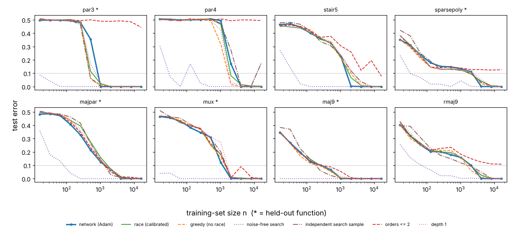

# Ablations of the race model: which ingredients make it match the networks

The race model ([`models/race.py`](models/race.py), evaluated as `Race(theta=1.5, Q=3, gate="relu")`) matches the
networks' sample complexity on the held-out targets very closely ([`MODEL-SCOREBOARD.md`](MODEL-SCOREBOARD.md)). This
file takes it apart. Each ingredient is switched off in turn
([`models/race_ablations.py`](models/race_ablations.py)). Each variant is evaluated on the full grid
(21 targets × 11 values of n × 3 seeds, on exactly the networks' training sets) at the calibrated constants, with no
recalibration, and scored with the scoreboard metrics. Six variants were also run at input dimension d = 15.

**Status: Numerical** throughout. There is one network architecture, one optimizer, and d = 30 (d = 15 for six
variants). Readings of mechanism are labelled **Heuristic**.

## Summary

1. **The race dynamics are not what makes the model match.** None of the following moves the scoreboard by more than
   about 0.1 beyond the spread that the calibrated model shows across its own random streams:
   - removing the alignment cost (`free`, `flat`);
   - removing persistence of partial growth (`reset-clock`, `reset-all`);
   - removing the race altogether (`greedy`: add the gate of largest utility, stagewise);
   - changing θ 12-fold, the power-iteration steps per firing 32-fold, the pool size 32-fold, or the gate budget
     2-fold.

   On held-out targets, mean |log₂ n\* ratio| is 0.25–0.42 for these variants, against 0.27–0.33 for the calibrated
   model under three random streams. The n\* Spearman is ≥ 0.93, the curve MAE ≤ 0.02 and the time Spearman 0.80–0.88
   for all of them. The same holds at d = 15.
2. **n\* is set by sampling noise in the direction search.**
   - **Noise-free search:** the target directions v\* and their order-k utilities come from a large fresh sample
     (`oracle-align`). Then n\* collapses to 16–87 on every target. On held-out targets |log₂ ratio| is 4.6, as far from
     the networks as the junta Occam learner (4.61).
   - **Independent sample of the same size n** (`indep-search`): the networks' n\* comes back (held-out 0.31).
     With a new size-n search sample at every firing (`indep-resample`; up to 48 times n samples in total, median 48
     near the networks' n\* — corrected in the Verification section), n\* falls by only about 1.5×.
   - **So it is the noise *level* at sample size n that matters.** Reuse of the training labels by the search does
     not. Race timing, persistence and alignment costs only act on top of it.
3. **A one-constant noise-floor rule predicts the networks' parity sample complexities at d = 15 and 30, but not at
   d = 60.**
   - **The rule:** n\*\_k is the n at which the order-k utility of the true direction exceeds 1.5 times the largest
     spurious order-k utility found on random labels.
   - **Prediction vs network,** for x₁x₂, x₁x₂x₃, x₁…x₄:
     - d = 15: 121 / 249 / 498 against 100 / 241 / 508;
     - d = 30: 277 / 765 / 2026 against 200 / 843 / 2728;
     - d = 60: 539 / 1779 / 5545 against 427 / 3410 / 14255. That is right for x₁x₂, but 1.9× and 2.6× too low for
       the 3- and 4-bit parities.
   - **Growth with d.** The networks' 3- and 4-bit parities get harder with d faster than this floor. A larger
     search budget barely changes the floor. For x₁…x₄ at d = 60, reachability of the direction from random starts
     appears to bind instead (§4.2).

     | d range | rule | networks | race |
     |---|---|---|---|
     | 15 → 30 | 1.2 / 1.6 / 2.0 | 1.0 / 1.8 / 2.4 | 1.0 / 0.9 / 1.4 |
     | 30 → 60 | 1.0 / 1.2 / 1.5 | 1.1 / 2.0 / 2.4 | 0.9 / 1.2 / 2.8 |
   - **Dense leap-1 targets:** the one-shot Hebbian classifier sign(E_S[y x]·x) gives n\* = 53, 116 and 346 for x₁,
     MAJ₃ and MAJ₉, against the networks' 47, 112 and 263. (Verification: the race's first gate alone, the *rounded*
     Hebbian direction, gives 74, 153 and 485; the gates added after it bring the race down to 54, 102 and 248.)
4. **The gate library matters.**
   - **Orders up to the target's leap are needed.**
     - Without orders 3–4 (`K2`), parities of 3 and 4 bits, the sparse polynomial and recursive majority are never
       learned (held-out 1.43).
     - Without order 4 (`K3`), only x₁…x₄ is lost.
   - **ReLU vs threshold gates:** ReLU gates beat threshold gates (`thr`: held-out 0.60, n\* of MAJ₉ and the DNF about
     doubled).
   - **Coarser weights:** ternary weights (`Q1`) lower n\* on most targets, by 1.5× on average, and break the match
     (0.81). Coarse rounding denoises the estimated directions. Q = 2, 3 and 5 are nearly equivalent.
   - **Depth-2 composition** matters little (held-out 0.35). It helps the staircase-like targets by about 0.4 log₂.
5. **Per-example agreement (0.50) comes from sharing the training sample.**
   - With an independent search sample of the same size, it halves: 0.26 for `indep-search`, 0.23 for `indep-align`.
     The halving is roughly uniform across target families (least for the staircase family, 0.51 → 0.33).
   - No ablation raises it above 0.53. The NNGP kernel has 0.69 and SGD-vs-Adam networks 0.71.
   - (Added in verification.) About 0.2 of every learner's score survives when the two learners see *different*
     training samples (race 0.21, kernel 0.20, network vs network 0.20). Sharing the sample therefore accounts for
     about 0.3 of the race's 0.50, against about 0.5 for the kernel and for SGD.
6. **Time to generalise.** Its *ordering* survives every ablation, including noise-free search (time Spearman
   0.75–0.88 held-out, 0.82–0.94 at n ≥ 4096). So the ordering is set by the true features' utilities, not by noise or
   by the race.

   Its *magnitudes* are matched only loosely by every variant:
   - **High-order parities.** The alignment law's leap factor makes them too slow. At n = 16384, x₁…x₄ takes 8–64× as
     long as x₁x₂ across the three random streams, against 5× for the networks. Without the leap factor (`free`) it
     takes 4.3×, but the staircase and the sparse polynomial become too fast.
   - **Scaling with d.** The networks take about 2× as many steps at d = 30 as at d = 15, on almost every target.
     No variant reproduces that: their clocks are nearly d-independent, except the alignment law on x₁…x₄.
7. **Negative: no delayed generalisation in the race.**
   - **Networks:** in 43 cells the test error is above 0.15 when the training error reaches 0.1, and at or below 0.1
     at the end, after up to 200× as many steps.
   - **Race:** there is 1 such cell (0 above 0.2, against 15 for the networks). Running it past interpolation
     (`nostop`) produces no strong delay either (3 cells above 0.15 at fit, none above 0.2). It lowers the test error
     in some small-n cells but raises it in more (corrected in the Verification section; the earlier text said it
     never helps).
   - **The networks' n\* is still falling at the end of training,** by 0.17 log₂ per doubling of steps between 10⁴ and
     2·10⁴. The race has no counterpart of that.
   - **So the match at 20000 steps is partly a match at that training budget.**

## 1. The ablations

| group | name | what is changed (everything else as in the calibrated model) |
|---|---|---|
| control | `base` | the calibrated race model: θ = 1.5, Q = 3, ReLU gates, λ = 10⁻³, K = 4, P = 8, 8 power-iteration steps per firing, ≤ 48 gates, depth ≤ 2. It reproduces `race.npz` bit for bit |
| control | `reseed1`, `reseed2` | the same model with another internal random stream (initial unit directions): measures the metrics' own noise |
| race dynamics | `free` | no alignment cost: every unit is at its target direction v\* at once, for all orders |
| race dynamics | `free3` | no alignment cost for orders ≥ 3 only |
| race dynamics | `flat` | order-independent alignment law: every order k ≥ 2 aligns like k = 2, T = log(1/m)/(2U_k). This removes the D^((k−2)/2) leap factor but keeps a search cost |
| race dynamics | `reset-clock` | all growth clocks reset to 0 after every firing; partial alignment is kept |
| race dynamics | `reset-all` | clocks reset, and every dormant unit restarts from a fresh random direction, after every firing: no persistence at all |
| race dynamics | `greedy` | no race: each step adds the candidate gate of largest utility U_g. The clock advances t += θ/U_g per gate (stagewise saddle-to-saddle time) |
| constants | `theta0.5`, `theta3`, `theta6` | firing threshold θ = log(1/α) = 0.5, 3, 6 (calibrated: 1.5) |
| constants | `P1`, `P32` | 1 or 32 dormant units per order (default 8) |
| constants | `iters1`, `iters32` | 1 or 32 power-iteration steps per firing (default 8) |
| constants | `gmax96` | at most 96 gates (default 48) |
| stopping | `nostop` | no stop at zero training error: always run to 48 gates |
| library | `depth1` | gates may not read earlier gates (one hidden layer of gates) |
| library | `K3`, `K2` | proto-units of orders ≤ 3 (resp. ≤ 2) only |
| library | `thr` | threshold gates 1[w·u > b] instead of discrete ReLUs relu(w·u − b) |
| library | `Q1`, `Q2`, `Q5` | integer weights in {−Q..Q} with Q = 1, 2, 5 (calibrated: 3) |
| search noise (oracle) | `oracle-align` | v\* and U_k come from a fresh labelled sample of 16384 points instead of the training set; the threshold and U_g still come from the training set |
| search noise (oracle) | `oracle-search` | v\*, U_k, the threshold and U_g all come from the fresh 16384-point sample; only the readout and the stopping rule see the training set |
| search noise (oracle) | `indep-align`, `indep-search` | as the two above, but the fresh sample has the same size n as the training set: same noise level, but the noise is independent of the training labels |
| search noise (oracle) | `indep-resample` | as `indep-search`, but a new size-n search sample is drawn before every firing |

**Which constants keep their meaning.**
- `greedy` makes θ a pure time unit: it rescales the clock and changes no decision.
- `free` removes the meaning of the alignment law but not of θ.
- `oracle-*` and `indep-*` use the target inside `fit()`. **They are diagnostics, not learning algorithms.** Their
  samples are drawn with their own random stream.
- No ablation was recalibrated.

## 2. Scoreboard

Metrics are as in [`MODEL-SCOREBOARD.md`](MODEL-SCOREBOARD.md), against the Adam networks; "never" is counted as
2 × 16384.

The reference rows are:
- **NN-SGD vs NN-Adam:** a ceiling for how alike two gradient-descent learners are; held-out targets only.
- **NNGP kernel:** the lazy baseline.

**Held-out targets**

| ablation | abs log2 n* ratio | n* Spearman | success agr. | curve MAE | per-example agr. | time Spearman |
|---|---|---|---|---|---|---|
| base | 0.33 | 1.00 | 0.95 | 0.01 | 0.50 | 0.83 |
| reseed1 | 0.32 | 0.97 | 0.96 | 0.01 | 0.51 | 0.85 |
| reseed2 | 0.27 | 0.98 | 0.96 | 0.01 | 0.51 | 0.83 |
| free | 0.33 | 0.98 | 0.96 | 0.01 | 0.51 | 0.83 |
| free3 | 0.50 | 0.97 | 0.94 | 0.02 | 0.49 | 0.80 |
| flat | 0.28 | 1.00 | 0.96 | 0.01 | 0.50 | 0.82 |
| reset-clock | 0.33 | 0.98 | 0.94 | 0.01 | 0.52 | 0.84 |
| reset-all | 0.25 | 0.95 | 0.96 | 0.01 | 0.53 | 0.88 |
| greedy | 0.27 | 0.98 | 0.95 | 0.01 | 0.53 | 0.86 |
| theta0.5 | 0.32 | 0.93 | 0.97 | 0.02 | 0.49 | 0.82 |
| theta3 | 0.41 | 0.97 | 0.95 | 0.01 | 0.50 | 0.83 |
| theta6 | 0.34 | 0.98 | 0.96 | 0.01 | 0.51 | 0.84 |
| P1 | 0.31 | 0.98 | 0.98 | 0.02 | 0.51 | 0.82 |
| P32 | 0.31 | 0.98 | 0.95 | 0.01 | 0.50 | 0.85 |
| iters1 | 0.31 | 0.95 | 0.96 | 0.01 | 0.53 | 0.83 |
| iters32 | 0.27 | 0.95 | 0.96 | 0.01 | 0.51 | 0.80 |
| gmax96 | 0.34 | 0.97 | 0.95 | 0.01 | 0.50 | 0.83 |
| nostop | 0.42 | 1.00 | 0.96 | 0.02 | 0.50 | 0.82 |
| depth1 | 0.35 | 0.98 | 0.96 | 0.01 | 0.51 | 0.84 |
| K3 | 0.34 | 0.98 | 0.95 | 0.01 | 0.51 | 0.84 |
| K2 | 1.43 | 0.83 | 0.86 | 0.05 | 0.52 | 0.86 |
| thr | 0.60 | 0.98 | 0.95 | 0.02 | 0.43 | 0.84 |
| Q1 | 0.81 | 0.98 | 0.92 | 0.03 | 0.42 | 0.75 |
| Q2 | 0.37 | 0.97 | 0.96 | 0.01 | 0.49 | 0.80 |
| Q5 | 0.29 | 0.95 | 0.96 | 0.01 | 0.52 | 0.82 |
| oracle-align | 4.63 | 0.72 | 0.55 | 0.14 | 0.04 | 0.78 |
| oracle-search | 4.64 | 0.72 | 0.55 | 0.14 | 0.04 | 0.80 |
| indep-align | 0.41 | 0.92 | 0.96 | 0.03 | 0.23 | 0.80 |
| indep-search | 0.31 | 0.97 | 0.96 | 0.02 | 0.26 | 0.78 |
| indep-resample | 0.54 | 0.93 | 0.95 | 0.02 | 0.29 | 0.79 |
| *NN-SGD vs NN-Adam* | 0.43 | 0.95 | 0.94 | 0.01 | 0.71 | 0.83 |
| *NNGP kernel* | 2.58 | 0.73 | 0.85 | 0.04 | 0.69 | 0.22 |

**All 21 targets**

| ablation | abs log2 n* ratio | n* Spearman | success agr. | curve MAE | per-example agr. | time Spearman |
|---|---|---|---|---|---|---|
| base | 0.28 | 0.97 | 0.97 | 0.01 | 0.51 | 0.90 |
| reseed1 | 0.28 | 0.95 | 0.97 | 0.01 | 0.51 | 0.90 |
| reseed2 | 0.26 | 0.97 | 0.97 | 0.01 | 0.51 | 0.90 |
| free | 0.31 | 0.95 | 0.97 | 0.01 | 0.52 | 0.89 |
| free3 | 0.44 | 0.93 | 0.96 | 0.02 | 0.49 | 0.80 |
| flat | 0.29 | 0.96 | 0.97 | 0.01 | 0.50 | 0.89 |
| reset-clock | 0.33 | 0.96 | 0.96 | 0.01 | 0.52 | 0.90 |
| reset-all | 0.28 | 0.97 | 0.97 | 0.01 | 0.52 | 0.88 |
| greedy | 0.35 | 0.96 | 0.97 | 0.01 | 0.53 | 0.88 |
| theta0.5 | 0.29 | 0.97 | 0.97 | 0.02 | 0.48 | 0.88 |
| theta3 | 0.34 | 0.95 | 0.97 | 0.01 | 0.51 | 0.90 |
| theta6 | 0.32 | 0.96 | 0.97 | 0.01 | 0.51 | 0.90 |
| P1 | 0.41 | 0.96 | 0.97 | 0.02 | 0.51 | 0.86 |
| P32 | 0.33 | 0.95 | 0.95 | 0.02 | 0.50 | 0.90 |
| iters1 | 0.41 | 0.98 | 0.95 | 0.02 | 0.53 | 0.90 |
| iters32 | 0.28 | 0.96 | 0.97 | 0.01 | 0.51 | 0.89 |
| gmax96 | 0.29 | 0.96 | 0.97 | 0.01 | 0.50 | 0.90 |
| nostop | 0.35 | 0.96 | 0.96 | 0.02 | 0.49 | 0.90 |
| depth1 | 0.34 | 0.97 | 0.96 | 0.01 | 0.51 | 0.89 |
| K3 | 0.47 | 0.96 | 0.95 | 0.02 | 0.51 | 0.89 |
| K2 | 1.26 | 0.95 | 0.89 | 0.04 | 0.52 | 0.87 |
| thr | 0.51 | 0.95 | 0.95 | 0.02 | 0.43 | 0.90 |
| Q1 | 0.89 | 0.96 | 0.92 | 0.03 | 0.41 | 0.78 |
| Q2 | 0.40 | 0.95 | 0.96 | 0.02 | 0.49 | 0.83 |
| Q5 | 0.32 | 0.96 | 0.97 | 0.01 | 0.52 | 0.91 |
| oracle-align | 4.26 | 0.73 | 0.60 | 0.14 | 0.06 | 0.88 |
| oracle-search | 4.36 | 0.66 | 0.58 | 0.14 | 0.05 | 0.88 |
| indep-align | 0.43 | 0.94 | 0.96 | 0.03 | 0.23 | 0.88 |
| indep-search | 0.35 | 0.95 | 0.96 | 0.02 | 0.26 | 0.84 |
| indep-resample | 0.63 | 0.95 | 0.95 | 0.03 | 0.26 | 0.86 |
| *NNGP kernel* | 2.15 | 0.88 | 0.86 | 0.04 | 0.68 | 0.34 |

**How to read it.**
- **Noise band.** `base`, `reseed1` and `reseed2` differ only in the model's own random stream. Their spread (held-out
  |log₂ ratio| 0.27–0.33, time Spearman 0.83–0.85) is the noise band for every "no change" statement.
- **Within about 0.1 of the band:** every race-dynamics ablation, every constant, `nostop` and `depth1`.
- **Outside the band:** only these leave it:
  - the noise-free search (`oracle-*`);
  - the library changes `K2`, `thr` and `Q1`;
  - to a lesser degree `free3` and `K3` (on ALL, through x₁…x₄);
  - `iters1` and `P1` on the calibration targets.

## 3. Sample complexity per target and per family

n\* per target. The *base range* column is the minimum to maximum over the calibrated model's three random streams;
for the parities it spans up to 0.6 log₂. A star marks the held-out targets.

| fn | NN | base range | base | greedy | free | reset-all | oracle-align | indep-search | indep-resample | K2 | K3 | depth1 | thr | Q1 |
|---|---|---|---|---|---|---|---|---|---|---|---|---|---|---|
| dict | 47 | 52–65 | 54 | 35 | 58 | 37 | 16 | 52 | 22 | 50 | 54 | 68 | 74 | 24 |
| and3* | 94 | 108–126 | 108 | 104 | 101 | 120 | 16 | 90 | 53 | 111 | 111 | 122 | 141 | 82 |
| maj3 | 112 | 95–105 | 102 | 74 | 103 | 89 | 16 | 106 | 55 | 100 | 97 | 100 | 146 | 52 |
| maj9* | 263 | 228–264 | 248 | 210 | 224 | 232 | 16 | 182 | 129 | 248 | 241 | 248 | 527 | 158 |
| thr10 | 563 | 552–593 | 578 | 603 | 513 | 618 | 16 | 326 | 221 | 765 | 575 | 624 | 546 | 545 |
| par2 | 200 | 180–190 | 180 | 184 | 199 | 186 | 16 | 195 | 125 | 168 | 175 | 206 | 234 | 121 |
| par3* | 843 | 494–684 | 572 | 483 | 539 | 758 | 16 | 479 | 437 | never | 531 | 722 | 732 | 412 |
| par4 | 2728 | 1955–2963 | 1980 | 1688 | 1730 | 1861 | 49 | 3207 | 1510 | never | never | 1803 | 1978 | never |
| stair5 | 1514 | 1766–1995 | 1766 | 2021 | 1874 | 1800 | 40 | 2363 | 1607 | 14340 | 2163 | 2416 | 1869 | 1004 |
| majpar* | 1380 | 1365–1632 | 1632 | 1443 | 1618 | 1309 | 59 | 1318 | 1026 | 1374 | 1492 | 1580 | 2002 | 503 |
| parmaj | 743 | 700–708 | 700 | 631 | 664 | 760 | 21 | 540 | 428 | 725 | 668 | 890 | 926 | 355 |
| mux* | 1156 | 1407–1537 | 1423 | 1361 | 1335 | 1506 | 16 | 1479 | 1047 | 1413 | 1433 | 1625 | 1597 | 472 |
| dnf3 | 505 | 475–564 | 564 | 471 | 573 | 446 | 52 | 643 | 304 | 543 | 514 | 595 | 995 | 480 |
| dlist5* | 110 | 128–170 | 163 | 130 | 189 | 128 | 16 | 146 | 96 | 172 | 163 | 177 | 250 | 104 |
| rmaj9 | 2027 | 1749–1895 | 1895 | 1542 | 1599 | 2199 | 87 | 1655 | 1303 | never | 1899 | 1919 | 2314 | 1585 |
| andxor | 376 | 802–896 | 802 | 755 | 793 | 781 | 18 | 890 | 476 | 838 | 826 | 783 | 855 | 336 |
| sparsepoly* | 2205 | 1761–2209 | 1761 | 2119 | 2089 | 2341 | 38 | 2063 | 1478 | never | 1642 | 2419 | 2242 | 1054 |
| rand0 | 222 | 194–212 | 194 | 219 | 208 | 201 | 16 | 233 | 148 | 192 | 195 | 200 | 286 | 105 |
| rand1* | 463 | 558–672 | 558 | 546 | 630 | 613 | 16 | 500 | 316 | 631 | 562 | 591 | 949 | 369 |
| rand2 | 91 | 85–97 | 85 | 55 | 99 | 72 | 16 | 112 | 81 | 72 | 66 | 92 | 112 | 28 |
| rand3* | 1016 | 1192–1393 | 1393 | 1256 | 1182 | 1333 | 28 | 1289 | 1171 | 4124 | 1246 | 1530 | 1274 | 482 |

Mean signed log₂(n\*_model / n\*_NN) per family (+ means the model needs more data). The families are:
- parity: x₁x₂, x₁x₂x₃, x₁…x₄;
- staircase/sparse polynomial: the staircase, sign(2x₁+x₂x₃+x₄x₅x₆) and the multiplexer;
- dense: MAJ₉, the 10-bit halfspace and recursive majority;
- compositions: MAJ(x₁x₂,x₃x₄,x₅x₆), MAJ₃⊕MAJ₃ and AND(x₁x₂,x₃x₄).

| ablation | parity | staircase/sparse-poly | dense majority/halfspace | compositions | all 21 |
|---|---|---|---|---|---|
| base | -0.39 | +0.07 | -0.05 | +0.42 | +0.07 |
| reseed1 | -0.44 | +0.23 | -0.04 | +0.37 | +0.11 |
| reseed2 | -0.08 | +0.20 | -0.13 | +0.40 | +0.12 |
| free | -0.44 | +0.15 | -0.24 | +0.38 | +0.07 |
| free3 | -0.55 | +0.21 | -0.36 | +0.65 | +0.16 |
| flat | -0.36 | +0.22 | -0.18 | +0.43 | +0.09 |
| reset-clock | -0.51 | +0.11 | -0.23 | +0.25 | -0.05 |
| reset-all | -0.27 | +0.24 | +0.02 | +0.34 | +0.05 |
| greedy | -0.54 | +0.20 | -0.21 | +0.28 | -0.08 |
| theta0.5 | -0.36 | +0.18 | +0.01 | +0.40 | +0.16 |
| theta3 | -0.43 | +0.05 | -0.12 | +0.33 | +0.02 |
| theta6 | -0.37 | +0.15 | -0.18 | +0.30 | +0.08 |
| P1 | +0.41 | +0.41 | +0.08 | +0.64 | +0.27 |
| P32 | -0.56 | +0.00 | -0.26 | +0.30 | +0.05 |
| iters1 | +0.21 | +0.40 | +0.06 | +0.58 | +0.22 |
| iters32 | -0.38 | +0.14 | +0.02 | +0.33 | +0.08 |
| gmax96 | -0.42 | +0.13 | -0.04 | +0.48 | +0.10 |
| nostop | -0.39 | +0.07 | +0.22 | +0.42 | +0.10 |
| depth1 | -0.26 | +0.43 | -0.00 | +0.51 | +0.21 |
| K3 | +0.91 | +0.13 | -0.06 | +0.36 | +0.23 |
| K2 | +2.87 | +2.48 | +1.46 | +0.37 | +1.16 |
| thr | -0.15 | +0.26 | +0.38 | +0.68 | +0.45 |
| Q1 | +0.61 | -0.98 | -0.38 | -0.89 | -0.55 |
| Q2 | -0.68 | -0.13 | +0.04 | -0.01 | -0.12 |
| Q5 | -0.26 | +0.35 | -0.06 | +0.29 | +0.16 |
| oracle-align | -5.05 | -5.76 | -4.57 | -4.69 | -4.26 |
| oracle-search | -5.30 | -5.83 | -4.70 | -4.72 | -4.36 |
| indep-align | -0.29 | +0.23 | -0.12 | +0.31 | +0.26 |
| indep-search | -0.21 | +0.30 | -0.54 | +0.24 | +0.05 |
| indep-resample | -0.83 | -0.21 | -1.00 | -0.30 | -0.57 |

## 4. What sets n\*: sampling noise in the direction search

### 4.1 Removing the noise, and decorrelating it

**Noise-free search (`oracle-align`, `oracle-search`).** The model keeps everything else:
- the same race;
- the same alignment costs (now computed from population utilities);
- the same readout fitted on the n training points;
- the same stop at zero training error.

It then reaches test error ≤ 0.1 by n ≤ 87 on every target, and already at n = 16 on 12 (`oracle-align`) or 14
(`oracle-search`) of the 21.

Below the networks' n\*, its circuits are made of true features: 13% spurious gates, against 99% for the calibrated
model (§4.4). So nothing in the race's *timing* produces a sample complexity by itself. Given clean statistics, the
race finds the true features, and the readout interpolates with them.

One artifact needs flagging. With a *fixed* search sample, a spurious direction of that sample keeps its utility after
it fires, because firing it does not fit that sample. The run can then fire it again and again. In `oracle-search`
this happens for one seed of x₁…x₄ at n = 128, and for one at n = 16384, where the oracle sample is no larger than
the training set. In `oracle-align` the failing cells are one seed of x₁…x₄ at n = 128 and at n = 256 (corrected in
verification).

**Independent sample of the same size n (`indep-align`, `indep-search`).** The noise level of the search is restored,
but the noise is independent of the training labels. The networks' n\* comes back:
- held-out |log₂ ratio| 0.31 (`indep-search`) and 0.41 (`indep-align`);
- n\* Spearman 0.97 and 0.92.

So n\* is a **noise-level** effect: what matters is how noisy the empirical moments are at n samples. It is not an
effect of the search *overfitting the training labels*.

The families respond differently:
- **Parity and staircase** get slightly harder with an independent sample: x₁…x₄ 3207 vs 1980.
- **Dense targets** get easier: the halfspace 326 vs 578, MAJ₉ 182 vs 248. With the training labels, spurious gates
  memorize the training set after the first good feature, and that memorization costs generalisation.

**A new search sample at every firing (`indep-resample`).** The search gets a fresh size-n sample before each
firing, so over a run it sees as many size-n samples as it fires gates: near the networks' n\* (0.5–2 n\*), a
median of 48, at least 3 (corrected in verification; the earlier text said 10–48).
- n\* falls on every family, by about 1.5× on average (mean signed log₂ −0.57; x₁…x₄ 1510, MAJ₉ 129).
- Held-out |log₂ ratio| rises to 0.54.

So a many-fold (typically 48-fold) increase in the total data the search sees buys only a factor 1.5 in n\*. What
sets n\* is the noise in the sample each search step uses.

### 4.2 The parity noise floor (Numerical; the rule is Heuristic)

For x₁…x_k the true direction is v = (1,…,1,0,…)/√k, with order-k utility U_k(v) = k^(−k/2)·E_S[r χ] ≈ k^(−k/2). On
the training set (r = y − ȳ) we compare it with the largest U_k that power iteration finds on *random labels* with the
same inputs (32 starts × 40 steps, 3 seeds). The table gives the n at which the ratio of the two crosses 1, 1.5 and 2,
interpolated on a √2-spaced grid of n (`python models/ablation_diagnostics.py floor`, with `DIM` = 15, 30, 60).

| d | target | n at ratio 1 | ratio 1.5 | ratio 2 | network n\* | race n\* |
|---|---|---|---|---|---|---|
| 15 | x₁x₂ | 52 | 121 | 183 | 100 | 87 |
| 15 | x₁x₂x₃ | 131 | 249 | 449 | 241 | 315 |
| 15 | x₁…x₄ | 270 | 498 | 810 | 508 | 762 |
| 30 | x₁x₂ | 122 | 277 | 472 | 200 | 180 |
| 30 | x₁x₂x₃ | 384 | 765 | 1247 | 843 | 572 |
| 30 | x₁…x₄ | 1142 | 2026 | 3083 | 2728 | 1980 |
| 60 | x₁x₂ | 252 | 539 | 872 | 427 | 335 |
| 60 | x₁x₂x₃ | 908 | 1779 | 2961 | 3410 | 1281 |
| 60 | x₁…x₄ | 3324 | 5545 | 8539 | 14255 | 13865 |

Network n\* at d = 15 and 60 are from [`DSCALE.md`](DSCALE.md) (2 seeds). Race n\* at d = 15 is `race-abl-base-d15`
(3 seeds); at d = 60 it is from DSCALE.md.

**The rule.** Read n\* as the ratio-1.5 crossing:
- **Accuracy:** it predicts the networks' parity n\* within a factor of 1.4 at d = 15 and 30.
  At d = 60 it is right for x₁x₂ (539 vs 427), but too low by 1.9× for x₁x₂x₃ (1779 vs 3410) and by 2.6× for x₁…x₄
  (5545 vs 14255). Two checks (`ablation_diagnostics.py budget`, `reach`):
  - **The floor is not an artifact of the search budget.** 128 or 512 starts × 100 steps instead of 32 × 40 raise the
    noise maximum by at most 5.5% at the crossings (23% for x₁…x₄ at n = 14255; both corrected in verification from
    "5%" and "20%").
  - **Reachability from random starts (Heuristic; 2 seeds × 256 starts).** The question here is from what fraction
    of random starts 8 power-iteration steps on the training residual reach the true direction (overlap > 0.9).
    - At the networks' n\*, that fraction is similar at all three d (within a factor of 3): x₁x₂x₃ 6%, 10%, 9%;
      x₁…x₄ 4.1%, 2.9%, 1.4% (d = 15, 30, 60; the d = 15 values were corrected in verification: 7% and 3.5% are the
      values at the d = 15 floor crossing, not at the networks' n\*).
    - At the d = 60 floor crossing it is 0.2% for x₁…x₄. So for the 4-bit parity at large d, a computational
      condition, reachability from random initialisation in a few steps, appears to bind beyond the statistical one.
    - For x₁x₂x₃ it is 5.7% at the floor crossing, so the 3-bit gap at d = 60 stays unexplained.
- **Growth with d,** as exponents of n\* in d for x₁x₂ / x₁x₂x₃ / x₁…x₄:

  | d range | rule | networks | race |
  |---|---|---|---|
  | 15 → 30 | 1.2 / 1.6 / 2.0 | 1.0 / 1.8 / 2.4 | 1.0 / 0.9 / 1.4 |
  | 30 → 60 | 1.0 / 1.2 / 1.5 | 1.1 / 2.0 / 2.4 | 0.9 / 1.2 / 2.8 |

  From 15 to 30 the rule tracks the networks better than the race model does; from 30 to 60 neither tracks the
  3-bit parity, and only the race tracks the 4-bit one.
- **One-constant fit:** the constant 1.5 was read off the same networks.

**Mechanism (Heuristic).** At these sizes the order-k noise maximum falls faster than n^(−1/2), about n^(−0.6) for
k = 4 at d = 30. The number of order-k directions, C(d,k), is larger than n here. So the empirical order-k tensor can
be "fitted" by spurious directions, much as a regression with more features than samples can.

### 4.3 Dense leap-1 targets: the noise in one Hebbian direction (Numerical)

For x₁, MAJ₃ and MAJ₉ the first gate is the rounded Hebbian direction E_S[y u] (order 1 in every cell with n ≥ 32),
and it usually already reaches training error ≤ 0.1. The networks' n\* is close to that of the one-shot correlation
classifier sign(c + a·h·x) (`ablation_diagnostics.py hebb`):

| target | network n\* | race n\* | sign(h·x), h = E_S[y x] | h rounded to {−3..3} | h rounded to {−1,0,1} |
|---|---|---|---|---|---|
| x₁ | 47 | 54 | 53 | 74 | 28 |
| MAJ₃ | 112 | 102 | 116 | 142 | 55 |
| MAJ₉ | 263 | 248 | 346 | 503 | 196 |
| 10-bit halfspace | 563 | 578 | 322 | 468 | never |
| 3-term DNF, recursive MAJ₉ | 505, 2027 | 564, 1895 | never | never | never |

**Correction (verification).** The race's n\* is *not* the rounded classifier's. The race circuit after its first
gate alone has n\* = 74, 153 and 485 for x₁, MAJ₃ and MAJ₉, close to the rounded column (74, 142, 503). The gates
fitted after it, on the way to interpolation, *lower* n\* to the race's final 54, 102 and 248. For x₁ and MAJ₃ this is
close to the continuous classifier. For MAJ₉ both the race (248) and the networks (263) beat the continuous classifier
(346) by about 0.4 log₂. So for the dense majorities the later "spurious" gates are refinements that help, not
memorisation that hurts. Only for the halfspace below do they hurt.

**The 10-bit halfspace.** Network and race agree with each other (563 and 578), but *both* need 1.8× more data than
the plain Hebbian classifier (322).
- In the race the cause is visible: after the first gate, which already fits, up to 47 further gates are fitted
  to interpolate the training set. They are mostly spurious, and they cost generalisation: the circuit at the moment
  the training error first reaches 0.1 has n\* = 327, the final one 578 (checked in verification).
- The race reproduces the network's suboptimality, not only its successes.

**Coarser weights denoise.** Rounding h to {−1,0,1} zeroes the noisy small coordinates. That is why `Q1` lowers n\*
almost everywhere and breaks the match.

### 4.4 What the circuits look like

A gate counts as *spurious* if it depends, through its depth-1 inputs, on any irrelevant coordinate. This uses the
target's relevant set after `fit()` has returned.

| ablation | gates (mean) | spurious gates at n < n*_NN | spurious at n >= 2 n*_NN | true features covered at n >= 2 n*_NN | order mix of gates (1/2/3/4) |
|---|---|---|---|---|---|
| base | 17.7 | 0.99 | 0.42 | 0.75 | 0.09/0.52/0.24/0.15 |
| reseed1 | 17.6 | 1.00 | 0.41 | 0.79 | 0.09/0.52/0.24/0.15 |
| free | 16.5 | 0.99 | 0.39 | 0.78 | 0.09/0.47/0.28/0.16 |
| greedy | 13.1 | 0.99 | 0.37 | 0.77 | 0.17/0.51/0.26/0.06 |
| reset-all | 14.3 | 0.99 | 0.40 | 0.77 | 0.12/0.64/0.20/0.04 |
| oracle-search | 10.6 | 0.13 | 0.11 | 1.00 | 0.14/0.70/0.14/0.01 |
| indep-search | 31.1 | 0.99 | 0.45 | 0.75 | 0.09/0.55/0.22/0.14 |
| K2 | 18.7 | 1.00 | 0.51 | 0.67 | 0.16/0.84/0.00/0.00 |
| depth1 | 18.6 | 0.99 | 0.46 | 0.77 | 0.13/0.48/0.24/0.15 |
| thr | 16.6 | 0.99 | 0.45 | 0.76 | 0.08/0.48/0.26/0.19 |
| Q1 | 13.8 | 0.90 | 0.11 | 0.92 | 0.10/0.53/0.23/0.14 |
| nostop | 47.9 | 1.00 | 0.74 | 0.75 | 0.07/0.50/0.25/0.18 |

- **Below the networks' n\*:** essentially every gate is spurious (99–100% for every variant that searches on the
  training set, except `Q1` at 90%). The model interpolates the training set with memorising gates before the true feature wins the
  search.
- **At n ≥ 2n\*:** the true features are present in about 75% of cells. The remaining spurious gates are mostly
  refinements of the dense targets.
- **Order mix:** the race and the greedy learner differ mainly in it. The race's *persistent growth clocks* shift
  selection toward orders 3–4: 15% order-4 gates, against 6% for `greedy` and 6% for `reset-clock` (clocks reset,
  alignment law kept). The alignment costs are not the cause: removing them leaves the share at 16% (`free`) or
  raises it to 29% (`free3`). (Corrected in verification; the earlier text credited the alignment costs.)

## 5. What sets the time to generalise

**Ordering.** The Spearman correlation between the networks' steps to generalise and the model's clock is about the
same for every variant. That includes the noise-free search and the greedy clock Σ θ/U_g.

| ablation | time Spearman, n ≥ 4096 | time Spearman, n < 4096 | Pearson r of log times | scatter of log₂ time ratio (cells) |
|---|---|---|---|---|
| base | 0.91 | 0.86 | 0.77 | 1.16 (350) |
| reseed1 | 0.92 | 0.87 | 0.81 | 1.04 (345) |
| reseed2 | 0.92 | 0.88 | 0.79 | 1.11 (349) |
| free | 0.90 | 0.87 | 0.78 | 1.18 (348) |
| free3 | 0.82 | 0.83 | 0.75 | 1.21 (341) |
| flat | 0.91 | 0.85 | 0.78 | 1.13 (348) |
| reset-clock | 0.92 | 0.86 | 0.80 | 1.11 (346) |
| reset-all | 0.94 | 0.87 | 0.79 | 1.23 (351) |
| greedy | 0.90 | 0.90 | 0.77 | 1.19 (352) |
| theta0.5 | 0.92 | 0.85 | 0.78 | 1.10 (342) |
| theta3 | 0.92 | 0.86 | 0.77 | 1.13 (348) |
| theta6 | 0.92 | 0.87 | 0.79 | 1.08 (349) |
| P1 | 0.87 | 0.84 | 0.76 | 1.50 (336) |
| P32 | 0.94 | 0.85 | 0.82 | 1.06 (347) |
| iters1 | 0.90 | 0.86 | 0.84 | 0.97 (340) |
| iters32 | 0.93 | 0.84 | 0.79 | 1.09 (344) |
| gmax96 | 0.91 | 0.86 | 0.77 | 1.16 (350) |
| nostop | 0.91 | 0.86 | 0.78 | 1.13 (346) |
| depth1 | 0.92 | 0.86 | 0.78 | 1.12 (344) |
| K3 | 0.90 | 0.86 | 0.77 | 1.13 (339) |
| K2 | 0.89 | 0.85 | 0.69 | 1.14 (287) |
| thr | 0.91 | 0.87 | 0.83 | 0.93 (324) |
| Q1 | 0.85 | 0.76 | 0.67 | 1.48 (357) |
| Q2 | 0.85 | 0.81 | 0.72 | 1.30 (349) |
| Q5 | 0.92 | 0.87 | 0.79 | 1.10 (346) |
| oracle-align | 0.92 | 0.86 | 0.73 | 1.38 (368) |
| oracle-search | 0.92 | 0.87 | 0.73 | 1.37 (367) |
| indep-align | 0.92 | 0.81 | 0.81 | 1.04 (338) |
| indep-search | 0.92 | 0.73 | 0.77 | 1.11 (345) |
| indep-resample | 0.91 | 0.80 | 0.78 | 1.22 (365) |

So the ordering is a property of the targets' feature structure under the gate library. It reflects how many stages
are needed and how small their utilities are. It is not specific to the race mechanics or to the noise.

The time measure was also tried both ways, as the clock at training error ≤ 0.1 (used throughout) and as the clock
at test error ≤ 0.1 along the trajectory. This changes the calibrated model's held-out time Spearman only from 0.83 to
0.78 (`ablation_diagnostics.py gentime`).

**Magnitudes far above n\*.** The median time to generalise at n = 16384 is given relative to x₁x₂, so that one unit
conversion is free (`ablation_diagnostics.py tprofile`).

| fn | networks | base | reseed1 | reseed2 | free | flat | greedy | reset-all | oracle-search |
|---|---|---|---|---|---|---|---|---|---|
| dict | 0.25 | 0.57 | 0.55 | 0.55 | 0.58 | 0.57 | 0.33 | 0.34 | 0.57 |
| maj9 | 0.25 | 0.69 | 0.65 | 0.69 | 0.68 | 0.69 | 0.39 | 0.41 | 0.70 |
| thr10 | 0.25 | 0.72 | 0.67 | 0.69 | 0.70 | 0.72 | 0.40 | 0.42 | 0.72 |
| par2 | 1.00 | 1.00 | 1.00 | 1.00 | 1.00 | 1.00 | 1.00 | 1.00 | 1.00 |
| par3 | 2.50 | 4.35 | 3.86 | 4.41 | 2.53 | 3.81 | 1.96 | 2.81 | 6.61 |
| par4 | 5.00 | 64.44 | 11.69 | 8.31 | 4.34 | 10.96 | 2.82 | 13.80 | 25.82 |
| stair5 | 5.00 | 6.38 | 7.94 | 9.27 | 2.19 | 6.18 | 6.04 | 13.15 | 6.32 |
| sparsepoly | 10.00 | 12.37 | 9.41 | 11.67 | 3.31 | 9.64 | 6.00 | 14.07 | 9.76 |
| majpar | 2.50 | 4.87 | 5.66 | 6.46 | 4.01 | 4.87 | 6.24 | 6.86 | 5.81 |
| mux | 2.50 | 2.28 | 2.16 | 2.16 | 1.46 | 2.28 | 1.98 | 2.75 | 3.18 |
| rmaj9 | 5.00 | 15.16 | 11.39 | 13.42 | 5.69 | 14.21 | 13.60 | 25.33 | 14.32 |
| dnf3 | 2.50 | 2.25 | 2.28 | 2.01 | 2.11 | 2.25 | 2.59 | 2.72 | 2.32 |
| rand3 | 2.50 | 2.60 | 2.01 | 2.37 | 1.93 | 2.60 | 3.63 | 4.21 | 3.63 |
| rms log2 deviation from the networks | – | 1.35 | 0.90 | 0.95 | 0.92 | 0.91 | 0.72 | 1.03 | 1.17 |

**The alignment law.** The homogeneous law dm/dt = kU_k m^(k−1), with its D^((k−2)/2) leap factor, makes x₁x₂x₃ and
x₁…x₄ 4× and 8–64× slower than x₁x₂. The networks take 2.5× and 5×.
- The x₁…x₄ value varies a lot between random streams. A likely cause (Heuristic) is that the order-4 unit's power
  iteration advances only at firings, and far above n\* firings are rare.
- `free` brings the parities into line (2.5× and 4.3×) but makes the staircase and the sparse polynomial too fast.
- `greedy` undershoots the parities and overshoots MAJ(x₁x₂,…) and recursive majority.
- No variant fits the profile clearly better than the calibrated model's own stream-to-stream spread (rms log₂
  deviation 0.90–1.35, against 0.72–1.17 for the others).

**Dependence on d (d = 15 against d = 30).**

n\* at d = 15 / d = 30, with the exponent log₂(n\*₃₀/n\*₁₅) in brackets. Networks: 2 seeds at d = 15. `oracle-search` and `indep-search` are diagnostics.

| fn | NN | base | free | greedy | flat | oracle-search | indep-search |
|---|---|---|---|---|---|---|---|
| par2 | 100 / 200 (0.99) | 87 / 180 (1.04) | 89 / 199 (1.16) | 68 / 184 (1.43) | 85 / 177 (1.05) | 16 / 16 (0.00) | 93 / 195 (1.06) |
| par3 | 241 / 843 (1.81) | 315 / 572 (0.86) | 223 / 539 (1.27) | 250 / 483 (0.95) | 305 / 684 (1.16) | 16 / 16 (0.00) | 313 / 479 (0.61) |
| par4 | 508 / 2728 (2.42) | 762 / 1980 (1.38) | 529 / 1730 (1.71) | 472 / 1688 (1.84) | 609 / 1817 (1.58) | 16 / 30 (0.89) | 862 / 3207 (1.90) |
| stair5 | 433 / 1514 (1.81) | 706 / 1766 (1.32) | 682 / 1874 (1.46) | 793 / 2021 (1.35) | 718 / 2008 (1.48) | 46 / 41 (-0.16) | 807 / 2363 (1.55) |
| mux | 364 / 1156 (1.67) | 453 / 1423 (1.65) | 426 / 1335 (1.65) | 416 / 1361 (1.71) | 447 / 1400 (1.65) | 40 / 16 (-1.31) | 577 / 1479 (1.36) |
| majpar | 306 / 1380 (2.17) | 483 / 1632 (1.76) | 726 / 1618 (1.16) | 416 / 1443 (1.79) | 497 / 1641 (1.72) | 51 / 81 (0.69) | 527 / 1318 (1.32) |
| maj9 | 123 / 263 (1.10) | 110 / 248 (1.18) | 113 / 224 (0.98) | 81 / 210 (1.37) | 118 / 241 (1.03) | 16 / 16 (0.00) | 116 / 182 (0.65) |

Mean |log₂ n\*_model/n\*_NN| at d = 15 over these 7 targets: base 0.43, free 0.37, greedy 0.40, flat 0.37, oracle-search 3.36, indep-search 0.53.
Mean |exponent_model − exponent_NN|: base 0.43, free 0.42, greedy 0.43, flat 0.34, oracle-search 1.69, indep-search 0.52.

Time to generalise far above n\* (median over n ≥ 4096), ratio d = 30 / d = 15:

| fn | NN | base | free | greedy | flat | oracle-search | indep-search |
|---|---|---|---|---|---|---|---|
| par2 | 2.00 | 0.97 | 1.00 | 1.00 | 0.97 | 0.96 | 0.96 |
| par3 | 2.50 | 1.30 | 0.67 | 1.00 | 1.28 | 1.14 | 1.17 |
| par4 | 2.00 | 2.17 | 1.08 | 1.00 | 1.57 | 2.29 | 3.63 |
| stair5 | 2.00 | 1.15 | 1.10 | 1.26 | 1.14 | 1.41 | 1.31 |
| mux | 1.00 | 0.60 | 1.15 | 0.96 | 0.49 | 1.03 | 1.19 |
| majpar | 2.50 | 0.84 | 1.09 | 0.91 | 0.84 | 1.13 | 0.94 |
| maj9 | 2.00 | 1.04 | 1.00 | 1.00 | 1.04 | 1.04 | 1.04 |

- **n\*.** At d = 15 too, the race dynamics make no difference: mean |log₂ n\*_model/n\*_NN| is 0.37–0.43 for
  `base`, `free`, `greedy` and `flat`.
- **Too-weak d-dependence for parities.** Every variant's parity n\* grows too slowly with d. From 15 to 30 the
  parity exponents are 0.9–1.3 for x₁x₂x₃ and 1.4–1.8 for x₁…x₄, against 1.8 and 2.4 for the networks; the
  noise-floor rule of §4.2 gives 1.6 and 2.0.
- **Times.** The networks need about twice as many steps at d = 30 as at d = 15, on six of the seven targets. The
  models' clocks are nearly d-independent: Σ θ/U_g does not involve d at all. The one exception is the alignment law,
  whose leap factor doubles the time of x₁…x₄.
- **So a global d-dependent time unit is missing from every variant (Heuristic).** It might be an
  optimizer/parametrisation effect: with Adam, a d-dimensional input weight vector moves at a per-coordinate rate.
  It does not affect any fixed-d rank metric.

**No delayed generalisation (negative).** For each cell, we compare the test error at the moment the training error
first reaches 0.1 with the final test error (`ablation_diagnostics.py delay`).

| | cells fitted | delayed: test > 0.1 at fit, <= 0.1 at end | ... test > 0.15 at fit | ... test > 0.2 at fit | gen/fit time 90th pct | max | in NN-delayed cells: generalises / already at fit |
|---|---|---|---|---|---|---|---|
| networks | 693 | 121 | 43 | 15 | 2.5 | 200 | – |
| race base | 690 | 51 | 1 | 0 | 1.20 | 41.5 | 106 / 75 |
| race nostop | 690 | 50 | 3 | 0 | 1.19 | 41.5 | 104 / 75 |

- **Race in the networks' delayed cells.** Of the networks' 121 delayed cells, the race generalises in 106, and in 75
  of those it already generalises at the moment it fits.
- **The race's own delays are shallow.** In its "delayed" cells the test error at fit is about 0.10–0.14, and a few
  more gates finish the job before interpolation. Where a network first memorizes (test error 0.2–0.4) and
  generalises much later, the race either finds the feature first or not at all.
- **Continuing to run rarely helps (corrected in verification).** The earlier text said that running the race past
  interpolation, to 48 gates (`nostop`) or, in spot checks, to 160, never improves its test error. On the full grid
  that is not so. Compared with `base` on the same trajectory, `nostop` ends lower by more than 0.005 in 88 of the 546
  cells that run past interpolation, and higher in 126.
  - The improvements are at n ≤ 512, nearly all at n ≤ 128. In three cells the test error crosses from above 0.1 to
    at most 0.1: x₁ at n = 64, and rand2 at n = 64 for two seeds.
  - n\* changes: x₁ 54 → 41, but MAJ₃ 102 → 137 and MAJ₉ 248 → 406.
  - Nothing changes at n ≥ 1024, and no cell goes from above 0.2 to at most 0.1. So the conclusion stands: the race
    shows no network-like strongly delayed generalisation.

**The networks' n\* is still decreasing at 20000 steps** (`ablation_diagnostics.py nnsteps`):

| target | n\* at 2000 steps | 5000 | 10000 | 20000 |
|---|---|---|---|---|
| MAJ₉ | 561 | 534 | 350 | 263 |
| 10-bit halfspace | 888 | 837 | 697 | 563 |
| x₁x₂ | 326 | 286 | 226 | 200 |
| x₁x₂x₃ | 979 | 977 | 878 | 843 |
| x₁…x₄ | 3302 | 3258 | 3109 | 2728 |
| multiplexer | 1517 | 1498 | 1396 | 1156 |
| rand3 | 1342 | 1312 | 1182 | 1016 |

Over all 21 targets, the drop between 10⁴ and 2·10⁴ steps averages 0.17 log₂. The race model matches the networks at
this budget, and has no knob that would follow a longer one.

## 6. Per-example agreement

The scoreboard's per-example agreement is 0.48–0.53 for every variant that searches on the training set (0.41–0.43
for `thr` and `Q1`). It is 0.23–0.29 for the variants that search on an independent sample of the same size, and that
drop is uniform across families:

| model | parity | staircase/sparse poly | dense | compositions | other |
|---|---|---|---|---|---|
| race `base` | 0.12 | 0.51 | 0.53 | 0.45 | 0.54 |
| `indep-search` | 0.05 | 0.33 | 0.26 | 0.21 | 0.25 |
| `greedy` | 0.12 | 0.53 | 0.56 | 0.47 | 0.57 |
| `thr` | 0.08 | 0.43 | 0.44 | 0.37 | 0.46 |
| NNGP kernel | 0.44 | 0.70 | 0.68 | 0.69 | 0.69 |

Partial cells per family: 3, 18, 21, 13 and 40.

**Reading (Heuristic).** Where a network is partially right, half of the race's excess agreement with it comes from
the two being misled by the *same spurious correlations of the same training sample*.
- **The kernel.** The kernel is a smooth deterministic function of the training sample, and agrees more (0.69). The
  networks' individual mistakes near n\* therefore look more kernel-like than circuit-like, even though their learning
  curves are circuit-like.
- **No ablation closes that gap.**

## 7. Family by family

- **Parities.**
  - n\* is the noise floor of the order-k utility (§4.2). Orders up to k are indispensable: `K2` never learns
    x₁x₂x₃, and `K3` never learns x₁…x₄.
  - The search's computational side matters a little: one power-iteration step per firing (`iters1`) raises x₁…x₄
    to 3738 (parity family +0.21 log₂ against −0.39). The race clock does not matter.
  - Time: the alignment law's leap factor overprices high orders (§5).
  - n\* grows with d more slowly in every race variant than in the networks, except x₁…x₄ from d = 30 to 60. From 30
    to 60 it also grows more slowly under the noise-floor rule.
- **Staircase, sparse polynomial, multiplexer.**
  - These are learned through low-order steps. Depth-2 composition helps a little (`depth1`: family +0.43 against
    +0.07 log₂; the staircase 2416 vs 1766, the sparse polynomial 2419 vs 1761).
  - With orders ≤ 2 only (`K2`), the staircase is still learned, but only at 14340, presumably through
    depth-2 composition of order-2 gates. The sparse
    polynomial, whose x₄x₅x₆ term has no lower-order foothold, is never learned; its plateau at 1/8 stays (figure).
- **Dense majorities and the halfspace.**
  - n\* is set by the noise in one Hebbian direction and by the gates fitted after it (§4.3). For MAJ₃ and MAJ₉ those
    later gates help: n\* 153 → 102 and 485 → 248 from the first gate to the final circuit. For the halfspace they
    hurt: 327 at fit, 578 at the end. (Corrected in verification; the earlier text said they only did damage.)
  - ReLU gates matter here: their linear regime represents a majority in one gate, and threshold gates double the n\*
    of MAJ₉ (527).
  - Recursive majority needs order-3 units: `K2` never learns it.
  - This family also has the largest drift of the networks' n\* with training length (MAJ₉: 350 → 263 from 10⁴ to
    2·10⁴ steps).
- **Compositions** (MAJ(x₁x₂,…), MAJ₃⊕MAJ₃, AND(x₁x₂,x₃x₄)).
  - Insensitive to everything but the library.
  - AND(x₁x₂,x₃x₄) is the one target that every variant searching on the training set misses by about 2×, except
    `Q1` (`base` 802 vs 376).

## 8. Caveats

- **Single setting.** One architecture, one optimizer, one width, and d = 30 (d = 15 for six variants). "No change"
  means no change beyond the calibrated model's own seed spread, which is up to 0.6 log₂ on single parity targets.
- **The oracle variants are diagnostics.** They see the target, and a fixed search sample can loop on its unconsumed
  noise (§4.1).
- **The noise-floor rule is empirical.** Its constant 1.5 was read off the same networks it is compared with. Its
  "noise maximum" is what 32 power-iteration starts find, a lower bound on the true maximum. It is stated only for
  sparse parities, and it fails at d = 60 for 3 and 4 bits. The reachability numbers in §4.2 rest on 2 seeds.
- **Spurious-gate counting is strict.** A gate with one small stray weight counts as spurious.

## Files

| file | contents |
|---|---|
| [`models/race_ablations.py`](models/race_ablations.py) | `RaceAblation`: `Race.fit` with switches for every ablation; its defaults reproduce `Race` exactly |
| [`models/run_ablations.py`](models/run_ablations.py) | full-grid driver: `python models/run_ablations.py NAME…` (with `DIM=15` for the d = 15 variants). Saves `race-abl-NAME[-d15].npz` (common.save_eval format) and per-cell circuit and trajectory diagnostics (`ablation_diag/race-abl-NAME[-d15].json`) |
| [`models/ablation_report.py`](models/ablation_report.py) | the tables of §2–§5 (scoreboard, n\*, families, circuits, time) |
| [`models/ablation_diagnostics.py`](models/ablation_diagnostics.py) | parity noise floor, Hebbian n\*, delayed generalisation, networks' n\* against training steps, time profile, generalisation-time rescoring |
| [`models/ablation_dscale.py`](models/ablation_dscale.py) | d = 15 against d = 30 |
| [`models/ablation_figure.py`](models/ablation_figure.py) → [`figures/ablation_curves.png`](figures/ablation_curves.png) | learning curves of the networks and the main ablations |

Evaluations are in the session scratchpad (`model_evals/race-abl-*.npz`, `ablation_diag/`). A full grid takes
1.5–12.5 minutes single-threaded.
