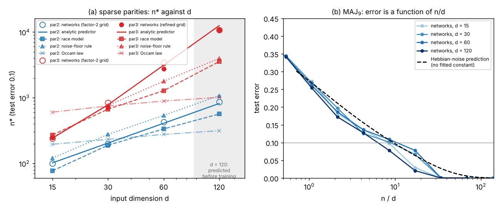

# Why the race model matches gradient-trained networks: a synthesis

Added on 24 October 2026. This note combines three investigations, each of which passed an adversarial verification
pass (see their Verification sections):
- [`ABLATIONS.md`](ABLATIONS.md): 30 ablations of the race model;
- [`MINIMAL-MODEL.md`](MINIMAL-MODEL.md): a minimal learner and a closed-form $n^*$ predictor;
- [`HYBRID.md`](HYBRID.md): a race model with a kernel background.

It also draws on the scoreboards ([`MODEL-SCOREBOARD.md`](MODEL-SCOREBOARD.md), [`RANDOM-SUITE.md`](RANDOM-SUITE.md),
[`DSCALE.md`](DSCALE.md)). Three new checks were made for this note (scripts in [`understanding/`](understanding/)):
1. a d = 120 test of the $d$-scaling predictions, written down before any d = 120 network was trained;
2. a finer $n$ grid at the 3-parity's crossing at every $d$;
3. a between-target analysis of what sets the time to generalise.

**Status labels** are as in the [project README](../README.md):
- **Numerical:** measured here.
- **Heuristic:** argued, not proved.
- **Proved.**

Everything is at one architecture: a μP two-hidden-layer ReLU MLP, width 128, trained with Adam at learning rate
$10^{-3}$, batch 64, for 20000 steps on a fixed training set. Inputs are uniform on $\{-1,1\}^d$.

Unless stated otherwise:
- the input dimension is $d=30$;
- the race model is evaluated as `Race(theta=1.5, Q=3, gate='relu')`, calibrated on the 12 CALIB targets;
- scores are for the 9 HELDOUT targets;
- "$n^*$ error" means the mean $|\log_2(n^*_{\rm model}/n^*_{\rm network})|$.

The new results in this note (sections 3, 6.3 and 7) have **not** been through an independent verification pass.

## Short answers

1. **What sets sample complexity: the noise of a feature search at sample size $n$, not the race's dynamics**
   (Numerical; reading Heuristic).
   - **The race's dynamics barely matter.** Clocks, persistence, alignment costs, θ, and even the race itself
     (greedy selection) move held-out $n^*$ error by about as much as switching the model's internal random stream
     does. Between streams the error ranges 0.23–0.33.
   - **The noise level does matter.** Removing the noise of the direction search collapses $n^*$ to 16–87 on every
     target. Restoring noise at the same *level* with an independent sample restores the match (0.31).
   - **Which noise binds depends on the target family:**
     - for dense leap-1 targets, the sampling noise of one linear (Hebbian) direction, with $n^*\propto d$ and no
       fitted constant;
     - for sparse parities, the noise of an order-$k$ search;
     - for compositions, the costliest single move on the greedy path.
   - **The gate library decides which moves exist:**
     - interaction orders up to the target's leap;
     - ReLU rather than threshold gates;
     - weights at least as fine as $\{-2..2\}$.
2. **What sets time to generalise: the target's feature structure, mainly how many stages it needs and how strong
   each is** (Numerical).
   - **The ordering of targets** survives every ablation, including a noise-free search. The race clock ranks the 21
     targets' large-$n$ network times with Spearman 0.92 (new, section 3); the plain path statistic $\sum_i1/\rho_i$
     reaches 0.75.
   - **Within a target** the clock carries no information (Spearman −0.07).
   - **Magnitudes** match only loosely.
   - **Dependence on $d$.** The networks' time for the 3-parity roughly doubles with each doubling of $d$ (200, 500,
     1000, 2000 steps at d = 15–120). The race's clock grows only 2× over that whole range.
3. **What the discrete picture misses** (Numerical; reading Heuristic):
   - **Which examples are wrong.** About 45% of a partially trained network's output variance comes from the
     particular training sample. That part has the shape of the network's own kernel at initialisation:
     - its correlation is 0.81 with NNGP kernel regression, against 0.48 with the race;
     - per-example agreement is 0.50 for the race, 0.69 for the kernel, and 0.65 for a race with a kernel background.
   - **The order of events.** Networks memorise kernel-style first and grow the generalising features afterwards, with
     long delays. The race never shows this.
   - **Training budget.** The networks' $n^*$ keeps falling with training length (0.17 log₂ per doubling).
   - **Small-$n$ inefficiency.** On easy targets at small $n$ the networks are 1.1–2.2× less sample-efficient than
     their own kernel.
   - **Growth with $d$.** For order $\ge3$ the race's $n^*$ grows too slowly with $d$ (point 6).
4. **The minimal analyzable model keeps most of the qualitative match but not the race's accuracy** (Numerical).
   - **What it is.** Greedy least squares over ±1 ReLU gates, with an acceptance rule $n\rho^2>c\,N(k)$ and two
     constants.
   - **What survives:** success agreement (0.94), curve MAE (0.02) and per-example agreement (0.50).
   - **What is lost:** held-out $n^*$ error is 0.59 against the race's 0.33 (0.28 averaged over streams); on 20 fresh
     random formulas it is 0.47 against 0.20.
5. **The analytic predictor** $n^*=\max\bigl(n_{\rm Hebb},\,c\max_iN(k_i)/\rho_i^2\bigr)$ gets $n^*$ from the target
   alone, at about the race's accuracy on held-out targets (0.38) and worse on random formulas (0.42 against 0.20).
   - **Where it beats the race:** the $d$-scaling of sparse parities.
   - **Pre-registered test at d = 120** (new):
     - **3-parity:** the predictor said 12525, the networks gave 10691 on a refined grid (14188 on the standard
       factor-2 grid). The race said 3557.
     - **2-parity:** predictor 817, networks 869.
   - **Where it fails:** it underpredicts compositions of low-leap moves by 1.4–2×. Most of that gap is already
     there at $d=30$.
6. **$d$-scaling** (Numerical).
   - **Parities.** The networks' parity $n^*$ follows the correlational-SQ / leap law
     $n^*\propto d^{\max(1,k-1)}$ for $k=2,3$ from $d=30$ to 120. The local exponents are 1.09 and 1.03 for $k=2$, and
     1.93 and 1.96 for $k=3$ on the refined grid.
   - **Detectability-type rules grow too slowly.** The race and the ablations' noise-floor rule grow like about
     $d^{1.2}$ for $k=3$. At $d=120$ they are 2.7–3× too early.
   - **Occam-type rules fail completely** (exponent about 0.2).
   - **Dense targets.** For MAJ₉ the networks' whole learning curve is a function of $n/d$ at all four $d$, as the
     constant-free Hebbian-noise law says.
   - **Reading (Heuristic):** the race matches at $d=30$ partly because there the "detect" and "escape" thresholds
     nearly coincide.

## 1. The picture in one paragraph (Heuristic)

A trained network behaves like the sum of two components:

$$\text{network}\ \approx\ \underbrace{\text{random-feature kernel background}}_{\text{absorbs the sample noise; decides which examples are wrong}}\ +\ \underbrace{\text{a few grown features}}_{\text{decide whether and when it generalises}}.$$

- **How features grow.** Features are added greedily. A candidate feature is accepted once its correlation with the
  current residual beats the sampling noise of the *continuous* search that would find it. That noise depends on how
  many inputs the feature needs *at once* that the circuit does not yet use, and it grows polynomially in $d$.
- **What this is not.** It is not the best-of-$M$ noise of a union bound over a finite library, so it is not Occam's
  description length.
- **What the race model contributes.** The race reproduces the feature channel: its sample complexity, its staged
  learning curves, and its ordering of targets in time.
- **What it gets wrong.**
  - It fits the sample noise with about 20 extra memorising gates per partially learned cell. The networks fit that
    noise with their kernel background instead.
  - Its search criterion scales with $d$ like detection of a direction in the empirical moments. The networks scale
    like escape from a random start.

## 2. What sets sample complexity

### 2.1 Not the race's dynamics (Numerical, [`ABLATIONS.md`](ABLATIONS.md) §2, Verification)

**Variants inside the noise band.** Each variant below is run with no recalibration and compared against the
calibrated model's own spread across six internal random streams: held-out $n^*$ error 0.23–0.33. Variants:
- removing the alignment cost (`free`, `flat`);
- resetting the clocks, or all dormant units, after every firing;
- replacing the race by greedy selection;
- θ from 0.5 to 6, power-iteration steps from 1 to 32, pool size from 1 to 32, a gate cap of 96, or no stop at
  interpolation.

**Results.**
- **Held-out $n^*$ error** is 0.25–0.42 for all of these variants.
- **Model against model.** Compared directly with the calibrated streams, with no network involved, the variants
  differ from them by 0.13–0.21 in mean $|\log_2 n^*|$. Two random streams differ from each other by 0.11–0.23.
- **Exceptions:**
  - `free3` (held-out 0.50);
  - on CALIB, pool size 1, one iteration and `greedy` (0.40–0.49). These act mostly through x₁…x₄: how well the
    search reaches high-order directions matters a little.

### 2.2 The noise level of the search (Numerical, [`ABLATIONS.md`](ABLATIONS.md) §4.1)

| search computed on | HELDOUT $n^*$ error | what it shows |
|---|---|---|
| the training sample (the race) | 0.33 (0.23–0.33 over streams) | – |
| a fresh 16384-point sample (`oracle-align`) | 4.63; $n^*$ = 16–87 on every target | with clean statistics the race finds the true features at once |
| an independent sample of the same size $n$ (`indep-search`) | 0.31 | the noise *level* at $n$ sets $n^*$, not the search overfitting the training labels |
| a new size-$n$ sample before every firing (`indep-resample`) | 0.54; $n^*$ ≈ 1.5× lower | a median 48-fold increase in total search data buys only 1.5× |

**Reading (Heuristic):** the race model is a device for producing the right *noise level* in a greedy feature
search. Its clocks are bookkeeping on top.

### 2.3 Family by family

Columns: network $n^*$, then the race, the analytic predictor, the minimal model and the hybrid. All 21 targets are
included, CALIB as well as HELDOUT. Signed is the mean $\log_2(n^*_{\rm model}/n^*_{\rm network})$, so + means too
late.

| family (targets) | what binds $n^*$ (evidence) | race | predictor | minimal | hybrid |
|---|---|---|---|---|---|
| dense, leap 1 ($x_1$, AND₃, MAJ₃, MAJ₉, 10-bit halfspace, rand2, decision list, recursive MAJ₉) | sampling noise of the order-1 (Hebbian) direction, plus refinement gates | 0.18 / +0.07 | 0.39 / +0.01 | 0.45 / +0.06 | 0.52 / −0.43 |
| sparse parities ($x_1x_2$, $x_1x_2x_3$, $x_1\cdots x_4$) | noise of the order-$k$ search | 0.39 / −0.39 | 0.07 / 0.00 | 0.21 / +0.21 | 0.04 / +0.04 |
| low-leap compositions (staircase, MAJ of pair parities, MAJ₃⊕MAJ₃, multiplexer, DNF, AND$(x_1x_2,x_3x_4)$, rand0, rand1, rand3) | one bottleneck move: a pair gate, the spectral (order-2) unit, or a gate needing 2 new inputs | 0.34 / +0.27 | 0.46 / −0.27 | 0.45 / −0.42 | 0.32 / +0.19 |
| leap-3 composition (sign$(2x_1+x_2x_3+x_4x_5x_6)$) | the 3-input gate $x_4x_5x_6$ | 0.32 / −0.32 | 0.41 / −0.41 | 1.46 / −1.46 | 0.46 / −0.46 |

Each cell gives mean |log₂| / signed log₂.

**Dense leap-1 targets** ([`ABLATIONS.md`](ABLATIONS.md) §4.3, [`MINIMAL-MODEL.md`](MINIMAL-MODEL.md) §3).
- **Constant-free predictions.** The predictor's Hebbian-noise term gives $n^*=1.64\,d$ for $x_1$, $4.94\,d$ for MAJ₃
  and $9.52\,d$ for MAJ₉, with no fitted constant: 49, 148 and 286 at $d=30$, against the networks' 47, 112 and 263.
- **How the race gets there.** Its first gate is the rounded Hebbian direction, which on its own gives 74, 153 and
  485. The gates added afterwards lower this to 54, 102 and 248.
- **Halfspace.** On the 10-bit halfspace both the networks (563) and the race (578) are 1.8× *worse* than the
  continuous Hebbian classifier (322). The race reproduces the networks' over-fitting here.
- **Gate type.** Threshold gates instead of ReLU double MAJ₉'s $n^*$ (527).
- **Status.** The closed forms are exact consequences of the predictor's definition. Their agreement with the
  networks is Numerical.

**Sparse parities** ([`ABLATIONS.md`](ABLATIONS.md) §4.2, [`MINIMAL-MODEL.md`](MINIMAL-MODEL.md) §2–3).
- **Predictor.** $n^*=c\,(2^k-1)\,d\,\max(1,d/a)^{k-2}$ with $c=2.25$, $a=18$, from the first gate (the $k$-input AND,
  $\rho^2=1/(2^k-1)$). The remaining gates reuse its inputs and are nearly free.
- **Orders are indispensable.** Without order-3 units the 3-parity is never learned; without order 4, the 4-parity is
  never learned.
- **Race.** On its calibrated stream it is 1.1–1.5× too early at $d=30$ (family mean −0.39 log₂), and its error
  grows with $d$ (section 6).

**Compositions.** The predictor names one bottleneck move per target. It is systematically too early, by 1.4–1.7× at
$d=30$ (staircase −0.59, MAJ of pair parities −0.76), and on 8 of 20 random formulas (0.58–0.73×).
- **What does not explain it.** Adding the costs of all moves instead of taking the maximum makes the random formulas
  worse (0.59 against 0.42).
- **The race is better here** (random formulas 0.20). It is too late on AND$(x_1x_2,x_3x_4)$: 802 against 376.
- **Depth-2 composition** in the race helps only staircase-like targets, by about 0.4 log₂.

**Status.** The family attributions are Numerical: they rest on the ablations and on the predictor naming its binding
term, which it does for 19 of 21 targets. That the network uses the *same* mechanism is Heuristic.

## 3. What sets the time to generalise (Numerical)

**From the ablations** ([`ABLATIONS.md`](ABLATIONS.md) §5):
- **Ordering survives everything.** The time Spearman (network steps against the model's clock, over cells) is
  0.75–0.88 for every variant, including noise-free search.
- **It ranks targets, not cells.** The within-target Spearman is −0.07 on held-out targets. A per-target constant, the
  race's gate count at fit, already scores 0.75.

**New: what in the target sets the ordering** ([`understanding/time_analysis.py`](understanding/time_analysis.py)).
- **The comparison.** The networks' time is the median number of steps to test error ≤ 0.1 over $n\in\{4096,8192,16384\}$,
  one value per target. It is compared with model clocks and with statistics of the predictor's population greedy
  path, up to the stage that reaches error 0.1.
- **The statistics:**
  - the number of stages $i^*$;
  - $\sum_i1/\rho_i$, a saddle-to-saddle time with utility of order $\rho$;
  - $\max_i1/\rho_i$;
  - the largest leap $\max_ik_i$.

| statistic | Spearman with the network time, 21 targets | 9 HELDOUT |
|---|---|---|
| race clock (median over the same cells) | **0.92** | 0.75 |
| minimal model's derived clock | 0.86 | 0.72 |
| race circuit size (median over the same cells) | 0.71 | 0.88 |
| $\sum_i1/\rho_i$ along the path | 0.75 | 0.68 |
| $\max_i 1/\rho_i$ | 0.70 | 0.88 |
| number of stages $i^*$ | 0.66 | 0.43 |
| largest leap $\max_ik_i$ | 0.59 | 0.73 |

- **Fast targets.** Dense leap-1 targets generalise within 50–200 steps, whenever the Hebbian direction alone
  suffices.
- **Slow targets.** Multi-stage or high-leap targets take 500–2000 steps. The slowest are the sparse polynomial,
  whose last stage is a weak 3-leap, recursive majority, whose only stage has $\rho^2=0.02$, the staircase (8 stages)
  and $x_1\cdots x_4$.
- **The race clock does best,** but only modestly better than target-only statistics. The networks' times sit on a
  checkpoint grid (50, 100, 200, 500, 1000, 2000), so this ranking has many ties.

**Magnitudes and $d$-dependence** (networks: median steps over $n\ge2n^*$, checkpoint-grid values;
[`understanding/time_dscale.py`](understanding/time_dscale.py)):

| target | networks, d = 15 / 30 / 60 / 120 | race clock, d = 15 / 30 / 60 / 120 |
|---|---|---|
| $x_1x_2$ | 100 / 200 / 200 / 500 | 4.1 / 4.2 / 5.0 / 4.9–5.8 |
| $x_1x_2x_3$ | 200 / 500 / 1000 / 2000 | 13.7 / 15.6 / 20.5 / 26–29 |
| $x_1\cdots x_4$ | 500 / 1000 / 2500 / – | 25 / 54 / 53 / – |
| staircase | 500 / 1000 / 1000 / – | 22 / 27 / 28 / – |
| multiplexer | 500 / 500 / 500 / 500 | 18 / 9.4 / 13 / 11–23 |
| MAJ of pair parities | 200 / 500 / 500 / – | 31 / 22 / 23 / – |
| MAJ₉ | 50 / 100 / 100 / 100 | 2.8 / 2.8 / 2.9 / 2.9 |

The d = 120 race values are the range over 4 internal streams; "–" means not run at d = 120.

- **The ablations' "global time unit ∝ $d$" is not borne out.** They saw about 2× from $d=15$ to 30 on six of seven
  targets. From 30 to 60 only the 3- and 4-parities slow down. The rest stay at the same checkpoint value.
- **What does slow down with $d$ is the high-leap parities.** The 3-parity's time doubles per doubling of $d$ from
  $d=30$ to 120, roughly $\propto d$.
  - The race's alignment law gives $d^{(k-2)/2}=d^{1/2}$ for $k=3$.
  - The race's actual clock grows only about $d^{0.3}$.
- **Mechanism unresolved.** It may be an Adam effect (per-coordinate normalised updates), or an escape-time law
  $\propto d^{(k-1)/2}$ (Heuristic, untested).

## 4. What the networks do that the discrete picture misses

### 4.1 Which examples are wrong: a kernel-shaped memorisation channel (Numerical, [`HYBRID.md`](HYBRID.md) §1)

This is measured on the 95 cells where the networks are partially right; 57 of them are at $n\le128$.
- **Every learner gets the signal.** All learners match the network's output on the target's relevant variables:
  correlation 0.92–0.98.
- **Learners differ in the sample-noise part.** About 45% of the network's output variance is sample noise (0.59 at
  $n\le64$, 0.23 at $n=2048$). Its correlation with the network's own sample-noise part:

  | learner | correlation |
  |---|---|
  | SGD network, same initialisation | 0.82 |
  | NNGP kernel | 0.81 |
  | Adam network, new initialisation | 0.70 |
  | race | 0.48 |

- **The degree-1 fingerprint.** On the irrelevant coordinates, the network's degree-1 noise has cosine 0.92 with the
  kernel interpolant's direction. The race and the raw Hebbian vector score 0.73 and 0.72.
  - *Proved:* for dot-product kernels on the cube, kernel regression weights each training point by its dual
    coefficient.
- **The swap test.** Giving the race the kernel's noise pattern raises its per-example agreement from 0.50 to 0.63.
  Giving the kernel the race's noise lowers the kernel's from 0.69 to 0.53.
- **What sharing the training sample is worth.**
  - Learners trained on *different* samples agree with a network at only about 0.2 (race 0.21, kernel 0.20, another
    network 0.20).
  - The same-sample excess on top of that is about 0.3 for the race and 0.5 for the kernel.
  - With an independent search sample the race's agreement halves (0.23–0.29). So its 0.50 comes from the race and
    the network being misled by the same spurious correlations.
- **The ceiling.** Averaging networks over initialisations raises their agreement with a held-out network: 0.623,
  0.667 and 0.684 for 1, 2 and 3 networks. Extrapolated, that is about 0.71–0.73, the level of the SGD reference.
  - The kernel agrees 0.78 with a three-network average.
  - Reading (Heuristic): the kernel behaves like the network averaged over initialisations.

| HELDOUT | $n^*$ error | per-example agreement |
|---|---|---|
| race | 0.33 (0.28 averaged over 6 streams) | 0.50 |
| race + kernel background (hybrid) | 0.35 (3 streams) | 0.65 |
| race score + kernel score ($\gamma=1$, post hoc) | 0.29 | 0.62 |
| NNGP kernel | 2.58 | 0.69 |
| init-averaged network (extrapolated ceiling) | – | ≈0.71–0.73 |

- **What the hybrid adds** is mechanistic, not a better scoreboard. It fires about 2 gates per partial cell where the
  race fires 22: roughly nine in ten of the race's gates there are memorisation that the networks do with their
  kernel background.
- **What it costs.** About 0.07–0.11 in $n^*$ error, and MAJ₉ comes too early in all three streams (127–174, against
  the networks' 263).

### 4.2 The order of events, and delayed generalisation (Numerical)

- **The networks interpolate first.** They fit the training set within 100–1000 steps, with kernel-like mistakes
  (agreement with the kernel 0.61–0.71).
- **Near $n^*$ the features grow afterwards,** over the remaining ~19000 steps ([`HYBRID.md`](HYBRID.md) §1.8).
- **Strongly delayed cells:** 43 network cells have test error above 0.15 when they fit and at most 0.1 at the end
  (15 above 0.2), with delays up to 200×.
  - The race has 1 such cell, and 0 above 0.2.
  - Running the race past interpolation never produces a strong delay ([`ABLATIONS.md`](ABLATIONS.md) §5).
- **The hybrid gets the end state right but the path reversed** on large training sets: its features fire before
  its slow background memorises.
- **Why no model reproduces the order.** It would need features that keep growing on an already interpolated residual.
  The one "memorise first" variant tried (scale-free utilities, a static background) was not better in a spot check
  on 8 cells.

### 4.3 The training budget (Numerical)

- **The networks' $n^*$ is still falling at 20000 steps:**
  - by 0.17 log₂ per doubling of steps, averaged over the 21 targets, between $10^4$ and $2\cdot10^4$;
  - MAJ₉ 350 → 263.
- **The same holds at $d=120$** (new). The refined 3-parity $n^*$ is 10691 at 20000 steps and 9374 at 40000, −0.19
  log₂. One seed at $n=9742$ is still at test error 0.40 at step 20000 and reaches 0 by step 40000.
- **The race has no corresponding knob.** Its match is partly a match at this particular budget.

### 4.4 Smaller gaps

- **Worse than their own kernel on easy targets.** At small $n$ the networks need 1.1–2.2× more data than their NNGP
  kernel: $x_1$ 47 against 29, rand2 91 against 41.
  - The race reproduces this through its noisy rounded Hebbian first gate. The hybrid does not.
  - It is not an Adam effect: the SGD networks are less efficient still.
- **Large circuits after generalising.**
  - *The race:* its circuit sits at its 48-gate cap from well below $n^*$ to beyond it.
  - *The networks:* their layer-2 kernel rank peaks just below $n^*$ and then collapses.
  - *Bounds:* distillation certificates show both to be functionally small circuits. Even so, the race's
    own-circuit Occam bound is vacuous for most of its large generalising fits: median 0.82 on a sample of 30,
    against a certificate median of 0.125 ([`RACE-CERTIFY.md`](RACE-CERTIFY.md)).
- **Width.** Between widths 32 and 256 the 4-parity's $n^*$ falls 1.9×, while the 3-parity's does not change. All
  models are models of width 128 (project README §3.2).
- **$d$-scaling** of high-order costs and times: sections 3 and 6.

## 5. How much survives in the minimal analyzable model (Numerical, [`MINIMAL-MODEL.md`](MINIMAL-MODEL.md))

**The model.** Greedy stagewise least squares over a finite library:
- $\pm1$-weight ReLU gates of fan-in ≤ 4;
- depth-2 gates on active wires;
- one Hebbian linear unit that keeps its sampling noise;
- one spectral (order-2) unit per stage.

It accepts the best gate if $n\rho^2>c\,N(k)$, with $N(0)=|\text{pool}|$ and $N(k)=d\max(1,d/a)^{k-2}$; $c=2.25$ and
$a=18$ are fitted on CALIB.

**What it drops from the race:** the continuous direction search and its rounding, the race clock, θ, and the
$\{-3..3\}$ weights.

| | HELDOUT $n^*$ error | $n^*$ Spearman | success agreement | curve MAE | per-example agreement | time Spearman | 20 random formulas |
|---|---|---|---|---|---|---|---|
| race | 0.33 (0.28 over streams) | 1.00 | 0.95 | 0.01 | 0.50 | 0.83 | 0.20 |
| minimal model | 0.59 (0.54–0.68 leaving one seed out) | 0.85 | 0.94 | 0.02 | 0.50 | 0.69 | 0.47 |
| analytic predictor (its noiseless limit) | 0.38 | 0.97 | 0.96 | 0.03 | – | – | 0.42 |

**What survives:**
- success agreement, curve MAE and per-example agreement;
- the CALIB $n^*$ match (0.36 against 0.24);
- the escape-law parity $d$-exponents, 1.00, 2.00 and 3.00, against the networks' 1.04, 1.91 and 2.40.

**What is lost:**
- **Held-out $n^*$ accuracy.** About half of that error comes from two targets:
  - the sparse polynomial, where one seed of three accepts a 3-leap gate early;
  - rand3, a structural miss (428 against 1016) shared with the predictor.
- **The random-formula match:** 0.47 against 0.20.
- **Learning-curve shape:** its curves are sharper than the networks'.

**Reading (Heuristic).** Three ingredients carry most of the match:
- a noisy dense linear unit;
- sparse gates priced by how many new inputs they need at once;
- nearly free reuse of active wires.

On mid-sized compositions, though, the race's continuous search gets something right that exhaustive scoring with a
significance test does not. One untested candidate is that the network's spectral search returns *mixtures* when
several pair spikes are degenerate. The minimal model's exhaustive pair search sidesteps that.

## 6. The analytic $n^*$ predictor

### 6.1 The formula (Heuristic derivation; closed forms exact for the predictor)

Along the target's population greedy path,

$$n^*\approx\max\Bigl(n_{\rm Hebb},\ c\max_{i\le i^*}\frac{N(k_i)}{\rho_i^2}\Bigr),\qquad N(k)=d\,\max(1,d/a)^{\max(k-2,0)}\ (k\ge1),\quad N(0)=|\text{pool}|.$$

- $\rho_i$ is move $i$'s correlation with the residual.
- $k_i$ is the number of inputs the move needs that are not yet active.
- $n_{\rm Hebb}$ is the $n$ at which the Hebbian unit's sampling noise, of variance $\propto d/n$, allows error 0.1.

**Derivation (Heuristic).** A dormant unit with initial overlap $m(0)^2\approx a/d$ escapes towards an order-$k$
direction only if its signal $kU\,m(0)^{k-1}$ beats the frozen sampling noise of the gradient, $\propto1/\sqrt n$.
That gives $n\propto d^{k-1}$ for $k\ge2$.
- This is the leap / information-exponent scaling known for online SGD (Abbe, Boix-Adserà and Misiakiewicz 2023; Ben
  Arous, Gheissari and Jagannath 2021), here observed for training that reuses a fixed sample.
- The "initial overlap" reading of $a$ is not quantitative ([`MINIMAL-MODEL.md`](MINIMAL-MODEL.md), Verification).

**Closed forms:** $1.64\,d$ for $x_1$, $9.52\,d$ for MAJ₉ (both constant-free), and $c(2^k-1)\,d\max(1,d/a)^{k-2}$
for $k$-parities. The closed form reproduces the predicted curve for 19 of 21 targets; it misses the decision list and
rand1.

### 6.2 How well it does at $d=30$ (Numerical)

**Scores.** CALIB 0.37, HELDOUT 0.38 (Spearman 0.97), 20 random formulas 0.42 (Spearman 0.92–0.96, depending on the
saved run). The race model's scores are 0.24, 0.33 and 0.20.

**Caveats:**
- **HELDOUT is clean for the constants, not for the structure.** CALIB alone would have picked the additive variant,
  which scores 0.59 on the random formulas.
- **The CALIB objective is flat.** Points within 0.02 of its optimum give HELDOUT 0.36–0.55.
- **It compares a fine grid with a coarse one.** The predictor's $n^*$ comes from a fine grid (1/16 octave). The
  networks' $n^*$ is log-interpolated on a factor-2 grid.
  - *New:* for the sharp parity transitions the factor-2 grid overstates the networks' $n^*$. The 3-parity's $n^*$ is
    719 on a refined grid against 843 on the factor-2 grid at $d=30$, 2740 against 3410 at $d=60$, and 10691 against
    14188 at $d=120$.
  - Against the refined values the predictor is 1.09–1.17× *high* on the 3-parity for $d\ge30$, instead of slightly
    low.
  - Every model scored on the common grid shares the bias, so the scoreboard comparisons among models are unaffected.

### 6.3 New: a pre-registered test at $d=120$ (Numerical)

**Setup.**
- **Predictions first.** The predictions were computed and saved ([`understanding/predictions_d120.json`](understanding/predictions_d120.json),
  02:42:06) before the d = 120 networks were launched (02:42:29; first results 02:44:31).
- **Models,** all with their $d=30$ CALIB constants unchanged:
  - the analytic predictor;
  - its Occam-law and no-leap variants;
  - the race model, 4 internal streams × 2 seeds, on exactly the networks' training sets.
- **Networks.** The same networks and protocol, 2 seeds, on four targets. They were run to 40000 steps, with $n^*$
  read at the protocol's 20000-step checkpoint.
- **Refinement.** After the first look, the 3-parity's and the multiplexer's crossings were refined with quarter-octave
  $n$ (prefixes of the same nested training sets).
- Scripts: [`understanding/`](understanding/) `predict_d120.py`, `run_d120.sh`, `run_d120_refine.sh`,
  `run_refine_all.sh`, `analyze_d120.py`, `refined_nstar.py`, `floor_d120.py`.

| target | networks, factor-2 grid | networks, refined grid | analytic predictor | race (4 streams; geometric mean) | noise-floor rule (ABLATIONS §4.2) | no leap cost | Occam law |
|---|---|---|---|---|---|---|---|
| $x_1x_2$ | 869 | – | **817** | 473–626 (566) | 1077 | 931 | 315 |
| $x_1x_2x_3$ | 14188 | 10691 | **12525** | 3423–3634 (3557) | 3961 | 2120 | 1015 |
| MAJ₉ | 845 | – | 1143 | 1239–1401 (1307) | – | 1143 | 1143 |
| multiplexer | 6524 | 5195 | 3405 | 3158–5467 (4013) | – | 2409 | 891 |

Mean $|\log_2|$ error over the four targets, against the factor-2-grid networks:

| predictor | race | no leap cost | Occam law |
|---|---|---|---|
| 0.41 | 0.99 | 1.18 | 2.14 |

Against the refined values for the 3-parity and the multiplexer, the predictor's error is 0.34.

**Readings:**
- **The 3-parity is the decisive case.**
  - The leap law predicted that $n^*$ would quadruple from $d=60$ to 120, and it did: networks 2740 → 10691 on the
    refined grid, against the law's 3131 → 12525.
  - The race grew only 2.8× (1281 → 3557), and the noise-floor rule 2.2×.
  - The race is now 3.0× too early, against 0.9× at $d=15$, 1.1× at $d=30$ and 2.1× at $d=60$ (refined networks;
    race geometric means over streams).
- **The 2-parity:** the predictor is within 6%. The race is 1.5× too early.
- **MAJ₉: the $n^*$ comparison misleads; the curve comparison does not.**
  - The networks' $n^*$ "exponent" from $d=60$ to 120 looks like 0.44 (625 → 845). That is an artifact of the 0.1
    threshold crossing the flat knee of the learning curve.
  - The whole curve is a function of $n/d$ at all four $d$ (figure, panel b):

    | $n/d$ | network test error, d = 15 / 30 / 60 / 120 | constant-free Hebbian law |
    |---|---|---|
    | 1.1 | 0.27 / 0.27 / 0.26 / 0.25 | 0.27 |
    | 2.1 | 0.18 / 0.20 / 0.19 / 0.17 | 0.21 |
    | 4.3 | 0.14 / 0.13 / 0.14 / 0.13 | 0.16 |
    | 8.5 | 0.10 / 0.10 / 0.11 / 0.08 | 0.11 |

  - So the Hebbian law, error a function of $n/d$ only, holds to within 0.01–0.04.
  - The networks' $n^*/d$ is 8.2, 8.8, 10.4 and 7.0 at $d=15$, 30, 60 and 120, against the predictor's 9.5. That
    scatter comes from where the flat curve crosses 0.1, not from a trend in $d$.
  - Below error 0.1 the curves spread (0.02–0.08 at $n/d=17$). That is the region where the networks' $n^*$ still
    drifts with training length.
- **The multiplexer:** the predictor's known composition miss persists and grows a little. It is 1.53× too early
  (refined grid), against 1.36× at $d=30$ and 1.67× at $d=60$ (factor-2 grid there). The race is 1.3–1.6× too early.
- **What the test shows (Heuristic reading of Numerical results).** The networks' sample cost for sparse parities
  follows the escape (correlational-SQ) law $d^{k-1}$ out to $d=120$ for $k\le3$. The race's acceptance rule does not
  embody that law.

*Figure ([`understanding/figure_dscale.py`](understanding/figure_dscale.py)):*
- *(a) $n^*$ of $x_1x_2$ and $x_1x_2x_3$ against $d$ for the networks, the predictor, the race (geometric mean over
  streams), the noise-floor rule and the Occam law. The shaded region is the out-of-sample $d=120$ point.*
- *(b) the networks' MAJ₉ test error against $n/d$ at four $d$, with the constant-free Hebbian-noise curve.*

## 7. $d$-scaling: predictions and whether they hold

**Exponents of $n^*$ in $d$.** Each column gives local exponents, $\log_2$ of the $n^*$ ratio per doubling of $d$.
Network values use the factor-2 grid except where marked refined. Race values are geometric means over internal
streams (4 at $d=15$, 6 at 30, 1 at 60, 4 at 120).

| target | networks | analytic predictor | race | noise-floor rule | Occam law |
|---|---|---|---|---|---|
| $x_1x_2$, 15→30→60→120 | 1.00, 1.09, 1.03 | 1.00, 1.00, 1.00 | 1.30, 0.82, 0.76 | 1.19, 0.96, 1.00 | 0.25, 0.25, 0.19 |
| $x_1x_2x_3$, 15→30→60→120 (refined) | 1.53, 1.93, 1.96 | 1.69, 2.00, 2.00 | 1.30, 0.93, 1.47 | 1.62, 1.22, 1.15 | 0.31, 0.25, 0.19 |
| $x_1\cdots x_4$, 15→30→60 | 2.42, 2.39 | 2.50, 3.00 | 1.4–1.5 (single streams; 1.8 averaged over streams), 2.81 | 2.02, 1.45 | 0.37, 0.25 |
| staircase / multiplexer / MAJ of pair parities, 15→30→60 | 1.81 / 1.67 / 2.17, then 1.20 / 1.30 / 1.33 | 0.24 / 1.69 / 1.00, then 1.00 / 1.00 / 1.00 | 1.09–1.76, then 0.6–1.2 | – | ≈0.1–0.3 |
| multiplexer 60→120 | 1.20 (factor-2 grid) | 1.00 | 0.57 | – | 0.19 |
| MAJ₉ | error curve a function of $n/d$ (§6.3) | $n/d$ exactly | error curve close to a function of $n/d$ (within 0.03 at fixed $n/d$, $d=15$–120) | – | – |

Notes on the table:
- The $x_1\cdots x_4$ row and the race's $d=15$/60 values come from [`MINIMAL-MODEL.md`](MINIMAL-MODEL.md) §5 and
  [`ABLATIONS.md`](ABLATIONS.md) §4.2, §5.
- The networks' 4-parity $n^*$ is limited by the 20000-step budget at $d=15$ and $d=60$.
- The predictor's 15→30 values reflect the cap $\max(1,d/a)$, which was probably introduced with the $d=15$ data in
  view.

**What holds:**
- **$k=2$ and $k=3$ parities follow $n^*\propto d^{k-1}$** from $d=30$ to 120, with constants close to the
  predictor's ($c=2.25$, $a=18$). This is now tested once out of sample, at $d=120$.
- **The Occam law is ruled out:** exponents 0.2–0.3 against 1–2.4.
- **Removing the leap cost is ruled out:** exponent 1 for every parity, and 2.3–2.7 log₂ off on the $d=120$ 3-parity.
- **Dense leap-1 targets scale as $n/d$** without a fitted constant.

**What does not hold, or is unresolved:**
- **The race's parity scaling.**
  - Its $n^*$ for $k=2,3$ grows too slowly once $d\ge30$: about $d^{0.8}$ and $d^{1.2}$.
  - It tracks the noise-floor rule within 1.1–1.4× at every $d$ from 15 to 120 for the 3-parity. Both are criteria
    for *detecting* the true direction among spurious ones in the empirical moments, whose noise maximum grows only
    about like $d$.
  - The networks follow the escape criterion instead.
  - *Reading (Heuristic):* at $d\approx a\approx18$–30 the two criteria nearly coincide. That is where the race was
    calibrated, which plausibly is why it matches there. At $d=30$ the leap factor $d/a=1.67$ is within the race's
    own stream spread.
- **The 4-parity.** The networks scale like $d^{2.4}$ from 15 to 60, below the law's $d^3$. The predictor
  overpredicts $d=60$ by 1.6×.
  - Candidate explanations, untested: a benefit from reusing samples (Dandi et al. 2024), assembly from two pair
    features, or the training budget.
  - Width also matters for the 4-parity: 1.9× from width 32 to 256. It does not for the 3-parity.
- **Compositions.** Low-leap compositions are underpredicted by 1.4–2×. Most of the gap is already there at $d\le30$.
  The networks' local exponents fall towards the predictor's 1.0 at large $d$: 1.20–1.33 from 30 to 60, and 1.20 for
  the multiplexer from 60 to 120.
- **Times.** The time-to-generalise $d$-dependence of high-leap parities (section 3) is not reproduced by any model.

**Forward predictions** (Heuristic; not tested):
- **4-parity at $d=120$.** The predictor says $n^*\approx1.8\times10^5$. Extrapolating the networks' $d^{2.4}$ gives
  about $7.5\times10^4$, and they would probably be budget-limited.
- **3-parity at $d=240$.** The leap law says about 50000. The race says about 8000–10000, if its recent growth
  continues.
- **MAJ₉ and other dense leap-1 targets** should keep their error curve as a function of $n/d$.

## 8. What is established, and how firmly

| claim | status | strength of evidence |
|---|---|---|
| The race's dynamics (clocks, alignment law, race against greedy, θ) do not set $n^*$ on held-out targets | Numerical | strong: 30 ablations, six-stream noise band, model-vs-model comparison |
| $n^*$ is set by the noise *level* of the feature search at sample size $n$ | Numerical | strong: oracle against independent same-size search |
| Dense leap-1 targets: $n^*$ is set by the Hebbian direction's sampling noise, error a function of $n/d$ | Numerical; closed form exact for the predictor | strong: constant-free, four values of $d$ |
| Sparse parities $k\le3$: $n^*\propto d^{k-1}$ (escape / CSQ law), constants $c=2.25$, $a=18$ | Numerical; derivation Heuristic | good: $d=15$–120, one pre-registered point; 2 seeds at $d\ne30$; the $d=15$ agreement relies on the cap $\max(1,d/a)$ |
| The race model's acceptance behaves like a detection threshold, not an escape threshold | Heuristic reading | moderate: race and noise-floor rule track each other across $d$; mechanism not isolated |
| Time ordering across targets is set by the feature structure (stages and utilities); within-target timing is not modelled | Numerical | good for the between-target claim; weak magnitudes |
| Networks' individual mistakes come from a kernel-shaped memorisation channel | Numerical, reading Heuristic | strong: decomposition, swap test, degree-1 fingerprint, robust to seeds and streams |
| Networks memorise first and grow features afterwards | Numerical | moderate: time courses on the 95 partial cells |
| The minimal model keeps the race's qualitative match but loses its held-out and random-formula $n^*$ accuracy | Numerical | strong: robust to seeds |
| The 4-parity's cost, compositions' constant factors, time $d$-scaling | open | – |

## 9. Open questions, in order of promise

1. **Prove the escape law** for a two-layer network trained on a fixed sample from small initialisation: an order-$k$
   direction escapes iff $n\gtrsim d^{k-1}/\rho^2$. The $d=120$ point makes this the best-supported quantitative
   claim of the study.
2. **Make the race model escape-limited.** Its acceptance currently behaves like detection, not escape. Ways to try:
   - pricing a unit's escape from its *own* initial overlap against the frozen gradient noise, as the minimal model
     does;
   - running a gradient-flow search with $m(0)^2\sim1/d$ instead of power iteration with restarts.

   Then check that the $d=30$ match survives and that the $d=120$ 3-parity moves from 3557 towards 10000.
3. **The order of events.** Find a single learner that memorises first with a kernel background and grows features
   later on the interpolated residual, as the networks do. This needs scale-free (Adam-like) growth on a tiny residual.
4. **Composition constants.** The 1.4–2× underprediction of mid-sized compositions by the predictor. Candidates:
   degenerate spectral spikes returning mixtures, or partial additivity of sequential moves.
5. **The 4-parity and width.** Test at larger widths and longer budgets whether $d^{2.4}$ is a budget or width effect,
   or a real reuse benefit.
6. **Time scaling.** Explain why the 3-parity's time to generalise grows about $\propto d$: Adam's per-coordinate
   normalisation against an escape-time law.

## Files

| file | contents |
|---|---|
| [`understanding/predict_d120.py`](understanding/predict_d120.py) → [`predictions_d120.json`](understanding/predictions_d120.json), [`predict_d120.log`](understanding/predict_d120.log) | the frozen $d=120$ predictions: analytic predictor and variants, race model (4 streams, 2 seeds) |
| [`understanding/run_d120.sh`](understanding/run_d120.sh), [`run_d120_refine.sh`](understanding/run_d120_refine.sh), [`run_refine_all.sh`](understanding/run_refine_all.sh) | the $d=120$ networks, and quarter-octave refinements of the 3-parity's crossing at $d=15$, 30, 60, 120 and of the multiplexer's at $d=120$ |
| [`understanding/analyze_d120.py`](understanding/analyze_d120.py) → [`d120_results.json`](understanding/d120_results.json) | scoring of the frozen predictions |
| [`understanding/refined_nstar.py`](understanding/refined_nstar.py) → [`refined_nstar.json`](understanding/refined_nstar.json) | refined-grid $n^*$ and 3-parity exponents |
| [`understanding/floor_d120.py`](understanding/floor_d120.py) → [`floor_d120.log`](understanding/floor_d120.log) | the ablations' noise-floor rule at $d=120$ |
| [`understanding/time_analysis.py`](understanding/time_analysis.py) → [`time_analysis.json`](understanding/time_analysis.json) | between-target analysis of time to generalise |
| [`understanding/time_dscale.py`](understanding/time_dscale.py) | networks' time to generalise against $d$ |
| [`understanding/figure_dscale.py`](understanding/figure_dscale.py) → [`figures/understanding_dscale.png`](figures/understanding_dscale.png) | the figure |

Raw outputs are in the session scratchpad, not the repository:
- $d=120$ networks: `results_d120/` and `results_d120_refine/`;
- refinements: `results_d15_refine/`, `results_d30_refine/`, `results_d60_refine/`;
- race evaluations: `model_evals/race-d120-s{0..3}-{par2,par3,maj9,mux}.npz`.

Every $d=120$ network run, refinement included, took under 2 minutes on the 4-core machine.

**Self-checks done.**
- The 3-parity's $d=120$ $n^*$ was computed by two separate scripts, `analyze_d120.py` and `refined_nstar.py`, which
  agree (10691).
- The nested training sets are prefixes of one data stream (checked), so the refinement runs and the race see exactly
  the networks' training sets.
- The scoreboard numbers quoted from the three source notes are their verified values.

No independent adversarial pass has been made of sections 3, 6.3 and 7.
