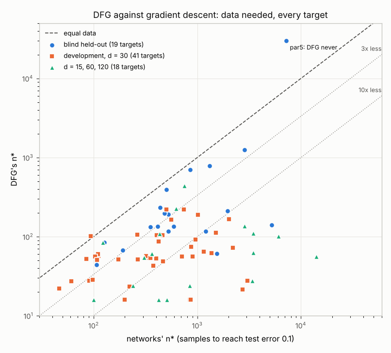

# DFG: a discrete learner that matches or beats gradient descent on the toy Boolean suite

Part 6 of the study (25 October 2026). All tables: [`RESULTS.md`](RESULTS.md), generated from `results/*.json`.

**Question (from the user).** Use the picture of what gradient descent does (Parts 1–5 of this study) to build a *more
discrete* learner. It should get test performance at least as good as gradient descent's with similar compute and data,
at least on the toy problems where gradient descent does well.

**Proposal.** *Discrete feature growth*, DFG (`dfg.py`), keeps the networks' strategy and replaces their search.

What it keeps:
- It grows features greedily, cheapest first.
- Each feature is tested against the noise of the current residual.
- A feature on inputs it already uses is cheaper.
- It fits a linear background.
- It predicts with the sign of a fitted readout on what it has grown.

What it replaces: it finds features by exhaustive enumeration of Fourier characters, with union-bound tests, instead of
by noisy local search in weight space. Each search runs on a subsample whose size is set by the compute budget, so a fit
stays within a fixed fraction of one network run.

**Result** (Numerical; details below). Against the study's networks (μP MLP d-128-128-1, Adam, 20000 steps, the same
training sets and test set):
- **Blind test of the final version** (v1.1 on held-out suite 2, written after v1.1 was committed): smaller n* on
  all 7 targets. The median factor is 3.1× less data, and per fit DFG uses at most 0.26 of one network run's FLOPs.
- **Blind test of the frozen first version** (held-out suite 1, 12 targets): smaller n* on 11 of 12, median 2.7×. It
  never learns par5, which needs a degree-5 search that the blind version did not have.
- **Development suites:** 21 designed targets and 20 random formulas. Clearly smaller n* on 40 of 41, median 5–6×; the 41st, and3, is a tie (101 against 94). The
  advantage grows with d, to a median 30–45× at d = 60 and 120, where the networks' cost for a k-parity grows like
  d^{k−1}.
- **Where it is worse.** Per (target, n), DFG is worse by more than 0.02 in 0–10% of cells, mostly at n = 16–64
  where both learners are near chance. The persistent exception is MAJ5 ⊕ MAJ5 at n = 64–256.

**What this says about gradient descent** (Heuristic). On these targets the networks' extra data cost is the price of
*searching in weight space*. Part 3 found that gradient descent pays for search in samples, n* ≈ c·N(k)/ρ² with
N(k) = d·max(1, d/a)^{k−2}, which is about d^{k−1} for a k-parity. DFG pays for search in compute, N candidates per
class, and only about ln N in samples. That is roughly 2k ln d for a k-parity, the Occam rate. Under the networks' own
FLOP budget, exhaustive search is affordable up to degree 4 on all the data at d = 30, and up to degree 6 on a
subsample. So on this suite data, not compute, is what limits a learner, and gradient descent spends data where an
exhaustive search spends FLOPs.

## 1. The learner, and where each piece comes from

| what the networks were seen to do (Parts 1–5) | DFG's discrete counterpart |
|---|---|
| Features are grown greedily, one bundle at a time, in order of detectability (plateaus and drops; Part 5) | rounds of exhaustive search; everything that passes the test this round is added |
| A feature's cost is set by its correlation with the **residual** against the noise of the competing directions ("noise-limited greedy growth", Part 2) | test \|mean(r χ_S)\| > c·s·sqrt(2 ln(4KN/δ)/n), with s = rms(residual) and N the size of the candidate class (c = 1, δ = 0.1, K = 4). s falls as features are fit, so weaker features become detectable later |
| Composition: features on a term's own inputs make it cheaper (the user's x1x2, x3x4 → x1x2x3x4 prediction, confirmed in Part 4) | small candidate classes, hence low thresholds: *extensions* S ∪ {j}, S ∪ {j, l} of current features; *local* search over every subset of the inputs in use (Walsh transform on V, up to junta completion) |
| A kernel background plus a few grown features (Part 3) | a *linear block* (all d inputs at once, when a χ²_d test says the linear part has signal) and a final Hebbian step on the residual |
| Dense targets: one direction grown from many weak correlations; spiked-estimation shrinkage 1 − N/(nρ²) | a *spectral block*: eigen-directions of the residual pair matrix above the noise edge 2s·sqrt(d/n) (spiked-eigenvalue shrinkage), features (u·x)² |
| On every plateau the network computes the sign of a truncated Fourier expansion of the target (Part 5) | readout: sign of the fit on the grown features; least squares (v1), refined by logistic regression (v1.1) |

The search classes are:
- global: degrees 1–4 on all the data, and degrees 5–6 in the first round on a subsample sized by the budget;
- extension;
- local;
- the two blocks.

Engineering:
- *Stopping.* Stop when nothing passes, or when every training sign is right.
- *Least squares.* Kept to p ≤ n/2 features, so it never sits at its interpolation peak.
- *Small n.* With few points the union bound passes nothing: at n = 16 even a perfect one-input target fails it. For
  n ≤ 512, a "forced" variant takes the best-scoring character anyway, at most twice. Cross-validation chooses it over
  the default only if it wins a paired (McNemar) test.
- *Compute budget.* Each search runs on the first m training points, with m chosen to keep it within a fixed share of
  one network run:
  - degree 4: 15% (25% in v1);
  - degree 3 and extensions: 3% per round each;
  - degrees 5 and 6: 3% each.

  A search whose m would fall below 32 is skipped. The cross-validation folds share half the budget (v1.1). A new round
  starts only below 75% of the budget. At d = 30 the budget binds only for degrees 5–6; at d = 60 and 120 it binds for
  degree 4 too.

**What is discrete.** The hypothesis is a set of Boolean features — parities χ_S and, for dense targets, a few quadratic
forms — found by enumeration and admitted by explicit tests. The only continuous parameters are the readout weights.

**v1 and v1.1.**
- *v1* (`dfg_frozen_359a6b61.py`, frozen at commit 359a6b61) is the version run blind on held-out suite 1.
- *v1.1* (`dfg.py` with `readout="logit"`, commit 0220cf04) was made after that run, and fixes two problems it showed:
  - *Readout.* On a dense halfspace (thr30) v1's least-squares readout plateaued at 5–6% error, where the networks reach
    1%. Square loss is the wrong readout for a halfspace: sign(LS) of a threshold function stays a few percent off. 15
    Newton steps of L2-regularized logistic regression on the same features (λ = 1e-4, when n ≥ 8p) take a dense dev
    halfspace from 0.056 to 0.007 at n = 16384.
  - *Budget.* An independent compute audit found that v1's small-n cross-validation gave every fold the whole budget,
    which at d = 120 cost up to 2.7 network runs per fit.

  Held-out suite 2 was written after v1.1 was committed (commit 70c604eb), so it is blind for v1.1.

## 2. Protocol

- **Same data as the networks.** An audit checked `harness.train_data` against `nn_train.make_data` row for row, for
  every n and seed, across the suites and d values. The networks' saved weights reproduce their recorded training error
  on these sets. The test set is the same 4096 points, and DFG sees only (X, y) and an rng.
- **Network reference.** The networks' final test error at each (n, seed). The step count is 20000, or 40000 at d = 120,
  where the study trained longer.
- **Compute.** FLOPs (multiply-add = 2), counting everything DFG does in a fit, including the cross-validation fits. An
  audit's independent ufunc-level count agrees with DFG's counter to within 0.98–1.00. Prediction is counted for
  neither side. The budget unit is one network run, 6P·64·T + 10P·T with T the step count (1.62·10¹¹ FLOPs at d = 30),
  which is what each (n, seed) network costs; vmap shares no computation between networks.
  - *CPU time is a different matter.* DFG's FLOPs run at about 7 GFLOP/s (float64 numpy, driven from Python), against
    32–50 GFLOP/s for the networks (float32 under XLA). So at n = 16384 a DFG fit takes roughly 0.6–1.7× a network's
    CPU time. The claim is about FLOPs.
- **What is in-sample.**
  - *Designed suite.* DFG's settings — notably the small-n rules and the n ≥ 4d gate on the spectral block — were chosen
    by looking at its test error here, so these results are in-sample.
  - *Random-formula suite.* It was run twice with intermediate versions and read, so it is a development check, not
    out-of-sample.
  - *Held-out suite 1* (12 targets, `make_dl_heldout_suite`, commit 805bff0e). Its networks were trained, and their
    curves inspected, before DFG v1 was frozen; DFG was run on it only after the freeze. One exception: the degree-5/6
    search was added knowing that par5 was in the suite, and par5's result depends on it entirely. The table therefore
    also shows v1 *without* that search (K_hi = 4), which is fully blind.
  - *Held-out suite 2* (7 targets, `make_dl_heldout2_suite`) is blind for v1.1.

## 3. Results

The summary below is copied from `RESULTS.md`, which also has the per-target tables: n* and the test error at
n = 64 / 256 / 1024 / 4096 for both learners. Definitions:
- *Data factor:* the networks' n* divided by DFG's.
- *Cells:* the 11 values of n on the grid, for each target.
- *s.e.:* from the seed-to-seed spread of both learners.

| suite, learner | DFG clearly better (n* ratio < 2^-0.25, or networks never) | clearly worse | median data factor (networks' n* / DFG's) | geometric-mean data factor | (target, n) cells where DFG's error exceeds the networks' by > 0.02 (of these, by > 2 s.e.) | max FLOPs per fit / one GD run |
|---|---|---|---|---|---|---|
| held-out 2 (7 targets), v1.1, inputs permuted per fit - blind | 7 | 0 | 3.1x | 3.4x | 6 (3) of 77 | 0.26 |
| held-out 1 (12), frozen v1 without the degree-5/6 search - blind | 11 | 1 | 2.7x | 3.7x | 13 (12) of 132 | 0.17 |
| held-out 1 (12), frozen v1 (degree-5/6 search added knowing par5 was in the suite) | 12 | 0 | 2.8x | 5.2x | 11 (10) of 132 | 0.23 |
| held-out 1 (12), v1.1 - post-hoc | 12 | 0 | 3.0x | 5.3x | 6 (5) of 132 | 0.43 |
| random formulas (20), v1 - used as a check during development | 20 | 0 | 6.0x | 6.8x | 9 (5) of 220 | 0.14 |
| designed (21), v1 - in-sample | 20 | 0 | 5.4x | 7.0x | 7 (2) of 231 | 0.19 |
| designed at d = 15 (7), v1 (the budget does not bind at d = 15) | 7 | 0 | 6.0x | 6.3x | 1 (0) of 77 | 0.08 |
| designed at d = 60 (7), v1.1 | 7 | 0 | 31.7x | 36.3x | 0 (0) of 77 | 0.46 |
| designed at d = 120 (4), v1.1 | 4 | 0 | 45.5x | 30.7x | 0 (0) of 29 | 0.18 |



*Figure (`plot_nstar.py`).* DFG's n* against the networks' n*, for every target of every suite, on log axes. Points
below the dashed line are targets where DFG needs less data. Blind: held-out 2 (v1.1) and held-out 1 (frozen v1 without
the degree-5/6 search; par5, which it never learns, is drawn at the top). Development: designed and random at d = 30,
frozen v1, inputs not permuted. Other d: v1 at d = 15, v1.1 at d = 60 and 120.

**Reading the table.**
- **Blind tests.** These are rows 1 and 2.
  - *Held-out 2* is the blind test of the final proposal, v1.1: DFG has the smaller n* on all 7 targets (median factor 3.1, geometric mean 3.4), at
    most 0.26 of a network run per fit. The worse cells are 6 of 77, and 3 of them beyond seed noise, all at n ≤ 64:
    dnf4x2@64 and sym8@32 and @64. The smallest gains are on the dense symmetric function sym8 (|x1 + … + x8| ≥ 4,
    1.3×) and on the 2-DNF (1.9×).
  - *Held-out 1* blind (frozen v1 without the degree-5/6 search): DFG has the smaller n* on 11 of 12 targets, by a
    median factor of 2.7. It never learns par5: it has no route to a degree-5 character without the degree-5 search,
    while the networks learn par5 at n ≈ 7200.
- **Size of the advantage.** It depends on the target.
  - *Dense targets* — majorities, halfspaces, intersections of halfspaces, MAJ5 ⊕ MAJ5: a factor 1.2–3.5. This is roughly the
    difference between a well-fitted linear readout and the networks' learned features.
  - *Sparse targets* — parities, staircases, majorities of parities, multiplexers, random formulas: a factor 3–100+,
    growing with d. At d = 60 and 120 the median factor is about 30–45.
  - *Where the networks need large n, DFG does not.* For par3 the networks need 843 / 3410 / ~14000 at d = 30 / 60 / 120;
    DFG needs 28 / 28 / 56. For par4: 2728 / 14255 for the networks at d = 30 / 60, against 52 / 56. These DFG values
    are with the inputs permuted per fit (`check_parity_perm.py`, `results/parity_perm.txt`). That is the k ln d against
    d^{k−1} contrast from the opening section.
- **Per cell (target, n).** DFG's error exceeds the networks' by more than 0.02 in 0–5% of cells on most rows, and in
  8–10% on held-out 1 under v1. Most of these are at n = 16–64, where both are near chance. The others are:
  - *In v1:* thr30 at n ≥ 2048, the least-squares readout plateau, fixed by v1.1.
  - *In both versions:* MAJ5 ⊕ MAJ5 at n = 64–256, where the networks reach 0.36 at n = 256 and DFG is at chance until
    its spectral block fires; DFG then leads, 0.02 against 0.16 at n = 1024.
- **Tie-break bias.** On the designed, random and held-out-1 rows, DFG saw the inputs in their natural order, and every
  suite puts the relevant inputs first. At n = 16–32, DFG's forced guess then wins ties toward the true target. The
  reproduction audit measured this on frozen v1: with the columns permuted, par4@16 goes from 0.17 to 0.40 error and
  par3@16 from 0.00 to 0.13. On the designed suite the mean log2 n* ratio moves by about +0.03. Held-out 2 and the
  ablations were run with the inputs permuted at random per fit (`harness.Permuted`), which removes the bias.
- **Compute.** The largest per-fit compute is 0.08–0.46 of one network run, depending on the suite, and it occurs at
  n = 16384 (degree-4 search, extensions, least squares and logistic refinement). At small n DFG uses about 1–5% of a
  run, while the networks always spend the full 20000 steps.
- **Robustness.**
  - *Fresh training seeds* (5–7) at the two grid points bracketing DFG's n* reproduce the recorded errors for stair5,
    rmaj9, parmaj and par3 (reproduction audit).
  - *mux is the exception:* on 9 fresh seeds its n* is about 87 rather than the recorded 65, so its factor is about 13,
    not 18.
  - *An alternative n* definition* (smallest grid n from which the error stays ≤ 0.1) changes the mean log2 ratios by at
    most 0.15.

## 4. Ablations: which ingredient carries the gain

DFG v1.1 with the inputs permuted per fit, on 7 designed targets. Each row removes one ingredient; the entries are n*,
from `RESULTS.md`.

| variant | maj9 | thr10 | par4 | stair5 | mux | rmaj9 | sparsepoly | mean log2 n* vs full |
|---|---|---|---|---|---|---|---|---|
| full | 107 | 146 | 52 | 111 | 64 | 167 | 93 | +0.00 |
| K3-no-hi | 107 | 152 | never | 113 | 158 | 167 | 93 | +1.34 |
| coef-readout | 309 | 295 | 52 | 112 | 63 | 210 | 99 | +0.42 |
| label-noise | 107 | 148 | 56 | 165 | 111 | 188 | 97 | +0.25 |
| ls-readout | 107 | 170 | 52 | 112 | 65 | 167 | 101 | +0.05 |
| no-background-no-small-n | 107 | 146 | 52 | 112 | 110 | 167 | 107 | +0.14 |
| no-blocks | 168 | 144 | 52 | 111 | 61 | 178 | 80 | +0.07 |
| no-composition | 107 | 142 | 52 | 196 | 107 | 167 | 108 | +0.25 |
| networks | 263 | 563 | 2728 | 1514 | 1156 | 2027 | 2205 | |

**Reading the ablations.**
- **No ablation loses to the networks on any of these targets, except par4 when the degree-4 search is removed.**
  Exhaustive search is what makes the difference with gradient descent, and each ingredient taken from the networks is
  worth a further factor of 1.2–3 on one class of targets.
- **The global search depth decides which leaps are possible.** Without degree 4, par4 is never learned: it has no
  lower-order signal, so neither extensions nor local search can reach it. mux gets 2.5× worse, because its largest
  term x1x2x3x4 then has to be built by extension. This is the discrete analogue of leap complexity. The difference
  from the networks is that DFG's cost of a leap is ln C(d, k) in samples and C(d, k) in compute, rather than about
  d^{k−1} in samples.
- **The readout fitted to the residual** (least squares) against raw Fourier coefficients: 2.9× on MAJ9, 2.0× on thr10,
  1.3× on rmaj9. The estimation noise of a coefficient is set by the residual, not by the label, once the big terms are
  fit. The logistic refinement adds 1.2× on thr10.
- **Thresholds scaled by the residual's noise** against the label's: 1.5× on stair5, 1.7× on mux, 1.1× on rmaj9. These
  are the staged targets, where later terms become detectable only once earlier ones are fit. This is
  "noise-limited greedy growth".
- **Composition classes** (extensions and local subsets): 1.8× on stair5, 1.7× on mux, 1.2× on sparsepoly. These are the
  targets whose high-degree terms sit on the inputs of their low-degree terms. It is the user's composition effect (Part
  4), and it matters for the discrete learner in the same way as for the networks.
- **The linear block** (kernel background): 1.6× on MAJ9. Without it the nine majority inputs must each pass an
  individual test.
- **The Hebbian background and the small-n variant:** 1.7× on mux and 1.15× on sparsepoly, at the smallest n.

The ablations were run on 7 targets to save time. The no-blocks variant also shows that the blocks cost a little on
sparse targets: sparsepoly goes from 93 to 80 without them.

## 5. Where DFG is worse, and its limits

- **The cells where DFG is worse.** These are listed per suite in `RESULTS.md`, and there are three kinds.
  - *Tiny n (16–64).* Both learners are near chance there. DFG's union-bound tests pass nothing, so it relies on the
    Hebbian background and the forced guess, and these are sometimes a few points worse than what the networks
    interpolate to.
  - *The dense halfspace thr30 at large n (v1 only).* That was the least-squares readout; v1.1 fixes it.
  - *MAJ5 ⊕ MAJ5 at n = 64–256.* The networks are partly there (0.36 at n = 256) while DFG is at chance. Its only route
    is the spectral block, which waits for n ≥ 4d and for an eigenvalue above the noise edge, and the networks start
    using the weak pair correlations sooner. DFG overtakes them by n = 1024 (0.03 against 0.16).
- **The inductive bias is narrow.** DFG's dictionary is characters on the Boolean cube (plus a few quadratic forms), and
  its tests rely on the characters being orthogonal under the uniform distribution. It is not a general-purpose learner:
  other input distributions, real-valued inputs and images would all need a different dictionary. The networks are
  generic. The claim is only the user's: as good or better on the toy problems where gradient descent does well.
- **Compute grows as d^K.** An exhaustive degree-k search costs about n·d^k. Under a fixed budget DFG subsamples, so a
  high-degree feature must have a large coefficient to be found: at d = 30 the degree-6 search sees about 150 points.
  Degrees 5–6 are skipped at d ≥ 60 (m < 64), and degree 4 is subsampled there (m ≈ 2200 at d = 60, m ≈ 360 at d = 120, in v1.1). A
  sparse degree-7 parity at d = 30 is out of reach for DFG under this budget; at n ≤ 16384 it is out of reach for the
  networks too.
- **One network configuration.** The reference is the study's fixed configuration: width 128, Adam lr 1e-3, 20000 steps,
  square loss. Earlier parts found its n* moves by tens of percent with width and optimizer, not by the factors seen
  here.
- **CPU time.** In wall-clock on this machine DFG is not faster: see the compute paragraph in Section 2.

## Reproduce

```
cd study/discrete_learner
python run_eval.py dfg_frozen_359a6b61:DFG designed       # frozen v1; also random, dlheld
python run_eval.py 'dfg:DFG:{"readout": "logit"}' dlheld2  # v1.1; also designed, dlheld, designed_d15/_d60/_d120
./run_ablations.sh
python make_tables.py                                     # RESULTS.md
```
The network reference files are the study's `fixed_adam_<fn>.npz` (Part 1; held-out suites from
`SUITE=dlheld[2] python nn_train.py --fns all --out <dir>`).
