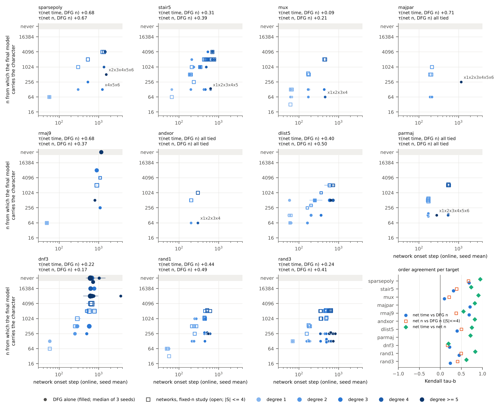

# The order in which DFG alone acquires a target's structure, against the Part 5 networks

Part 11, Q7, "order" (PROTOCOL.md, Q7: "the order in which DFG admits a target's characters, against the order in
which the Part 5 networks acquire them (on the Part 5 targets)"). The object is DFG v1.3 run alone (`dfg13-perm`:
`part10/hyb_portfolio3/dfg13.py`, md5 `69cabe5c…`, `DFG(readout="logit")` inside `harness.Permuted`). The networks are
those of Part 5 ([`../../../trajectories/TRAJECTORIES.md`](../../../trajectories/TRAJECTORIES.md)) and of the
fixed-training-set study that preceded it. Written 2 November 2026; corrected after independent verification on 3
November 2026 (see Verification).

Labels: **Numerical** = measured here, the source file is named; **Heuristic** = my reading of the numbers. Denominators
are given with every count. "tau" is Kendall's tau-b over a target's Fourier characters (positive = same order).

## Verification

An independent agent verified this report on 3 November 2026 ([`VERIFY_ORDER.md`](VERIFY_ORDER.md),
[`VERIFY_ORDER.json`](VERIFY_ORDER.json)). It used its own code: 12 refits through a separate code path, all 23,727
round-0 z-scores from the raw training rows, the network onsets under four conventions, and every order, tau, pair
count and route count. The corrections were applied on 3 November 2026. Then every script was re-run
single-threaded and every number in the text was checked against its output. That check found further errors, which
items 26–33 correct.

- **Confirmed: 41 of 60 claims.** These include:
  - the identity of all 363 fits with the evaluation queue. The 12 refits also reproduce the rounds, the feature
    counts, and the logged s and n_new of every round;
  - the test replay (3217 / 13 / 29890 / 17, none unexplained);
  - every tau-b, pair count, route count and median, endpoint share, data-cost count and non-monotone count;
  - the round-0 priority (44 of 44 positive);
  - mux's x1x2x3x4: first by z0 in every fit at n ≥ 64; n_glob 54 against 271. The report and the verifier both
    counted these fits as 30; there are 27 (item 26);
  - the network onsets and the n_glob formula.
- **Corrected: 19 claims, plus 9 omissions.** All are applied below.
  - Two points are declined in part, each with the stored evidence (items 5 and 16).
  - One correction is applied with a per-seed qualification (item 11).
  - Each correction was checked against the stored cells before it was applied. "Recomputed" marks a number of mine;
    the others are the verifier's.
- **Found while re-checking: items 26–33.** These are numbers and descriptions that the verifier confirmed or did not
  check, plus one sentence added in the first round of corrections.
- **Regenerated.** `order_analysis.py`, `order_report.py` and `order_validate.py` were re-run single-threaded. Their
  outputs differ from the pre-verification ones only as listed here, and a repeat run reproduces them byte for byte.
  `order_fit.py` skips the fits that exist; called on 4 stored cells (`order_recheck.py --refit`), it reproduces them
  exactly.
  - In the existing tables the only changed number is majpar's x1⋯x6 n_glob (147 → 513, item 9).
    `order_targets.md` and `order_degree_size.md` gain a note on dnf3's n-axis entries. `order_stages.md` now states
    its stage rule and also lists Part 5's chained stages (item 30).
  - New numbers are in `order_numbers.json` under new keys: `net_n_resolution`, `priority_online_seed_matched`,
    `onset_conventions`, `mechanism.*_without_dnf3`, `mechanism.dnf3_share_by_how` and
    `rounds_by_n.*.nonpositive_multi`. The stopping-round counts are in `order_validation.json`.
  - The new [`order_recheck.py`](order_recheck.py) prints the numbers that come from single fits or single
    characters (§1.2, §1.5, §2, §3, §4.2, §4.3, §5.1, §5.3, §5.4, §7) to
    [`tables/order_recheck.txt`](tables/order_recheck.txt).
  - The figure is unchanged (byte for byte, with the PDF's date fixed by `SOURCE_DATE_EPOCH`).

**Corrections (old → new; the claim or omission number of VERIFY_ORDER.md in brackets).**

1. Short answer 2 (claim 17, omission 4): "never negatively" → "never negatively in the per-target summaries". Per
   fit, the round order is negative in 3 of the 69 multi-round fits (mux at n = 64: −0.48, −0.05; rmaj9 at n = 512:
   −0.01). §2 lists them.
2. §1.2 (claim 7): "the seed-mean φ curve (the `stages.py` convention)" → "… located by `analyze_traj`'s
   log-interpolated first crossing". `stages.py`'s own rule does not interpolate and gives somewhat different taus
   (e.g. mux +0.21 against +0.09). All three of the verifier's values are reproduced.
3. §1.2 (claim 9): "One exception … (geometric mean 2117)" → the two conventions differ by more than 10% for 143
   characters (142 of them dnf3's). x1⋯x9's geometric mean is 2115, as in §2.2.
4. §3 (claim 21): "Mux, the lowest" → "Mux, among the lowest". Mux is lowest online and at n = 2048; dnf3 is lower at
   n = 16384 and 512.
5. §1.4 (claim 24, omission 1): "like for like: yes, in data and criterion" → "yes in data and rule; not in estimator
   precision for |ŷ| well below 0.1".
   - Qualifications follow in Short answers 2 and 4, §4.1, §4.2, §5.3, §5.4 and §7. On dnf3's 21 resolvable
     characters its +0.17 is +0.56 and its +0.19 is +0.87. 255 of the 349 small data-cost characters are dnf3's, and
     218 of the networks' 223 n-axis drops are on dnf3.
   - **Declined in part.** The verifier counts all 218 of those drops and all 255 of those characters as
     noise-dominated. But 3 of the 218 and 21 of the 255 are on |ŷ| = 0.19 characters. By the verifier's own
     criterion these are resolvable: the sd of φ is 0.08, and a network equal to the target scores 0.88–1.17 on them.
     The text therefore says 215 of the 218 and 234 of the 255 (recomputed, `net_n_resolution`).
6. §4.2 (claim 27): rmaj9's networks "128–4096" → "64–4096 per seed (256–4096 by median)". By median, one character
   (x2x5x8) never enters, an estimator artefact.
7. §4.3 stair5 (claim 30, omission 8): "the one place … where DFG builds like the networks" → one of several
   construction-order entries at n = 128. x1x2x3x4 also enters by extension. x1 enters by the local class after a
   higher-degree character, the reverse of the networks' order.
8. §4.3 mux (claim 31): added "(seed 2) a forced pick (z = 0.95)" and the linear block's entries.
9. §4.3 majpar (claim 33, omission 7): "n_glob is 147, exactly the degree-6 subsample cap" → the 147-row cap holds only
   at n > 512. At n ≤ 512 it is 73 rows, so the global route opens only above 512, and then only marginally. x1⋯x6
   enters by blocks at 256. `nglob()` now applies the halved cap: the tables show 513 for x1⋯x6, the smallest n above
   512; on the n grid that is 1024, the verifier's value (recomputed; no tau changes).
10. §4.3 andxor (claim 35): seed 2's product comes after x3x4, in the same round as x1x2, not after both pairs.
11. §4.3 dlist5 (claim 36): "of higher degree and carried by a block" → "of higher degree in 25 of them".
    - **Applied, with a per-seed qualification.** The verifier's "carried by a block" holds in seeds 0 and 2. It also
      holds at the median onset, n = 512 for all 33: in every case a seed in which a block carries the character has
      its onset there.
    - In seed 1, 15 are carried by a block, 16 by ext1 or ext2, and 2 never enter (recomputed). The text gives both.
12. §4.3 parmaj (claim 37): "the pairs and degree-4 terms come by global tests" → at the n onset (128) no test admits
    any character. Two folded blocks carry 42 of their 45 character-seeds. Tests, mostly global ones, take them only
    at larger n.
13. §4.3 dnf3 (claim 38): "0.027-characters at 512 (degrees 2–3)" → "256–2048 (one at 16384)". "0.0039-characters
    at 8192–16384 or never" → "from 1024 to never".
    - From the same evidence, checked: the networks' "about 500 characters … from 228 to 1084" → 501 characters of
      degree 2–8 from 228 to 2037 steps, one stage by Part 5's rule (item 30). In `order_stages.md`'s stages, 490 of
      them are in stages that start at 228–1084, and 11 degree-5 characters form two late stages (1474, 2005).
    - Recomputed: the late 0.027-characters are of degrees 4–6 (not 4–5), at 4096–16384 or never.
14. Short answer 3 and §5.2 (claim 44): bundles "cut by coefficient size, not by construction" → cut by detectability.
    That is mainly size, but also degree and the carrying block, so equal coefficients are split (sparsepoly, majpar)
    and one stage mixes sizes (rand3).
15. Short answer 3 and §5.3 (claim 46): "the reverse holds for DFG at degree ≤ 4" and "a large coefficient is admitted
    first whatever its degree" → a tendency on 5 of 8 targets, not a rule.
16. §5.3 rmaj9 (claim 48): "have no route but blocks, and are never carried" → carried at some n in every seed and
    dropped later, so never carried for good (except 7 degree-7 characters).
    - **Declined in part.** The verifier says "carried only by blocks, at n = 512–4096".
    - The cells show the local class admitting them as explicit features at n = 2048 (seed 2, 26 of 36) and 4096
      (seed 0, 36 of 36). Blocks also carry them at 8192 (seed 1, 9) and 16384 (seed 0, 7) (`order_recheck.txt`,
      §5.3).
17. §5.4 (claim 50): "all or nothing. A character either passes a test … or it does not" → "nearly all or nothing".
    1134 of the 1497 character-seeds carried for good are carried by a block, not by a test of their own.
18. Short answer 5 and §6 step 3 (claim 57, omission 2): "blocks carry characters 5.3 doublings below … rmaj9's
    x1⋯x9, parmaj's x1⋯x6, dnf3's degree-6 to degree-9 terms" → the 5.3 is quoted for block-carried characters of
    degree ≤ 4 (2.7 outside dnf3). The named examples have no global route at all.
19. Short answer 5 and §6 step 2 (claim 58): "an exact replay of DFG's tests" → "… of DFG's character tests (block
    tests not replayed)". "It is why … 1.3–2.4 doublings below" → a descriptive, partly definitional statement, not
    causal until the nocomp/nosums ablations are in.
20. §6 (omission 2): the route table gains an "outside dnf3" column (recomputed; block −2.72, local −0.74).
21. §5.2 (omission 3): bundle rows added for sparsepoly (6 split / 0 kept) and mux (5 / 2).
22. §1.5 (omission 5): the stopping round is now checked (`order_validate.py`). In the 90 fits that stop with nothing
    passed, no target character has z > 1. All 192 stopping rounds with one are sign-rule stops.
23. §3 (omission 6): the online row is not seed-matched. Seed-matched, the per-target values are 0.20–0.81 and all
    33 per-seed values are positive (recomputed).
24. §7 (omission 9): added the verifier's estimate, which it did not test, that Part 5's time-axis φ is also noisy
    for dnf3's smallest characters.
25. Wording from confirmed claims, and for consistency:
    - the 17 capped rejections are one round's 64-cap (claim 3);
    - rmaj9's seed-0 rounds at n = 512 (claim 16);
    - the halved degree-5/6 caps at n ≤ 512 are also given in §3 (claim 19);
    - stair5's networks' degree-3 onsets 341–703 (claim 29);
    - rand3's blocks not all modulated (claim 39);
    - mux's "3×" is the coefficient ratio (claim 40);
    - mux's x1x2x3x4 is tied at 64 (claim 43);
    - dnf3 is a near-tie, not a tie (claim 45);
    - the learned and partial shares overlap (claim 49);
    - "never" → "never for good" (§4.3 rmaj9) and "that ever enter" → "that enter for good" (Short answer 3, §5.3),
      following item 16.

**Found while re-checking (old → new; recomputed, in `order_recheck.txt` unless another source is named).**

26. Short answer 3 and §3 (claims 20 and 43, both confirmed): "in all 30 fits with n ≥ 64" → "in all 27". The grid
    has 9 values of n ≥ 64 (64 … 16384), so there are 27 such fits. x1x2x3x4 has the strictly highest round-0 z in
    all 27, and in 2 of the 3 fits at n = 32. The verifier's "30/30" repeats the report's miscount.
27. §1.2, a sentence added with item 3: "the largest difference is dnf3's x1⋯x9" → the largest in steps (3598
    against 2115). The largest ratio belongs to dnf3's x3x6x7x8x9: 1865 against 873, 2.1×.
28. §4.3 rand1: the networks' last stage, "degrees 3–4 (434)" → "degrees 3–5 (434–607)". It holds x1x3x4x5x6
    (degree 5, 547 steps).
29. §4.3 rand3: the networks' "mixed degree-3/4 stages" → "one mixed cascade of degrees 3–6, from 346 to 825
    steps". In `order_stages.md` the stages that start at 471 and 639 steps both hold degree-5 characters, and the
    second also the degree-6 one.
30. §2, §4.3 and `order_stages.md`: the networks' stages in `order_stages.md` do not follow Part 5's rule, as its header
    said.
    - Each stage there is a run of onsets within 1.35× of the stage's first onset. Part 5's `stages.py` chains: an
      onset joins the stage if it is within 1.35× of the previous onset.
    - The two rules agree on sparsepoly, mux, majpar, andxor and parmaj. On the other six targets chaining merges some
      stages: for example rmaj9's into one cascade at 796–1217 steps, and dnf3's into one at 228–2037.
    - The header of `order_stages.md` now states its rule, and the file also lists the chained stages
      (`order_report.py`). No tau, pair count or bundle count uses these stages; those compare onsets pair by pair.
    - §2 and §4.3 now give the chained range where they describe one cascade. rmaj9: "a cascade at 796–1081" →
      "796–1217". dnf3: see item 13.
31. §5.2 rand3: "separated from the 256 stage by whether a character contains x6" → its 0.125-characters are split
    by x6: without it at 128, with it at 256. x5x6 and x4x5x6 contain x6 too, but they are 0.375-characters at 128.
32. §4.2's table of medians, and §4.3 majpar, whose DFG stages are by median seed: majpar's pairs "32–64" → "64
    (32–64 per seed)". By median all three pairs enter at 64.
33. Precision:
    - §5.3 rmaj9 at n = 512: "by modulated blocks" → "by the sum blocks of rounds 1–2"; nine of those ten blocks are
      modulated;
    - §4.3 parmaj at n = 128: in seed 1, round 1 also adds the full-sum block's product with |x18+x27|.

## Short answer

1. **At Part 5's sample sizes DFG has almost no order (Numerical).** At n = 16384, 2048 and 512, DFG admits every
   target character it will ever carry in a single round in 32, 30 and 24 of the 33 fits (11 targets × 3 seeds), and
   then stops because every training sign is right. Its round axis is empty exactly where the networks' time axis is
   richest. DFG's order exists in two other places: inside its first round (the z-scores of its tests) and across n.
2. **Where it exists, it agrees with the networks' order moderately, never negatively in the per-target summaries
   (Numerical).** Per fit, the round order is negative in 3 of the 69 multi-round fits: mux at n = 64 (−0.48 and
   −0.05) and rmaj9 at n = 512 (−0.01).
   - *Inside round 0, at n = 16384:* DFG's priority is positively rank-correlated with the networks' onset order on all
     11 targets (tau 0.22–0.81, median 0.54).
   - *On the n axis:* the smallest n from which the final model carries a character is compared with the networks'
     onset order. tau is 0.09 (mux) to 0.71 (majpar), median 0.40, on the 9 targets where DFG's n order is not all
     tied. On andxor and parmaj every character enters DFG at the same n.
   - *Like for like on n:* against the networks' own n order (same training sets, characters of degree ≤ 4), tau is
     0.17–0.67, median 0.40. The networks' time order and n order agree with each other much more closely (tau
     0.19–0.95, median 0.75).
     - dnf3's two values (0.17 and 0.19) rest mostly on characters too small for the networks' n-axis estimate to
       resolve (§7). On its 21 resolvable characters they are 0.56 and 0.87.
     - With those two values, the ranges are 0.21–0.67 (median 0.45) and 0.55–0.95 (median 0.82).
   - *At small n, where DFG runs several rounds:* its round order agrees with the networks' time order at mean tau
     0.44 (n = 64 and 128). At n = 128 all 24 multi-round fits are positive.
3. **Part 5's four qualitative findings, for DFG (Numerical; readings Heuristic):**
   - *Linear stage first:* only partly. On the n axis, DFG's linear terms come strictly first in 6, tied in 12 and
     not first in 6 of 24 target-seed cases. The networks put them first on all 8 targets that have linear terms.
   - *Bundles:* DFG has bundles, cut by detectability. That is mainly coefficient size, but also degree (through the
     union bound and the degree-5/6 caps) and the block that carries a character.
     - It merges whole targets whose coefficients are equal: parmaj's 16 characters all enter at n = 128.
     - It splits network bundles whose coefficients differ. For example, stair5's x1x3, x1x4, x1x5 (−0.125) arrive
       with x1x2 (0.375) in the networks, at 188–234 steps. DFG takes them at n = 512–2048, against 128 for x1x2.
     - It also splits equal coefficients by degree. sparsepoly's six 0.25-characters enter at five different n.
       majpar's pairs enter at 32–64 and its degree-6 term at 256.
     - One DFG stage can also mix sizes (rand3 at n = 128).
   - *Order follows construction, not coefficient size:* DFG tends to the reverse at degree ≤ 4 (on 5 of the 8 targets
     whose coefficient sizes differ), but not as a rule.
     - Mux's largest term x1x2x3x4 (0.75) is the networks' last character. It is DFG's first: ranked first by
       round-0 z in all 27 fits with n ≥ 64, and in the model from n = 64 in all 3 seeds. There it is tied, by
       median, with x2, x3 and x2x4, and in seed 2 it is a forced pick. The networks need n = 2048 for it.
     - Over the targets, the networks' time order follows degree more than coefficient size on 7 of the 8 targets
       whose coefficient sizes differ (dnf3 is a near-tie that slightly favours size). DFG's n order follows 1/|ŷ|
       more than degree on 5 of those 8.
     - Above degree 4 the global search does not reach (except subsamples at degrees 5–6). Those characters enter
       through sum blocks (473 of the 490 character-seeds that enter for good), the local and extension classes (14)
       or the degree-5 subsample (3). Where they build on lower terms they come after them (majpar's degree-6 term,
       stair5's x1x2x3x4x5).
   - *Stopping partway at finite n:* both stop partway, for different reasons.
     - At n = 512 the networks have learned 36% of a target's characters and hold 30% partially (learned fraction
       between 0.25 and 0.75). The two shares overlap: 18% are in both. DFG has learned 80% and holds 7% partially.
     - At n = 16384 the networks have learned 100%, but DFG carries only 92%, because it stops once every training
       sign is right.
4. **DFG needs less data, like for like, for large coefficients only (Numerical).** For the 64 characters of degree
   ≤ 4 with |ŷ| ≥ 0.25, DFG's median n onset is 4× smaller than the networks' (median log2 ratio −2.0; DFG less data
   for 46, equal for 11, more for 7). For the 349 smaller ones the median ratio is 1 (less for 147, equal for 64, more
   or never for 138).
   - 255 of those 349 are dnf3's, and for most of them the network n onsets are estimator noise (§7).
   - Without dnf3 the split is 47 / 15 / 32 of 94, and the median ratio is still 1.
5. **Mechanism (Heuristic).** It is quantified by an exact replay of DFG's character tests; block tests are not
   replayed. The route labels are descriptive, not causal, until the nocomp/nosums ablations are in.
   - *What DFG's order is:* detectability against the residual's noise. In round 0 a character passes once n ≥
     n_glob = 2 ln(4K·C(30,|S|)/δ)(1 − ŷ_∅²)/ŷ_S². Degree enters only through the logarithm of the union bound,
     size through 1/ŷ².
     - Characters admitted by that global test enter at n ≈ n_glob (median +0.26 doublings, 151 character-seeds).
     - Characters admitted by the composition classes (extensions, subsets of the inputs in use) enter 1.3–2.4
       doublings below n_glob (0.7–2.4 outside dnf3).
     - Characters of degree ≤ 4 carried by sum blocks enter 5.3 doublings below it. dnf3 supplies 445 of these 661
       character-seeds; outside dnf3 the median is 2.7 doublings.
   - *What the networks' order is:* by Part 5's own model, set by how many inputs a new feature must coordinate (cost
     ∝ e²), and only weakly by size (∝ ρ^{-1/2}).
   - The two orders coincide when a target's large coefficients sit at low degree, and invert when they do not (mux).

## 1. What was compared, and what is like for like

### 1.1 Targets and data

- **Targets (Numerical).** The 11 Part 5 targets are the calibration five (sparsepoly, stair5, mux, majpar, rmaj9)
  and the six held-out ones (andxor, dlist5, parmaj, dnf3, rand1, rand3).
  - All 11 are entries of `boolfuncs.make_suite(30)`, the `designed` toy suite, at d = 30.
  - Part 5 read them from the same function (`nn_train.SUITE`).
  - Their exact Fourier supports on the relevant inputs (`order_fit.target_support`) have 3 (andxor) to 511 (dnf3)
    non-constant characters; 719 characters in all.
- **Data (Numerical).** The training rows are the same for both learners.
  - The Part 5 networks with fixed training sets draw them with `nn_train.make_data` = `default_rng([fn_seed, seed])`,
    first n of 16384 rows. That is `harness.train_data`, which `eval_dfg.py` uses.
  - So DFG at (n, seed) sees exactly the training set of the network at (n, seed), both in Part 5's fixed conditions
    (n = 512, 2048, 16384) and in the fixed-n study (n = 16…16384).
  - The online networks see fresh data at every step and have no DFG counterpart. DFG at n = 16384 stands in for
    them; Part 5 found online indistinguishable from n = 16384.

### 1.2 The networks' orders

- **Time (Part 5).** The source is `trajectories/results/<fn>_{online,fixed}.json`, written by `analyze_traj.py`.
  - The learned fraction is φ_S(t) = c_S(t)/ŷ_S, the Fourier coefficient of E[f | x_R] on the relevant cube divided by
    the target's.
  - Onset = the first step with φ ≥ 1/2 that stays ≥ 0.4, log-interpolated between checkpoints
    (`analyze_traj.first_cross`).
  - I use the onset of the seed-mean φ curve, located by that rule, and the per-seed onsets as stored.
  - `stages.py` also averages the seeds, but it takes the first checkpoint, without interpolation. Its rule gives
    somewhat different taus (`onset_conventions` in the numbers file):
    - tau(networks' time, DFG n) is +0.21 for mux (+0.09 here) and +0.83 for rmaj9 (+0.68 here);
    - tau(networks' time, networks' n) is +0.50 for majpar (+0.82 here).
  - Recomputed this way, the onsets reproduce TRAJECTORIES.md §2.2 to within about 10% for most characters (576 of
    719). Mux: linear 60–66, x_i·x4 169–176, x1x2x3 430, x1x2x3x4 452.
  - §2.2's table uses the geometric mean of the per-seed onsets instead. The two conventions differ by more than 10%
    (larger over smaller > 1.1) for 143 characters (`onset_conventions`):
    - 142 of them are dnf3's (e.g. x2x7: 228 here against 178; x1x4x7: 789 against 996);
    - the other is stair5's x1x2x4 (703 against 588);
    - the largest difference in steps is dnf3's x1⋯x9. Its per-seed onsets are 504, 3209 and 5858 (geometric mean
      2115, as in §2.2), while its seed-mean curve crosses 1/2 at 3598. I use 3598;
    - the largest ratio is dnf3's x3x6x7x8x9: 1865 here against 873, 2.1× (`order_recheck.txt`).
- **Sample size (fixed-n study).** The source is `$SCR/results/fixed_adam_<fn>.npz`, written by `nn_train.py`.
  - These are the same network, optimizer and training sets, at n = 16…16384 with 3 seeds.
  - `coef` is the mean over the 4096 test inputs of f(x)·χ_S(x), recorded only for |S| ≤ 4 (`char_sets`, kmax = 4).
    Its sampling sd on φ is about 0.0156/|ŷ_S|, too large for dnf3's small coefficients (§7).
  - Network n onset = the smallest grid n whose network at step 20000 has φ ≥ 1/2, with φ ≥ 0.4 at every larger n.
  - These networks are different runs from Part 5's trajectory networks (different minibatch draws, same setup).

### 1.3 DFG's orders

The fits are made by [`order_fit.py`](order_fit.py). It calls the shared `../dfg_hooks.fit_toy_dfg`, which is bit for
bit `eval_dfg.py`'s fit, and also records every `numpy.linalg.solve` solution.

- **What the solves give.** DFG solves one least-squares system before round 0 and one after each round. So the
  solves give, for each round j of the final fit, the feature count p_{j+1} and the weights w_{j+1}.
- **Per round.** For each round I record:
  - the features admitted, in original coordinates;
  - the learned fraction φ_S of the least-squares function held after the round. This is the same estimator as Part
    5's: E[f | x_R] on all 2^|R| patterns, here with M = max(32, 32768/2^|R|) random completions.
  - a replay of every target character's test statistic in every candidate class: z = |mean(r χ_S)| / threshold, with
    DFG's own N, subsample m and residual.
- **Round onset.** The first round j after which φ_S ≥ 1/2 and stays ≥ 0.4 in every later round.
  - *Half-round:* within round j, characters (and the linear and spectral blocks) are tested on the round's residual
    r. Sum blocks are tested on r deflated by the round's characters. So a character carried in round j only by a
    sum block gets onset 2j + 1, and an explicit one 2j.
- **Round-0 priority (z0).** The best z of the character in round 0, i.e. the order in which DFG's first round would
  admit characters as n grows.
- **n onset.** The smallest grid n whose final least-squares function has φ_S ≥ 1/2, with φ ≥ 0.4 at every larger
  grid n (the networks' rule). n = 16…16384, seeds 0–2, 363 fits.

### 1.4 Like for like, or not

| comparison | like for like? | why |
|---|---|---|
| networks' n order vs DFG's n order | **yes in data and rule; not in estimator precision for \|ŷ\| well below 0.1** | Same training sets, same n grid, same rule (learned fraction of the final model ≥ 1/2, for good). Differences: networks only for \|S\| ≤ 4; the network's φ is a 4096-point test-set average of its square-loss output, DFG's a cube average of its least-squares function. The test-set average cannot resolve \|ŷ\| well below 0.1 (sd of φ ≈ 0.0156/\|ŷ\|): dnf3, and partly rmaj9 and dlist5 (§7). |
| networks' time order vs DFG's round order | **no; ranks only** | A round is a test-and-refit step on a fixed sample, not time. DFG uses one round in 86 of the 99 fits at Part 5's n. Its number of rounds shrinks as n grows, while the networks' stage order is the same at every n. |
| networks' time order vs DFG's round-0 priority z0 | **no; an analogy** | z0 is a statistic of one round. It predicts the order in which DFG would admit characters as n grows, not a time course. |
| networks' time order vs DFG's n order | **no; an analogy** | Both are "what appears first as the resource grows". The analogy leans on the networks' own time and n orders agreeing (tau 0.19–0.95, median 0.75; 0.55–0.95, median 0.82, with dnf3 restricted to its resolvable characters). |

### 1.5 Checks (Numerical, [`tables/order_validation.json`](tables/order_validation.json))

- **Identity.** All 363 refits equal the evaluation queue's `part11/results/toy__dfg13-perm__designed.json` exactly,
  in test error and FLOP count.
- **Residual replay.** The residual rms rebuilt from the recorded weights matches DFG's own round log, to 4 decimals,
  in all 363 final fits.
- **Test replay.** Every decision DFG made about a target character agrees with the replayed z-score:
  - 3217 admissions by the tests have z > 1;
  - 13 admissions have z ≤ 1, all forced picks of the forced variant;
  - 29890 non-admissions have z ≤ 1;
  - 17 non-admissions have z > 1, all in one round that hit the 64-per-round cap (dnf3, n = 16384, seed 1, round 1);
  - none is unexplained.
- **Stopping round.** This was checked after verification, and `order_validate.py` now includes it.
  - In the 90 fits that stop with nothing passed (or on the budget or room), no target character has z > 1.
  - The 192 stopping rounds that do have one all end by the sign rule, which DFG applies before testing.
- **Compute.** 17.8 CPU-minutes in all (the longest fit 13.9 s), single-threaded, one process (`order_recheck.txt`).

## 2. At Part 5's sample sizes DFG has (almost) no round order (Numerical)

**Fits in which the target's characters enter over two or more rounds.** Source:
[`tables/order_numbers.json`](tables/order_numbers.json), `rounds_by_n`; 33 fits per n.

| n | 16 | 32 | 64 | 128 | 256 | 512 | 1024 | 2048 | 4096 | 8192 | 16384 |
|---|---|---|---|---|---|---|---|---|---|---|---|
| fits with ≥ 2 entry rounds | 0 | 2 | 11 | 24 | 12 | 9 | 2 | 3 | 4 | 1 | 1 |
| mean tau(network onset online, DFG half-round order), over those fits | – | 0.77 | 0.44 | 0.44 | 0.30 | 0.25 | 0.18 | 0.15 | 0.22 | 0.12 | 0.10 |
| of which positive | – | 2 | 9 | 24 | 11 | 8 | 2 | 3 | 4 | 1 | 1 |

- **Not always positive per fit** (`rounds_by_n`, `nonpositive_multi`). The non-positive multi-round fits are:
  - mux at n = 64, seeds 1 and 2 (−0.05 and −0.48);
  - sparsepoly at n = 256, seed 1 (0.00);
  - rmaj9 at n = 512, seed 0 (−0.01).
- **The round order sits at small n.** DFG's round order is richest at n = 128. There rounds admit few features, and
  DFG's own cross-validation picks the forced variant in 15 of 33 fits (14 of the 24 multi-round ones; cells,
  `variant`, counted in `order_recheck.txt`). At that n the round order agrees with the networks' time order in every
  multi-round fit (tau 0.08–0.93).
- **At Part 5's n it is gone** (fits and stops listed in `order_recheck.txt`).
  - n = 512: the multi-round fits are rmaj9 (3 seeds), dlist5 (2), dnf3 (2), parmaj (1) and rand1 (1).
  - n = 2048: rmaj9 seed 2 and dnf3 seeds 0 and 2.
  - n = 16384: dnf3 seed 1.
  - In the other fits, round 0 admits everything DFG ever carries, and the stop rule fires at round 1: every
    training sign is right (`stop` in the cells).
  - All 99 fits at these three n end by that sign rule. Their test error is 0 in 97 of them; the two exceptions are
    dnf3 at n = 512 (0.006 and 0.017).
- **What a tau means in a one-round fit.** It only separates the characters DFG carries from those it leaves out,
  which are tied last. For example, rmaj9 at n = 16384 gives tau 0.59–0.71 because DFG omits the small degree-5 and
  degree-7 terms the networks learn last. That is a statement about the endpoint (§5.4), not about order.
- **Two multi-round fits at n = 512** (from the cells; `order_recheck.txt`):
  - *rmaj9, seed 0.*
    - Round 0: the 9 linear terms, x1x2x3, x7x8x9, and the full-sum block (x1+…+x9). The block carries the degree-9
      character x1⋯x9.
    - Rounds 1–3: modulated blocks such as chi[x7,x8,x9]·|x1+x2+x3−x4−x5−x6|, which carry degrees 3, 5 and 7.
      Rounds 1–2 also admit four explicit characters (x4x5x6, x3x6x8, x2x4x9, x1x5x7), and round 3 also adds two
      unmodulated sum blocks.
    - The networks: linear terms (47 steps), then one cascade from 796 to 1217 steps, which x1⋯x9 opens (796).
  - *parmaj, seed 1.*
    - Round 0: 8 of the 9 cross pairs, 4 of the 6 degree-4 terms, and x1⋯x6. The last is carried by the folded block
      |−x1−x2−x3+x4+x5+x6|.
    - Round 1: x3x4 and the other 2 degree-4 terms.
    - The networks: pairs (168), degree 6 (280), degree 4 (543).

## 3. Inside the first round: DFG's priority (Numerical)

**Kendall tau between network onset and DFG's round-0 priority, at n = 16384.** Network seed s against DFG seed s, on
the same training set; mean of 3 seeds ([`tables/order_targets.md`](tables/order_targets.md)).

| sparsepoly | stair5 | mux | majpar | rmaj9 | andxor | dlist5 | parmaj | dnf3 | rand1 | rand3 |
|---|---|---|---|---|---|---|---|---|---|---|
| +0.81 | +0.52 | +0.31 | +0.67 | +0.56 | +0.33 | +0.54 | +0.54 | +0.22 | +0.65 | +0.58 |

- **Always positive.** The correlation is positive on all 11 targets (median 0.54). It is about the same against the
  online networks (`priority` in the numbers file).
- **Per condition.** At each of Part 5's conditions, network seed s is compared with DFG seed s at that n (mean of 3
  seeds).
  - Online is compared with DFG at n = 16384: each DFG seed against the online networks' seed-mean onsets, so this
    row is not seed-matched.
  - Seed-matched (online network seed s against DFG seed s), the online values are 0.20 (dnf3) to 0.81 (sparsepoly),
    and all 33 per-seed values are positive (`priority_online_seed_matched`).

  | condition | sparsepoly | stair5 | mux | majpar | rmaj9 | andxor | dlist5 | parmaj | dnf3 | rand1 | rand3 |
  |---|---|---|---|---|---|---|---|---|---|---|---|
  | online | +0.81 | +0.51 | +0.24 | +0.78 | +0.54 | +0.56 | +0.55 | +0.43 | +0.25 | +0.66 | +0.59 |
  | n = 16384 | +0.81 | +0.52 | +0.31 | +0.67 | +0.56 | +0.33 | +0.54 | +0.54 | +0.22 | +0.65 | +0.58 |
  | n = 2048 | +0.62 | +0.33 | +0.10 | +0.78 | +0.49 | +0.33 | +0.48 | +0.54 | +0.19 | +0.58 | +0.56 |
  | n = 512 | +0.60 | +0.40 | +0.19 | +0.64 | +0.46 | +0.56 | +0.50 | +0.61 | +0.09 | +0.56 | +0.38 |

  All 44 entries are positive. Per seed, 131 of the 132 are positive and one is 0.00 (mux, n = 2048, seed 2). The
  round-order and half-round-order taus per seed and condition are in the same file (`priority`: `tau_round`,
  `tau_half`). In one-round fits they only separate what DFG carries from what it leaves out (§2).
- **What z0 is.** In round 0 the only classes are the global ones, so z0 ≈ |ŷ_S| √n / (s √(2 ln(4K·C(30,|S|)/δ))).
  This holds for |S| ≤ 4 at d = 30. Degrees 5 and 6 are searched on budget-capped subsamples (m ≤ 1374 and ≤ 147
  rows at n > 512; 687 and 73 at n ≤ 512, where the final fit has half the budget), so their z0 is smaller. Degree
  ≥ 7 has z0 = 0.
- **Mux, among the lowest.** It is lowest online and at n = 2048; dnf3 is lower at n = 16384 and 512. 6 of mux's 21
  network-ordered pairs are inverted, and all 6 involve x1x2x3x4. From the cells:
  - x1x2x3x4 has the highest z0 of the 8 characters in every fit at n ≥ 64 (27 fits), and in 2 of 3 at n = 32
    (`order_recheck.txt`);
  - at n = 16384 its z0 is 17.1–17.5, against 6.1–8.3 for the others.

## 4. On the n axis

### 4.1 Rank agreement (Numerical; [`tables/order_targets.md`](tables/order_targets.md), figure)

**Kendall tau on the n axis, per target.**
- *Pairs:* character pairs whose network onsets differ by more than Part 5's factor 1.35, counted as concordant /
  tied / inverted in DFG's n order (median seed).
- *"all tied":* DFG gives every character the same n onset.

| target | chars | tau(networks' time, DFG n) | pairs c / t / i | tau(networks' n, DFG n), \|S\| ≤ 4 (chars) | tau(networks' time, networks' n) |
|---|---|---|---|---|---|
| sparsepoly | 7 | +0.68 | 13 / 1 / 1 | +0.67 (5) | +0.95 |
| stair5 | 16 | +0.31 | 45 / 18 / 18 | +0.39 (15) | +0.73 |
| mux | 8 | +0.09 | 7 / 10 / 4 | +0.21 (8) | +0.91 |
| majpar | 4 | +0.71 | 3 / 0 / 0 | all tied (3) | +0.82 |
| rmaj9 | 76 | +0.68 | 764 / 0 / 2 | +0.37 (39) | +0.55 |
| andxor | 3 | all tied | 0 / 2 / 0 | all tied (3) | +0.82 |
| dlist5 | 31 | +0.40 | 180 / 117 / 45 | +0.50 (30) | +0.75 |
| parmaj | 16 | all tied | 0 / 69 / 0 | all tied (15) | +0.72 |
| dnf3 | 511 | +0.22 | 34171 / 8989 / 13265 | +0.17 (255) | +0.19 |
| rand1 | 15 | +0.44 | 51 / 6 / 14 | +0.49 (14) | +0.83 |
| rand3 | 32 | +0.24 | 107 / 136 / 35 | +0.41 (26) | +0.62 |

- **Pair totals.** Over the 10 targets other than dnf3, the network-ordered pairs are 1170 concordant, 359 tied and
  119 inverted in DFG's n order.
- **dnf3 on the n axis** (`net_n_resolution`).
  - Its like-for-like tau (+0.17) and its networks' time-against-n tau (+0.19) rest mostly on its 234 characters with
    |ŷ| ≤ 0.027, which the networks' test-set estimate cannot resolve (§7).
  - On its 21 resolvable characters (|ŷ| = 0.19) they are +0.56 and +0.87.
- **The networks are more consistent with themselves than with DFG.** Their time order and n order agree with each
  other (median 0.75) more than either agrees with DFG (median 0.40 on both axes). With dnf3 restricted to its
  resolvable characters, it is 0.82 against 0.45 like for like.

**Figure ([`figures/fig_order.pdf`](figures/fig_order.pdf)).** One panel per target; each point is a target character.
- *x:* the networks' onset step online (seed-mean learned fraction ≥ 1/2 for good).
- *y:* the smallest n from which the final model carries the character. Filled: DFG alone (median of 3 seeds). Open:
  the networks of the fixed-n study (median of 3 seeds, |S| ≤ 4 only). Grey band: never within n ≤ 16384.
- *Colour:* degree.
- *Coinciding points* are offset vertically by up to ±0.26 doublings; the grid spacing is one doubling.
- *rmaj9, dlist5, dnf3:* one marker per (degree, |ŷ|) group at the group's median, with size ∝ √(count) and a bar
  over the 10–90% range of the network onsets.
- *dnf3:* the open squares of its |ŷ| ≤ 0.027 groups are dominated by the test-set noise of the networks' estimate
  (§7). So are its two n-axis taus in the last panel.
- *Last panel:* the three taus per target.

**Reading.** A target on which the open squares rise with x is one where the networks' n order follows their time
order. Filled points below open squares mean DFG needs less data for that character.

### 4.2 How much data each learner needs, like for like (Numerical, `data_cost`)

For the 413 characters of degree ≤ 4 with both n onsets defined, compared by median over 3 seeds:

| | DFG needs less data | equal n | DFG needs more (or never) | median log2(DFG n / networks' n), both finite |
|---|---|---|---|---|
| \|ŷ\| ≥ 0.25 (64 characters) | 46 | 11 | 7 | −2.0 (64) |
| \|ŷ\| < 0.25 (349 characters) | 147 | 64 | 138 | 0.0 (234) |

- **The small row is mostly dnf3** (`net_n_resolution`).
  - 255 of its 349 characters are dnf3's, and 234 of those have |ŷ| ≤ 0.027, where the networks' n onsets are
    mostly noise (§7).
  - Without dnf3 the row is 47 / 15 / 32 of 94 characters, with a median log2 ratio of 0.0 over the 93 with both
    onsets finite.

Per-target examples (medians; [`tables/order_chars.md`](tables/order_chars.md), `order_recheck.txt`):

| target | character | DFG n | networks' n |
|---|---|---|---|
| mux | x1x2x3x4 | 64 | 2048 |
| majpar | pairs | 64 (32–64 per seed) | 512–1024 |
| andxor | all 3 characters | 64 | 512–1024 |
| parmaj | all 15 characters of degree ≤ 4 | 128 | 512–2048 |

- **Against DFG: rmaj9.** Its 27 cross-block degree-3 characters (|ŷ| = 0.0625) need 2048–16384 for DFG per seed
  (4096–16384 by median), against 64–4096 for the networks per seed (256–4096 by median). For rmaj9, DFG needs more
  data for 27 of 39 characters (`data_cost.per_target`; the ranges are in `order_recheck.txt`).
  - By median, one of them (x2x5x8) never enters the networks' n axis. That is an artefact of the test-set estimate:
    a network equal to the target scores φ = 0.42 on it.

### 4.3 The stages, target by target

The full lists are in [`tables/order_stages.md`](tables/order_stages.md). Below, networks' time stages online (steps)
against DFG's n stages (median seed); verdicts are Heuristic, numbers Numerical. The single-fit details are in
`order_recheck.txt`.
- *Network stages.* In `order_stages.md` a stage is a run of onsets within 1.35× of the stage's first onset.
  - Part 5's `stages.py` chains instead: an onset joins the stage if it is within 1.35× of the previous onset. The
    two rules agree on sparsepoly, mux, majpar, andxor and parmaj.
  - On the other six targets chaining merges some stages; `order_stages.md` lists both. Below, a cascade that
    chaining keeps whole is described as one.

- **sparsepoly: agree.**
  - Networks: x1 (56) → x2x3 (299) → x1x2x3 (532) → x4x5x6 and its products (1234–1542).
  - DFG: x1 (64) → x2x3 and x4x5x6 (128) → x1x2x3 (256) → x2x3x4x5x6 (512) → x1x4x5x6 (1024) → x1⋯x6 (4096).
  - The one inversion is x1x2x3 against x4x5x6. They have the same |ŷ| (0.25), degree and n_glob (402), and DFG does
    not charge x4x5x6 for needing three new inputs.
  - In 2 of 3 seeds x1x2x3 (= x1·x2x3) enters through the local class, i.e. DFG's junta completion. That matches
    the networks' "products of learned features are faster".
  - x2x3x4x5x6 enters through the degree-5 subsample search (n_glob 508). x1⋯x6 enters only through product blocks,
    at 2048–4096, and never in seed 2.
- **stair5: partly.**
  - DFG: the six 0.375-characters (x1, x1x2, x1x2x3, x1x3x5, x1x2x3x4, x1x2x3x4x5) at n = 128, then the −0.125-ones
    at 512–4096.
  - Networks: x1 (65) → all four x1·x_j (188–234, three of them −0.125) → degree 3 (341–703), interleaved with
    degrees 4 and 5 (485–768).
  - 18 pairs are inverted. In 15 of them the networks learn a −0.125 character before a 0.375 character that DFG
    learns first. The other 3 pair two −0.125 characters.
  - n_glob is 159 for x1x2 and 1427 for x1x3; the ratio, 9, equals (0.375/0.125)².
  - The staircase's top term x1x2x3x4x5 enters by extension of lower staircase terms (ext1 or ext2, rounds 1–3) at
    n = 128 in all seeds. That is a construction order, but not the only construction-order entry at n = 128:
    - x1x2x3x4 also enters by extension (ext2 in seed 0, ext1 in seed 2, round 1);
    - x1 enters by the local class in round 1 of every seed, after a higher-degree character admitted by the global
      test in round 0 (x1x2, x1x3x5 or x1x2x3);
    - that is the reverse of the networks' order: DFG's first character at n = 128 is never x1, the networks' first.
- **mux: disagree.**
  - Networks: linear (60–66) → x_i·x4 (169–176) → x1x2x3 (430) and x1x2x3x4 (452).
  - DFG: x1x2x3x4, x2, x3, x2x4 (64) → x1, x1x4, x3x4, x1x2x3 (128).
  - x1x2x3x4 is admitted by the global degree-4 test (seed 1), or carried by a block such as (−x1−x2−x3+x4) whose
    levels span it (seed 0). In seed 2 it is a forced pick of the forced variant (z = 0.95).
  - The rest then enters through the local class on V = {x1, …, x4} (N = C(4, k) ≤ 6), through the same blocks, or
    (seed 2) by the global test in round 1. The linear terms also enter through the linear block (x3 in seeds 1–2,
    x1 in seed 2).
- **majpar: agree.**
  - Networks: pairs (189–210) → x1⋯x6 (1164).
  - DFG: pairs (64; 32–64 per seed) → x1⋯x6 (256, all 3 seeds). The degree-6 term comes through round-0 weighted
    blocks, or products with one, whose inner term is a pair parity: (x3+x4−x5−x6 + 3·x1x2) in seed 2,
    |x3+x4|×(x5+x6 + 3·x1x2) in seed 0. These are tested on the residual left after the pairs.
  - The n_glob formula gives 147 rows for x1⋯x6. That equals the degree-6 subsample cap, but only of a fit at
    n > 512 (m = 147).
  - At n ≤ 512 the final fit has half the budget and searches degree 6 on 73 rows. So the global test cannot admit
    x1⋯x6 at any n ≤ 512.
  - Above 512 the test opens only marginally: the expected z is 1.0, and the replayed z is 0.83–0.997 at n = 1024–16384,
    never above 1. With the halved cap n_glob is 513, which the tables now use.
  - So x1⋯x6 enters only through blocks, at 256, after the pairs. That is DFG's version of "the degree-6 term comes
    after the pairs".
- **rmaj9: agree on stage order; DFG splits the cascade by size.**
  - DFG: linear (64) → within-block degree 3 (|ŷ| 0.25; 256) → x1⋯x9 through the full-sum block (512) → cross-block
    degree 3 (0.0625; 4096–16384). Degrees 5 and 7 never enter for good (median seed; seed 0 carries 7 degree-7
    characters from 16384). They are carried at some n and dropped later (§5.3).
  - Networks: linear (47) → one cascade from 796 to 1217 steps. Its first part (796–1012) holds the 27 cross-block
    degree-3 characters, 1 within-block one and x1⋯x9. The second part (1081–1217) holds the other 2 within-block
    characters and all of degrees 5 and 7. `order_stages.md` lists these two parts as stages 796 and 1081.
  - Both learners get the top-degree parity early through sum features. In DFG it is the block's level indicators: a
    parity of the block's inputs is a function of their sum. In the networks, Part 5 found ReLUs of block sums.
- **andxor: DFG ties everything at n = 64 (median).** In every seed the product x1x2x3x4 still comes after a pair:
  - seed 1: in round order, through the local class (round 2, n = 32), after both pairs;
  - seed 2: in round order, through ext2 (round 1, n = 64), after x3x4 but in the same round as x1x2;
  - seed 0: in n, through a block at n = 128 against the pairs at 64.
  - That is the networks' pairs → product order (200 → 298 steps), but it does not survive the median on the n axis.
- **dlist5: partly.**
  - Networks: all five linear terms first (49–64), including x4 and x5 (±0.0625).
  - DFG: x1, x2, x3 and x1x2 (|ŷ| 0.69, 0.31, 0.19, 0.31) at n = 64. x4 and x5 come at 128–512 (median 512),
    through the linear block (the χ²_d test on all remaining inputs).
  - In all 45 inverted pairs the networks' earlier character has |ŷ| = 0.0625 (8 linear, 32 pairs, 5 triples).
    - In 33 the character DFG takes first is also a 0.0625-character, of higher degree in 25 of them (the same
      degree in 8). Its median onset is n = 512 in all 33. At its own n onset it is carried by a block in seeds 0
      and 2. In seed 1 it is carried by a block in 15 of the 33, by ext1 or ext2 in 16, and never enters in 2.
    - In 12 it is a larger one (x1x2, x1x3, x2x3, x1x2x3).
- **parmaj: DFG ties everything at n = 128.**
  - At n = 128 no test admits any character in any seed (n_new = 0 in every round).
    - Round 0 adds a folded block, |x1+…+x6| or |−x1−x2−x3+x4+x5+x6|. Round 1 adds another. In seed 0 it also adds
      the linear block, and in seed 1 the full-sum block's product with |x18+x27|.
    - These blocks carry x1⋯x6. They also carry 42 of the 45 character-seeds of the pairs and degree-4 terms at
      their n onsets; the other 3 are global admissions at n = 1024 (seed 2).
  - Tests take the pairs and degree-4 terms (all |ŷ| = 0.25) only at larger n. At n = 512, seed 1 (§2), 12 of the 15
    are admitted by global tests in round 0 and the other 3 by the local class in round 1. Their global z-scores are
    only 1.17× apart (√(ln 4.4·10⁶ / ln 7.0·10⁴)).
  - Networks: pairs (168) → x1⋯x6 (280) → degree 4 (543).
- **dnf3: partly.**
  - DFG ranks mostly by size:
    - |ŷ| = 0.19 characters (9 linear, 9 pairs, 3 triples) at 128–256;
    - 0.027-characters at 256–2048 (degrees 2–3; one at 16384), and at 4096–16384 or never (degrees 4–6);
    - 0.0039-characters from 1024 to never. 33 of the 343 enter at 1024–4096 (mostly degrees 6–7, through blocks),
      before many 0.027-characters of degree 4–5.
  - Networks: linear (53), then one cascade of 501 characters of degree 2–8 from 228 to 2037 steps, and x1⋯x9 at
    3598.
    - `order_stages.md` splits the cascade into stages. 490 characters are in stages that start at 228–1084, and 11
      degree-5 characters form two late stages (8 at 1474, 3 at 2005).
- **rand1: partly.**
  - DFG: linear (64) → the 0.375-characters x3x5, x4x6, x1x4x6 (degrees 2, 2, 3) at 128 → the 0.125-characters at
    256–1024.
  - Networks: linear (49) → all four pairs including the 0.125 ones (212) → degrees 3–5 (434–607).
- **rand3: different.**
  - DFG at n = 128 (from the cells): first the four characters on {x4, x5, x6} that contain x5, by tests, about one
    per round. Then sum blocks on the signed sum (−x1+x2+x3), modulated by those characters, e.g.
    chi[x5]·(x1−x2−x3−x4) and chi[x4,x5]·(x1−x2−x3−…).
  - At its onset, 84 of rand3's 96 character-seeds are carried by sum blocks.
    - At n = 128 these are mostly modulated ones like these. The fits there also have one unmodulated block in seeds
      1 and 2.
    - At n = 256 it is a single unmodulated product block such as (x1−x2−x3)×(x4+x6+2·x5).
  - By median n: 18 characters at 128 (the 16 on {x1, …, x5} that contain x5, plus x5x6 and x4x5x6), and the other
    14, all containing x6, at 256.
  - Networks: x5 (69) → x_j·x5 for every j (155) → one mixed cascade of degrees 3–6, from 346 to 825 steps.

## 5. Part 5's qualitative findings, checked for DFG

### 5.1 Linear stage first (Numerical, `checks`)

- **Networks.** On all 8 targets with linear terms, every linear onset comes before every other onset.
- **DFG, n axis.** Compare the latest linear n onset with the earliest non-linear one, per target and seed (24 cases):
  - *strictly first:* 6 (sparsepoly seeds 1–2, rmaj9 seeds 1–2, rand1 seeds 1–2);
  - *tied:* 12;
  - *not first:* 6 (mux seeds 1–2, all three dlist5 seeds, dnf3 seed 1).
- **Heuristic.**
  - *Why linear terms come early:* the degree-1 class has the smallest union bound, N = 30. ln(4K·N/δ) is 8.5 nats,
    against 11.2, 13.4 and 15.3 for degrees 2, 3 and 4. So linear terms are first for equal coefficients.
  - *Why they are not always first:* the bound is only logarithmic. A coefficient √(15.3/8.5) = 1.34× larger at
    degree 4 already beats a linear term. Mux's 0.75 at degree 4 beats 0.25 at degree 1: the coefficients differ
    3×, the z-scores 2.2× and n_glob 5× (54 against 271).
  - *Small linear terms:* they wait for the linear block or for the residual to shrink (dlist5's ±0.0625).
  - *The networks' linear stage* comes first "whatever the size of the linear coefficients" (Part 5). DFG's does not.

### 5.2 Bundles (Numerical, `bundles`; Heuristic reading)

Count the pairs of characters inside one network stage (network onsets within 1.35× of each other, pair by pair) that
DFG's n order splits, against those it keeps together:

| target | split | kept |
|---|---|---|
| sparsepoly | 6 | 0 |
| mux | 5 | 2 |
| stair5 | 32 | 7 |
| rmaj9 | 1294 | 790 |
| dlist5 | 63 | 60 |
| rand1 | 16 | 18 |
| rand3 | 110 | 108 |
| dnf3 | 57018 | 16862 |
| parmaj | 0 | 51 |
| majpar | 0 | 3 |
| andxor | 0 | 1 |

- **Merged, not split.** On parmaj and andxor, DFG also ties every pair the networks put in different stages (69 of
  69 and 2 of 2).
- **Heuristic.** DFG's bundles are the characters that pass in the same round, so they are sets of near-equal
  detectability. Junta completion and blocks widen them: a block admits a whole symmetric family. The networks'
  bundles are "everything one new direction of a hidden unit can carry", and they cut across coefficient size.
  The two coincide when the target's coefficients are equal within a construction step (majpar, parmaj's pairs) and
  differ when a step mixes sizes (stair5's x1·x_j, dnf3's large bundle).
- **Detectability is not size alone (Numerical, `order_chars.md`).** It is mainly coefficient size, but also degree
  (through the union bound and the degree-5/6 caps) and the block that carries a character.
  - So DFG also splits equal coefficients by degree. sparsepoly's six 0.25-characters enter at 128 (x2x3, x4x5x6),
    256, 512, 1024 and 4096. majpar's 0.5-pairs enter at 32–64 and its 0.5 degree-6 term at 256.
  - And one DFG stage can mix sizes. rand3's stage at n = 128 has four 0.375- and fourteen 0.125-characters. Its
    0.125-characters are split from the 256 stage by x6: those without x6 are at 128, those with it at 256. The
    0.375-characters x5x6 and x4x5x6 also contain x6, but they are at 128 (`order_recheck.txt`).

### 5.3 Order follows construction, not coefficient size

**Kendall tau of each order against degree and against 1/|ŷ|.** Source:
[`tables/order_degree_size.md`](tables/order_degree_size.md) (Numerical). Positive means higher degree, or smaller
coefficient, comes later.

| target | net time vs degree | net time vs 1/\|ŷ\| | DFG n vs degree | DFG n vs 1/\|ŷ\| |
|---|---|---|---|---|
| sparsepoly | +0.88 | +0.53 | +0.85 | +0.55 |
| stair5 | +0.73 | +0.16 | +0.13 | +0.79 |
| mux | +0.89 | −0.50 | +0.11 | +0.38 |
| rmaj9 | +0.67 | +0.41 | +0.80 | +0.61 |
| dlist5 | +0.77 | +0.47 | +0.35 | +0.77 |
| dnf3 | +0.25 | +0.27 | +0.22 | +0.47 |
| rand1 | +0.89 | +0.61 | +0.43 | +0.82 |
| rand3 | +0.69 | +0.39 | +0.52 | +0.33 |
| majpar, andxor, parmaj | +0.71, +0.82, +0.63 | all \|ŷ\| equal | +1.00, tied, tied | all \|ŷ\| equal |

- **Networks.** Their time order follows degree more than coefficient size on 7 of the 8 targets whose sizes differ.
  dnf3 is a near-tie that slightly favours size (0.25 against 0.27). On mux the order runs against size (−0.50).
  - Their n order (|S| ≤ 4, same file) follows degree more than size on all 8.
  - dnf3's entries there rest on characters the n-axis estimate cannot resolve (§7). On its 21 resolvable
    characters, which all have one size, net n against degree is +0.85.
- **DFG.** Its n order follows 1/|ŷ| more than degree on 5 of those 8 (stair5, mux, dlist5, dnf3, rand1). It follows
  degree more on 3 (sparsepoly, rmaj9, rand3).
  - On the |S| ≤ 4 characters (same file) it is also 5 of 8. Size wins on stair5 (0.77 against 0.27), mux (0.38
    against 0.11), rmaj9 (0.75 against 0.68), dlist5 (0.77 against 0.37) and rand1 (0.82 against 0.46).
  - Degree wins on sparsepoly (0.89 against 0.67), dnf3 (0.68 against 0.66) and rand3 (0.45 against 0.31).
  - *sparsepoly:* the coefficients take only two values.
  - *rmaj9:* degrees 5 and 7 (36 characters) are carried at some n in every seed, all 108 character-seeds
    (`order_recheck.txt`):
    - at n = 512 by the sum blocks of rounds 1–2, nine of whose ten are modulated (seeds 0–1, all 36);
    - at 2048 (seed 2) and 4096 (seed 0) mostly as explicit features admitted by the local class (26 and 36 of 36);
    - by blocks in three more fits (9 at 4096 in seed 2, 9 at 8192 in seed 1, 7 at 16384 in seed 0).
    - Each is dropped at a larger n. So they are never carried for good (except the 7 degree-7 characters in seed
      0, from 16384), and they tie last.
  - *rand3:* the {x4, x5, x6} characters come first, by tests, and the rest through sum blocks. At n = 128 those are
    mostly blocks modulated by these characters; at 256 a product block.
- **Mux, the clearest case.** See §3 and §4.3: DFG's first character is the networks' last.
- **Where DFG does construct (Heuristic).** Above degree 4 its global search does not reach, except the round-0
  subsamples for degrees 5 and 6 (`how_at_onset_by_deg`):
  - degree ≥ 5 characters, when carried, enter mostly through blocks (473 of the 490 character-seeds that enter for
    good);
  - the rest come through the local class (11), extensions (3), and the degree-5 global subsample (3);
  - these come after the lower-degree characters they build on: majpar's degree-6 after its pairs, stair5's
    x1x2x3x4x5 by extension.
- **So the composition rule is in DFG, but only beyond the global degree cap and in later rounds.** Within degree ≤ 4,
  a large coefficient tends to be admitted first whatever its degree (on 5 of the 8 targets whose sizes differ), but
  not as a rule.

### 5.4 Stopping partway at finite n (Numerical, `endpoints`, `nonmonotone`)

**Share of a target's characters at the end of training.** Networks at step 20000, Part 5's fixed runs; DFG's final
least-squares function; mean over 33 target-seed cells, each target weighted equally.

| n | networks: learned (φ ≥ 1/2) | networks: partial (0.25 ≤ φ < 0.75) | DFG: learned | DFG: partial |
|---|---|---|---|---|
| 512 | 0.36 | 0.30 | 0.80 | 0.07 |
| 2048 | 0.84 | 0.16 | 0.88 | 0.06 |
| 16384 | 1.00 | 0.00 | 0.92 | 0.04 |

- **The columns overlap.** "Learned" (φ ≥ 1/2) and "partial" (0.25 ≤ φ < 0.75) share the range 0.5 ≤ φ < 0.75. At
  n = 512, 18% of the networks' characters are in both (`order_recheck.txt`), so the two columns must not be added.
- **Networks.** Part 5's "same order, different endpoints": at finite n the later stages saturate partway (30% of
  characters partial at n = 512) or never start. Example, sparsepoly at 2048: x2x3 ends at 0.78, x1x2x3 at 0.66, and
  x4x5x6 at 0.18.
- **DFG is nearly all or nothing.** A character is either fitted or absent. It is fitted by its own test or, in most
  cases, as part of a sum block: 1134 of the 1497 character-seeds carried for good are block-carried. On sparsepoly at
  2048 DFG carries 6–7 of 7 characters.
- **DFG stops on signs, not on estimation.** It stops as soon as every training sign is right. So its final model is
  sign-sufficient, not E[y | x_R], at every n. At n = 16384 (`order_recheck.txt`):
  - rmaj9 carries 40–47 of 76 characters, with test error 0;
  - dnf3 carries 232–497 of 511.
- **This makes DFG's n axis non-monotone.** A character carried at one n is dropped at a larger n, where round 0
  already gets the signs right with fewer features. For example, on rmaj9 in seed 0 four rounds carry all 76
  characters at n = 512, and one round carries 47 at 16384 (`order_recheck.txt`). The drops:
  - DFG: 1139 of 2157 character-seeds, 945 of them on dnf3 and 159 on rmaj9; 35 of 396 on the other 9 targets;
  - networks: 223 of 1239 (|S| ≤ 4), 218 of them on dnf3. 215 of those 218 are on characters with |ŷ| ≤ 0.027,
    whose network n-axis φ is mostly test-set noise (§7).

## 6. Mechanism: why DFG's order is what it is

**Numerical, from the replay; [`tables/order_numbers.json`](tables/order_numbers.json), `mechanism`.**
- *How each character is carried at its DFG n onset,* over 2157 character-seeds. The block route is read from the
  fits' features; only the character tests are replayed.

  | route | count |
  |---|---|
  | carried only by a sum block or spectral feature | 1134 |
  | global test | 154 |
  | local class | 96 |
  | linear block | 73 |
  | extensions (ext1 18, ext2 11) | 29 |
  | forced | 11 |
  | never | 660 |

- *Against n_glob,* for degree ≤ 4 with both finite (1007): the median log2(DFG n onset / n_glob) is −3.1, or −1.5
  over the 474 outside dnf3. dnf3 supplies 445 of the 661 block-carried, 38 of the 85 local and 19 of the 151 global
  character-seeds, so the pooled medians mostly describe dnf3. By route, with dnf3 left out in the last column
  (`mechanism`, `*_without_dnf3`):

  | route | median doublings | count | outside dnf3: median (count) |
  |---|---|---|---|
  | global | +0.26 | 151 | +0.26 (132) |
  | local | −1.74 | 85 | −0.74 (47) |
  | extension | −1.34 (ext1, 17), −2.42 (ext2, 9) | 26 | −0.76 (ext1, 15), −2.42 (ext2, 9) |
  | linear block | −1.68 | 73 | −2.08 (46) |
  | forced | −1.48 | 11 | −1.39 (9) |
  | sum block | −5.33 | 661 | −2.72 (216) |

- *tau(n_glob, DFG n onset)* is 0.40 (dnf3) to 1.00 (majpar), where defined.
- *tau(n_glob, networks' onset)* is 0.28 (dnf3) to 0.88 (sparsepoly); mux 0.32.

**Heuristic reading, in three steps.**
1. **Round 0 is a ranking by detectability.**
   - DFG admits χ_S when |mean(r χ_S)| > s √(2 ln(4K N/δ)/m) in some class of size N.
   - In round 0, mean(r χ_S) ≈ ŷ_S, s² ≈ 1 − ŷ_∅², and the only class is the global one with N = C(30, |S|). The
     character then passes at n_glob ∝ ln C(30, |S|) / ŷ_S².
   - The 151 globally admitted character-seeds enter a median of +0.26 doublings from n_glob.
   - This is the order of §3: size first, degree only through a logarithm. For example, n_glob is 54 for mux's
     x1x2x3x4 against 271 for its linear terms.
2. **Later rounds make what is in use cheaper.** Two things happen:
   - *the residual noise s falls* as features are fit. On mux, x1x2x3x4 alone carries 0.75² = 0.56 of Var y, so s²
     falls to 0.44 once it is in;
   - *small classes open:* extensions of current characters (N = bases·d or bases·C(30,2)), every subset of the
     ≤ 12 inputs in use (N = C(|V|, k)), and sum blocks modulated by a current character (rand3, rmaj9).
   - This is DFG's composition rule. Local and extension admissions sit 1.3–2.4 doublings below n_glob (0.7–2.4
     outside dnf3).
     - That is partly so by construction: a character admitted below its n_glob cannot have passed the round-0
       global test in expectation, so it entered by another route.
     - Whether these classes cause the earlier entry is for the nocomp/nosums ablations; here the reading is
       descriptive.
   - It matches two of Part 5's findings once DFG has a foothold: junta completion and "products of learned features
     are faster" (sparsepoly's x1x2x3, mux's pairs after x1x2x3x4).
   - The foothold itself is chosen by size, not by construction.
3. **Blocks carry whole families, and the stop rule truncates.**
   - A sum block's level indicators span every function of its signed sum. That includes the parity of its inputs
     and many small high-degree characters.
     - So blocks carry characters of degree ≤ 4 a median 5.3 doublings below their individual detectability (2.7
       outside dnf3).
     - They also carry characters that have no global route at all: rmaj9's x1⋯x9, parmaj's x1⋯x6 (it would need
       588 rows against the 147-row cap), and dnf3's degree-6 to degree-9 terms.
   - The sign stop then cuts the sequence off as soon as the training signs are right. That is DFG's version of
     "stopping partway", and it is what leaves small characters out even at n = 16384.

**The networks, by Part 5's model** (TRAJECTORIES.md §4, Heuristic there):
- a move's duration grows with the number of inputs it coordinates at once (∝ e² at d = 30);
- it is doubled when the move must be built on a feature, and for odd degree ≥ 3;
- it shrinks only as ρ^{-1/2} in the bundle's share of the residual.

**The two cost laws are close to opposite.**
- *DFG:* about logarithmic in degree, quadratic in 1/coefficient.
- *Networks:* steep in the number of inputs coordinated, mild in coefficient.
- *Consequence:* the orders agree when the target's large coefficients sit at low degree and its small ones at high
  degree (sparsepoly, majpar, rmaj9: tau 0.68–0.71), and disagree when a large coefficient sits at high degree (mux)
  or a stage mixes sizes (stair5, dnf3, rand3).
- *A side effect:* the networks' time order also correlates with n_glob (0.28–0.88), because on most of these targets
  degree and coefficient size are aligned.

## 7. What could not be checked, and caveats

- **Characters above degree 4 on the networks' n axis.** The fixed-n study recorded only |S| ≤ 4 (255 of dnf3's 511
  characters, 39 of rmaj9's 76). The like-for-like n comparison is restricted to those.
- **Different estimators of the learned fraction.**
  - The networks' n-axis φ is a 4096-point test average of the network output, with Monte Carlo noise of order
    sd(f)/64 ≈ 0.016 on c_S. On φ that is about 0.0156/|ŷ_S| (`net_n_resolution`): 0.06 for |ŷ| = 0.25, 0.25 for
    0.0625 (rmaj9, dlist5), 0.57 for 0.027 and 4.0 for 0.0039 (dnf3).
  - *So it cannot resolve small coefficients.* A network equal to the target would score these φ:
    - from −9.9 to +9.6 on dnf3's 0.0039-characters (45 of 108 below 0.5);
    - from −0.52 to 2.57 on dnf3's 0.027-characters (25 of 126 below 0.5);
    - from 0.42 to 1.54 on rmaj9's 0.0625-characters (and 0.58 to 1.41 on dlist5's). rmaj9's one network "never"
      on the n axis, x2x5x8, is this artefact (0.42).
    - 19 of dnf3's 0.0039-characters have network n onsets ≤ 32.
  - *Noise-dominated as a result:*
    - dnf3's like-for-like tau (+0.17; +0.56 on its 21 resolvable characters) and its networks' time-against-n tau
      (+0.19; +0.87);
    - dnf3's entries in the "net n" columns of the degree-size table (§5.3);
    - 215 of the networks' 223 n-axis drops (§5.4);
    - 234 of the 349 "small" data-cost characters, all dnf3's (§4.2).
  - DFG's φ is a cube average of its least-squares function with M ≥ 64 completions per pattern.
  - DFG's final predictor is the logistic refit plus the kernel background. It can distort individual coefficients
    (mux at n = 128, seed 0: φ = 0.31 for the x_i·x4 terms although the least-squares φ is 0.98;
    `order_recheck.txt`). I use the
    least-squares function as "what the model holds". The final predictor's φ is in the cells (`phi_final`,
    `phi_final_test`).
- **The networks' time axis for dnf3's smallest characters.** Part 5's φ(t) is estimated with 32 random completions
  per pattern.
  - The verifier estimates its noise at roughly 0.2–0.25 on φ for dnf3's 0.0039-characters near their onsets. The
    basis is an irrelevant-input variance of about 0.015 at step 500, so sd(c_S) ≈ 0.001. Neither the verifier nor I
    tested this.
  - The networks' time order of those characters may therefore also be partly noise.
- **n_glob at degrees 5–6.** It uses the n-dependent subsample cap: 1374 / 147 rows at n > 512, and 687 / 73 at
  n ≤ 512, the halved final-fit budget. Before verification `nglob()` ignored the halving. That changed only majpar's
  x1⋯x6 (147 → 513) and no tau.
- **DFG has no time axis.** Its rounds are not comparable to steps in scale. Only ranks are compared, and only where
  there are several rounds: mostly n = 64–256, not Part 5's n.
- **Online.** The online networks have no DFG counterpart; DFG at n = 16384 is used in their place.
- **The replay covers the target's characters only.** Spurious characters DFG admits or rejects are not replayed. The
  replay reproduces every decision on target characters (§1.5), so the class labels and z-scores are DFG's own.
- **Ties.**
  - DFG's n onsets live on a doubling grid, so many pairs tie: 359 of 1648 network-ordered pairs outside dnf3.
  - Medians of 3 seeds can hide seed-to-seed reordering. On sparsepoly, x4x5x6 enters at n = 64, 1024 and 128 in the
    three seeds; per-seed values are in [`tables/order_chars.md`](tables/order_chars.md).
- **"For good" on a non-monotone axis.** DFG's final models drop characters at larger n (§5.4). The "for good" n onset
  is therefore later than the first n at which a character appears. Both are in the summary (`n`, `n_first`,
  `dropped_after`).
- **Three seeds, one network, d = 30.**
- **Not independent targets.** Spearman/Kendall p-values are not quoted, because the targets come from a few designed
  families (cf. the Part 10 verifiers' C5 note).
- **Labels.** The mechanism labels ("local", "block", …) name the class whose test admitted the character, or the
  block that carries it. They do not say what would have happened without that class. The protocol's ablations
  (`nocomp`, `nosums`) answer that, and their results are not part of this analysis. Only the character tests are
  replayed: "block" means that χ_S is not an explicit feature and a sum block or spectral feature carries it.

## Files

- **Code.**
  - [`order_fit.py`](order_fit.py): instrumented fits and replay.
  - [`order_analysis.py`](order_analysis.py): orders, taus, pairs.
  - [`order_report.py`](order_report.py): tables and figure.
  - [`order_validate.py`](order_validate.py): identity and replay checks, including the stopping round.
  - [`order_recheck.py`](order_recheck.py): the numbers taken from single fits or single characters, recomputed from
    the stored files (added after verification). With `--refit` it also refits 4 stored cells through
    `order_fit.analyse_cell` and compares them with the stored ones.
  - Run single-threaded, in that order (`OMP_NUM_THREADS=1 OPENBLAS_NUM_THREADS=1`). `order_fit.py` skips the fits
    that exist; `order_report.py` writes the PDF figure with the current date unless `SOURCE_DATE_EPOCH` is set.
- **Verification.** [`VERIFY_ORDER.md`](VERIFY_ORDER.md) and [`VERIFY_ORDER.json`](VERIFY_ORDER.json), by an
  independent agent. The Verification section above lists what changed.
- **Data.**
  - `results/cells/<target>__n<n>__s<seed>.json.gz`: 363 fits.
  - [`results/order_summary.json.gz`](results/order_summary.json.gz): all per-character orders.
- **Tables.**
  - [`tables/order_targets.md`](tables/order_targets.md) (the main table),
  - [`tables/order_chars.md`](tables/order_chars.md) and `.csv` (per character),
  - [`tables/order_stages.md`](tables/order_stages.md),
  - [`tables/order_degree_size.md`](tables/order_degree_size.md),
  - [`tables/order_numbers.json`](tables/order_numbers.json) (every number above, by key, except the single-fit
    details),
  - [`tables/order_validation.json`](tables/order_validation.json),
  - [`tables/order_recheck.txt`](tables/order_recheck.txt) (the single-fit details, by section of this report).
- **Figure.** [`figures/fig_order.pdf`](figures/fig_order.pdf) and `.png`.
- **Inputs, read only.**
  - `trajectories/results/*.json`;
  - `$SCR/results/fixed_adam_<fn>.npz`;
  - `part11/results/toy__dfg13-perm__designed.json` (identity);
  - `part11/interp/dfg_hooks.py` (the shared fit wrapper);
  - `discrete_learner/harness.py` and `boolfuncs.py`, for the networks' 4096-point test set (`net_n_resolution`,
    `order_recheck.py`);
  - `part10/hyb_portfolio3/dfg13.py`, through `eval_dfg.load_dfg13` (md5-checked), for its constructor defaults and
    subsample caps (`order_recheck.py`).
