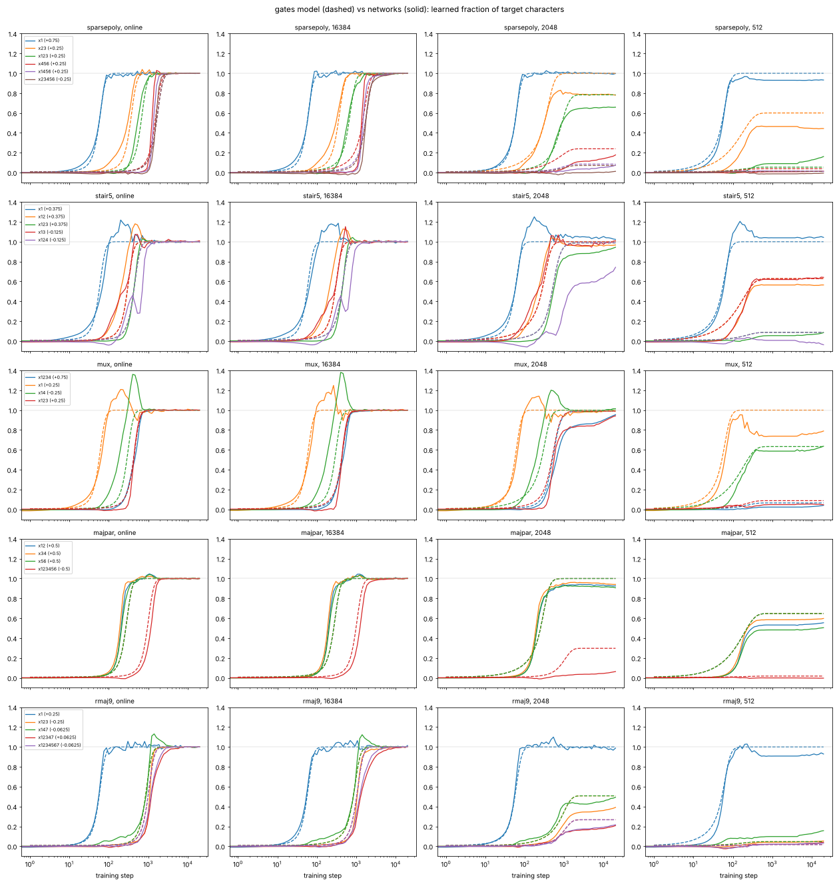

# `gates`: a feature-growth model of the learning trajectory

Status labels as in the project README: **Numerical** (measured here), **Heuristic** (argued, not proved).
The mechanism is Heuristic and the scores are Numerical. Everything is at one width (128), one input dimension (30)
and one optimizer setting (Adam, learning rate 1e-3), the setting of the trajectory runs.

## The model in a few sentences

The network's function at step $t$ is the least-squares fit of the target on the **gates** grown so far.
- Each gate is a first-layer ReLU feature on a set of relevant inputs. It carries a **bundle** of Fourier characters.
- Two more pieces are always present: the Hebbian linear unit, which the readout builds from the random first layer,
  and the output mean.

Gates **race**:
- Every unlearned character $\chi_U$ has an **order** $\kappa(U)$: the number of pieces it must be built from at once.
  A piece is a single input or (a subset of) an existing gate's support.
- Characters of equal order that share inputs form one bundle, and one gate grows them together.
- Every bundle aligns in parallel by the homogeneous saddle-escape law
  $\dot m = \eta\,\rho_B\,m^{\kappa-1}$ from a common initial overlap $m_0$, where $\rho_B$ is its correlation with the
  current residual. It **escapes** when $m=1$.
- Each escape changes the residual, the orders and the bundles, so the next escape is recomputed.
- The growth after an escape is a logistic in time.

At finite $n$:
- **Memorisation** removes the training residual on an Adam-normalised clock whose rate is $\propto 1/n$. The features
  run on the same slowed clock, so later stages saturate or never start.
- The network's **kernel background** learns a degree-dependent fraction $L_{|U|}(n)$ of what the features did not.
  This fraction comes from eigenlearning theory with the NNGP kernel, and has no fitted constant.

There are **5 fitted constants**: $\eta, T_1, m_0, c_w, c_{\rm mem}$. All five are global, fitted jointly on the 5
calibration targets × 4 conditions. Beyond them, at least 12 structural or "derived" choices were made with the
calibration networks or their scores in view, so the effective number of degrees of freedom is well above 5 (see
Independent verification).

**Scores** (calibration targets). `score.py` scores the model against the 3-seed mean of the networks (traj and onset).
For a like-for-like comparison with network-to-network variability, [`fair_scores.py`](../../fair_scores.py) scores the
model against single seeds, next to one seed scored against another (traj only):

| | model traj | model onset | model vs single seeds, traj | seed vs seed, traj |
|---|---|---|---|---|
| online | 0.007 | 0.091 | 0.0096 | 0.0070 |
| n = 16384 | 0.007 | 0.086 | 0.0096 | 0.0068 |
| n = 2048 | 0.016 | 0.168 | 0.0219 | 0.0163 |
| n = 512 | 0.009 | 0.304 | 0.0196 | 0.0307 |
| **mean** | **0.010** | **0.162** | | |

- An independent rerun of the network scores the seed-vs-seed value. A prediction equal to the networks' expected
  function would score about half of it.
- Online, at $n=16384$ and at $n=2048$ the model is 1.3–1.4× seed vs seed: further from a network than another seed is.
- At $n=512$ it is 0.64×, between a rerun and the exact expected function. There the seeds differ much from each other.
- So the model is not at the noise level. Its `score.py` traj is about 6× the irreducible error of the 3-seed-mean
  reference (≈ seed vs seed / 6: 0.0012 online, 0.0027 at 2048) online and at $n=2048$, and 1.8× at $n=512$ (0.0051).

The trivial step function scores traj 0.12–0.30 and onset 0.4–1.0. No script in the repository computes this baseline.

Files:
- [`gates.py`](gates.py): the model.
- [`predict.py`](predict.py): `python predict.py <fn> <out_dir>`, about 2 s per target.
- [`fit.py`](fit.py): the fit and the ablations.
- [`figure.py`](figure.py) draws [`figure.png`](figure.png).
- `fit_*.json`: the fit records.
- `preds/`: the calibration predictions and `scores.json`.



*Learned fraction (coefficient / target coefficient) of the largest characters. Solid lines are the networks (seed
mean), dashed lines the model. One curve per distinct (coefficient, bundle).*

## 1. What the networks do (the facts the model is built on, Numerical)

Read from `traj_*.npz` and `results/*.json`.

1. **The output mean is learned at a constant speed.** For sparsepoly (mean $-0.25$) the output mean moves linearly in
   $t$ up to step 14, at about 0.017–0.018 per step (the learned fraction of the constant rises about 0.07 per step, to
   0.95 at step 14). That is the speed derived in §2.6.
2. **The linear stage needs no first-layer feature.**
   - All linear characters switch on together at about 50–65 steps, whatever their size: x1 (0.75) at 56, stair5's
     x1 (0.375) at 65, mux's three 0.25s at 62, rmaj9's nine 0.25s at 50.
   - Meanwhile the first-layer weights on the relevant inputs barely move (about 15%). In sparsepoly online, the unit
     with the largest $|w_{x_1}|$ goes from 0.53 to 0.62 by step 75 (seed 0; 0.55 to 0.63 and 0.53 to 0.62 in the
     other seeds).
   - First-layer "feature types" appear only after the linear stage (STAGES.md).
   - So the linear function is built by the upper layers on the random first layer.
3. **Every nonlinear stage needs first-layer alignment, and its cost is set by how many pieces are combined.**
   Online half-learned steps, with the previous stage's step in brackets:
   - pairs from scratch: majpar 200, mux $x_ix_4$ 172, stair5 $x_1x_j$ 198, sparsepoly $x_2x_3$ 299;
   - one existing feature plus an input, or two features: sparsepoly $x_1x_2x_3$ 532 (299), stair5 degree 3 454 (198),
     mux degree 3–4 447 (172), sparsepoly's products of $x_4x_5x_6$ 1449 (1234);
   - three new inputs or three features: sparsepoly $x_4x_5x_6$ 1234, rmaj9 degree 3 ≈ 1000, majpar degree 6 1164 (200).
4. **Stages come as bundles.**
   - mux grows its three $x_ix_4$ together, and $x_1x_2x_3$ with $x_1x_2x_3x_4$.
   - stair5 grows $x_1x_2$ (+0.375) with $x_1x_3, x_1x_4, x_1x_5$ (−0.125).
   - rmaj9 grows its 3 within-block cubic characters with the 27 small cross-block ones.
   - sparsepoly grows the three products of $x_4x_5x_6$ with earlier terms right after it.
5. **Finite $n$ is a race against memorisation.**
   - Define $D_n(t)$ = training loss / population loss. It is almost target-independent: across the five targets it
     is 0.29–0.44 at step 174 for $n=512$ and 0.41–0.49 at step 532 for $n=2048$. It decays super-exponentially.
   - Each stage tracks the online curve until memorisation removes the training residual, then nearly freezes (it
     still creeps up slowly after interpolation, §5).
   - At $n=512$, every degree-2 character ends at 0.37–0.82 (seed means). That is about the level at which a kernel
     learns degree 2 at $n=512$ ($L_2 = 0.56$, §2.7).
   - At $n=512$ the degree ≥ 3 characters end at −0.05–0.24 (the highest: rmaj9 $x_2x_4x_8$ 0.24, stair5 $x_1x_2x_5$
     0.21).

## 2. The model and the reasoning behind it (Heuristic)

### 2.1 State and output

The state is a list of grown gates.
- Each gate has a **support** (a set of relevant inputs) and a **bundle** of target characters.
- Two pieces are always present: the Hebbian unit (all linear characters) and the mean.

The output is the least-squares fit of $y$ on the grown features, with each bundle weighted by its growth fraction
$\varphi_B(t)\in[0,1]$:
$$f_t(x_R)=\bar y\,\varphi_0(t)+\sum_B\varphi_B(t)\sum_{U\in B}\hat y_U\chi_U(x_R)\;(+\text{kernel background at finite }n).$$

The implementation represents a gate by the exact characters it adds, so the fit is a projection: a gate's ReLU
realisation is left implicit. The consequence (no overshoot) is discussed in §5.

### 2.2 Order of a character (composition)

A unit must align with all pieces of a character simultaneously before its gradient signal becomes first-order. This is
the homogeneous alignment law of the race model (`models/race.py`), $\dot m=\kappa U m^{\kappa-1}$.

A piece is either one input (found from a random overlap) or an existing gate. A gate's units already read its whole
support, so any subset of that support counts as one piece. Hence
$$\kappa(U)=\max\bigl(2,\ \min\#\{\text{pieces covering }U\}\bigr)\quad(|U|\ge2),\qquad\kappa=1\ (|U|=1).$$
- The floor of 2 says that a product always needs a new ReLU threshold: sharpening an existing gate is not free.
- The cover is a minimal set cover by gate supports and single inputs, computed exactly ($r\le10$).
- The Hebbian unit is not a gate: by fact 2 it builds no first-layer feature, so linear characters do not make their
  inputs "cheap".
- When a new gate lowers a character's order, its alignment restarts from $m_0$ along the new route.

Examples:
- sparsepoly $x_1x_2x_3$ = gate $\{2,3\}$ + input 1: order 2.
- majpar's degree-6 term = three pair gates: order 3.
- mux $x_1x_2x_3x_4$ lies inside the stage-2 gate's support $\{1,2,3,4\}$: order 2.
- rmaj9's cubic terms have no gate yet: order 3.

### 2.3 Bundles

Unlearned characters of equal order that share an input are one bundle (a connected component), and one gate grows
them together. A new gate gets the union of their supports. All linear characters form the Hebbian bundle.

This is what makes stair5's small $x_1x_3, x_1x_4, x_1x_5$ ride with $x_1x_2$, and rmaj9's cross-block cubics ride
with the within-block ones.

### 2.4 Timing: a parallel alignment race

Every bundle $B$ of order $\kappa\ge2$ has an overlap $m_B$. All bundles advance at the same time, each at its own rate:
$$\frac{dm_B}{dt}=\eta\,\rho_B\,m_B^{\kappa-1},\qquad m_B(0)=m_0,\qquad \rho_B=\frac{\|r_B\|}{\|r\|},$$
where $\|r_B\|^2=\sum_{U\in B}\hat y_U^2$ over the bundle and $\|r\|^2$ is the same sum over all unlearned characters.

$\rho_B$ is the correlation of the current residual with the bundle's function. It is a correlation, not a covariance,
because Adam normalises every update by the gradient's scale, so the drift depends on signal-to-noise.

A bundle escapes when $m_B=1$. Event-driven:
1. find the next escape;
2. advance every other bundle's $m$ along its own law;
3. mark the escaped characters learned, add the gate;
4. recompute orders, bundles and $\rho$.

At constant $\rho$ the escape times are:
- order 2: $\ln(1/m_0)/(\eta\rho)=135/\rho$ steps;
- order 3: $(1/m_0-1)/(\eta\rho)=680/\rho$ steps;
- order 4: $(m_0^{-2}-1)/(2\eta\rho)\approx5300/\rho$ steps.

The **Hebbian bundle** escapes at a fixed step $T_1$, the readout's capped Adam speed (fact 2). A single alignment law
for all orders was also tried (§4): it scores the same traj but worse onsets, because the linear stage's time hardly
depends on its size.

### 2.5 Shape of a transition

After its escape at step $T_B$, a bundle grows as $\varphi_B(t)=\bigl(1+e^{-(\tau(t)-T_B)/(c_wT_B)}\bigr)^{-1}$: a logistic
in time of width proportional to its escape step. With $c_w\approx0.2$, a stage rises from 10% to 90% over about
$0.87\,T_B$. The networks' 10–90% widths are 55–70 steps for the linear stage, 160–540 for the second and third stages,
450–920 for the late ones.
- The rule gets the early stages and majpar's degree-6 stage about right.
- It is too wide for later stages: sparsepoly $x_4x_5x_6$ 1280 against 455 in the networks, its products 1398 against
  713, mux's pairs 249 against 182. The networks' late transitions are 2–3× sharper.

### 2.6 Output mean (derived, no constant)

Under Adam every readout weight moves about $\mathrm{lr}_a=5\cdot10^{-4}$ per step in the direction
$\mathrm{sign}(\bar r\,\mathbb E h_{2,k})$. So the mean output moves by $V_0=N\,\mathrm{lr}_a\,\mathbb E[h_2]$ per step.
At initialisation, $\mathbb E[h_2]=\mathbb E\,\mathrm{relu}(\mathcal N(0,\tfrac12))=0.282$, so $V_0=0.018$ per step,
and $\varphi_0(t)=\min(1,V_0t/|\bar y|)$.

This matches sparsepoly's measured 0.017–0.018 per step (fact 1). It is the only calibration target with a nonzero
mean, so the constant matters mainly for held-out targets. It was checked only against sparsepoly, and the
initialisation-time $\mathbb E[h_2]$ was chosen knowing that slope. On the held-out networks (measured after the
freeze) the output mean moves faster: andxor 0.027, dnf3 0.022, dlist5 0.020 per step.

### 2.7 Finite training sets

**Memorisation drive.** $D_n(t)$ is the fraction of the training residual not yet memorised. Memorisation is a fit of
the training residual whose Adam step is normalised by Adam's own lagging second moment:
$$D_n'=-\frac{B}{c_{\rm mem}\,n}\,\frac{D_n}{\sqrt{\hat v}},\qquad \hat v_t=\frac{\mathrm{EMA}_{0.999}(D_n^2)}{1-0.999^t}.$$
- With $\beta_2=0.999$ (Adam's) and one constant, this reproduces the measured $D_n(t)$ at both $n=512$ and
  $n=2048$, including the super-exponential decay.
- Fitted on the training-loss curves alone, $c_{\rm mem}\approx25$ epochs. The joint score fit gives 24.6.

**Feature clock.** Feature growth is driven by the same training residual and normalised by the same lagging second
moment. So features run on the effective time
$$\tau(t)=\int_0^t D_n/\sqrt{\hat v}.$$
Its limit is $\tau_\infty\approx 198$ steps at $n=512$, 790 at $n=2048$ and 6300 at $n=16384$. Online, $\tau=t$.
Stages beyond $\tau_\infty$ never start, and stages around it stop partway.

**Kernel background.** The part of every character not learned by gates, $1-\varphi_U$, is learned by the network's
random-feature background at the eigenlearning learnability of its degree,
$$L_j(n)=\lambda_j/(\lambda_j+\kappa_n),\qquad n=\sum_j\binom dj\frac{\lambda_j}{\lambda_j+\kappa_n}.$$
- $\lambda_j$ are the hypercube eigenvalues of the 2-hidden-layer ReLU NNGP kernel at $d=30$.
- The background grows as memorisation proceeds, as a factor $1-D_n(t)$.
- $L_2=0.56$ and $L_3=0.03$ at $n=512$; $L_3=0.17$ at $n=2048$; $L_3=0.75$ at $n=16384$. There is no fitted constant.

## 3. Constants and how they were fitted

| constant | value | meaning |
|---|---|---|
| $\eta$ | 0.0198 / step | alignment rate per unit correlation (orders ≥ 2) |
| $T_1$ | 56.5 steps | escape step of the Hebbian (linear) bundle |
| $m_0$ | 0.069 | initial overlap of an alignment (all orders ≥ 2) |
| $c_w$ | 0.198 | transition width / escape step |
| $c_{\rm mem}$ | 24.6 epochs | memorisation time scale: initial rate $B/(c_{\rm mem}n)$ |

Fixed or derived, not fitted by the optimiser (but several were chosen with the calibration networks or scores in view;
see Independent verification):
- $V_0=0.018$ per step;
- Adam's $\beta_2=0.999$ in the memorisation and feature clocks;
- the NNGP learnabilities;
- the composition, bundle and restart rules.

**Fit.** Nelder–Mead in log-parameters on the joint objective mean traj + 0.1 × mean onset (onset in decades). It
covers the 5 calibration targets × 4 conditions, against the same metrics as `score.py`. A fit takes about 2 minutes.

Restarts from three different points converged to the same optimum within 0.1% of the objective. This was checked only
on an earlier variant of the law, not on the reported model.

**Leave-one-target-out (Numerical).** Refitting the five constants without one target and scoring that target:

| held-out target | full fit: traj / onset | fit without it: traj / onset |
|---|---|---|
| sparsepoly | 0.0048 / 0.148 | 0.0049 / 0.154 |
| stair5 | 0.0166 / 0.203 | 0.0205 / 0.217 |
| mux | 0.0080 / 0.090 | 0.0082 / 0.096 |
| majpar | 0.0111 / 0.250 | 0.0124 / 0.267 |
| rmaj9 | 0.0100 / 0.119 | 0.0114 / 0.233 |

The constants stay within $\eta$ 0.017–0.023, $T_1$ 55–61, $m_0$ 0.059–0.080, $c_w$ 0.16–0.21 and $c_{\rm mem}$
19–26.
- For sparsepoly, mux and majpar, leaving the target out costs little.
- For rmaj9 the onset score doubles (0.119 → 0.233), and stair5's traj rises 23% (0.0166 → 0.0205).
- The LOO fits start Nelder–Mead at the full-data optimum (`fit.py`: `x0 = log(G.PARAMS)`), and every structural choice
  was made with all five targets in view. So this tests only the stability of the five constants, not of the structure.

## 4. Results (Numerical)

### 4.1 `score.py` on the calibration targets

| target | cond | traj | onset | final | zero-function traj |
|---|---|---|---|---|---|
| sparsepoly | online | 0.003 | 0.052 | 0.000 | 0.528 |
| sparsepoly | 16384 | 0.003 | 0.027 | 0.000 | 0.524 |
| sparsepoly | 2048 | 0.006 | 0.003 | 0.009 | 0.429 |
| sparsepoly | 512 | 0.007 | 0.510 | 0.010 | 0.361 |
| stair5 | online | 0.011 | 0.129 | 0.000 | 0.465 |
| stair5 | 16384 | 0.011 | 0.122 | 0.000 | 0.459 |
| stair5 | 2048 | 0.037 | 0.305 | 0.022 | 0.335 |
| stair5 | 512 | 0.008 | 0.255 | 0.010 | 0.142 |
| mux | online | 0.007 | 0.104 | 0.000 | 0.493 |
| mux | 16384 | 0.007 | 0.104 | 0.000 | 0.491 |
| mux | 2048 | 0.010 | 0.092 | 0.001 | 0.414 |
| mux | 512 | 0.008 | 0.060 | 0.008 | 0.152 |
| majpar | online | 0.008 | 0.117 | 0.000 | 0.460 |
| majpar | 16384 | 0.008 | 0.125 | 0.000 | 0.456 |
| majpar | 2048 | 0.012 | 0.097 | 0.021 | 0.330 |
| majpar | 512 | 0.016 | 0.662 | 0.016 | 0.121 |
| rmaj9 | online | 0.007 | 0.052 | 0.000 | 0.523 |
| rmaj9 | 16384 | 0.007 | 0.050 | 0.000 | 0.521 |
| rmaj9 | 2048 | 0.018 | 0.343 | 0.033 | 0.416 |
| rmaj9 | 512 | 0.007 | 0.032 | 0.012 | 0.369 |
| **mean** | | **0.010** | **0.162** | | |

Per condition (traj / onset): online 0.007 / 0.091; 16384 0.007 / 0.086; 2048 0.016 / 0.168; 512 0.009 / 0.304.

The large finite-$n$ onset errors are partly near-threshold effects and partly real timing and level misses:
- **Near threshold: majpar at $n=512$ (0.662).** Its pairs end at 0.50–0.60 in the networks and at 0.65 in the model.
  No character crosses one half in only one of the two. But $x_5x_6$ creeps across one half only at step 15632 in the
  networks, a 1.8-decade two-sided error.
- **Partly threshold, partly level: rmaj9 at $n=2048$ (0.343).** Characters crossing in only one of model and network
  contribute 0.10 of the 0.34. Per character (seed means), the three within-block cubics (−0.25) end at 0.35–0.39 and
  never cross one half; the 27 cross-block cubics end at 0.49–0.68. The model's uniform 0.51 is too high for the
  large characters and too low for the small ones. The bundle-level agreement (0.51 against 0.45, §4.2) hides these
  opposite errors.
- **A real miss: stair5 at $n=2048$ (0.305).** No one-sided crossings. Its degree-4/5 characters cross one half at
  steps 1141–13884 in the networks against 514 in the model, because the model saturates at 0.99 where the networks
  creep to 0.60–0.79 (§5).

One seed scored against the mean of the other two has onset error 0.35 at $n=512$. This is not directly comparable
with the model's onset, which is scored against the 3-seed mean.

### 4.2 Stage by stage

The steps are the half-learned step of the bundle, weighted by coefficient².

| target | bundle (order) | online: model / net | n=2048 final: model / net | n=512 final: model / net |
|---|---|---|---|---|
| sparsepoly | x1 (1) | 56 / 56 | 1.00 / 1.00 | 1.00 / 0.93 |
| | x2x3 (2) | 351 / 299 | 1.00 / 0.78 | 0.60 / 0.44 |
| | x1x2x3 (2) | 653 / 532 | 0.78 / 0.66 | 0.05 / 0.16 |
| | x4x5x6 (3) | 1472 / 1234 | 0.24 / 0.18 | 0.04 / 0.01 |
| | x4x5x6 × {x1, x2x3, x1x2x3} (2) | 1607 / 1449 | 0.08 / 0.04 | 0.01 / 0.00 |
| stair5 | x1 (1) | 56 / 65 | 1.00 / 1.02 | 1.00 / 1.04 |
| | x1·{x2,x3,x4,x5} (2) | 293 / 198 | 1.00 / 0.97 | 0.63 / 0.58 |
| | all of degree 3–5 (2) | 428 / 533 | 0.99 / 0.83 | 0.08 / 0.04 |
| mux | x1, x2, x3 (1) | 56 / 62 | 1.00 / 0.99 | 1.00 / 0.96 |
| | x1x4, x2x4, x3x4 (2) | 286 / 172 | 1.00 / 1.02 | 0.63 / 0.59 |
| | x1x2x3, x1x2x3x4 (2) | 421 / 447 | 0.99 / 0.95 | 0.07 / 0.04 |
| majpar | x1x2 / x3x4 / x5x6 (2, three bundles) | 270 / 189–210 | 1.00 / 0.93 | 0.65 / 0.55 |
| | x1..x6 (3) | 949 / 1164 | 0.30 / 0.06 | 0.02 / 0.00 |
| rmaj9 | 9 linear (1) | 56 / 50 | 1.00 / 0.99 | 1.00 / 0.97 |
| | 30 cubic, within and cross-block (3) | 849 / 999 | 0.51 / 0.45 | 0.05 / 0.09 |
| | 37 of degree 5–9 (2) | 984 / 1152 | 0.27 / 0.22 | 0.02 / 0.02 |

### 4.3 Which ingredients matter (ablations; each refitted with the same procedure)

| variant | fitted constants | traj | onset | online traj / onset | 2048 | 512 |
|---|---|---|---|---|---|---|
| **model** | 5 | **0.010** | **0.162** | 0.007 / 0.091 | 0.016 / 0.168 | 0.009 / 0.304 |
| order = degree of the character (no composition) | 5 | 0.016 | 0.229 | 0.015 / 0.159 | 0.025 / 0.276 | 0.009 / 0.319 |
| no bundles (every character its own gate) | 5 | 0.020 | 0.274 | 0.017 / 0.220 | 0.030 / 0.317 | 0.017 / 0.334 |
| no kernel background | 5 | 0.013 | 0.153 | 0.007 / 0.081 | 0.024 / 0.193 | 0.013 / 0.253 |
| no memorisation (online prediction for every $n$) | 4 | 0.065 | 0.334 | 0.009 / 0.112 | 0.056 / 0.415 | 0.185 / 0.704 |
| plain feature clock $\tau'=D_n$ (no Adam normalisation) | 5 | 0.009 | 0.179 | 0.007 / 0.083 | 0.012 / 0.254 | 0.009 / 0.298 |
| one gradient-flow law for all orders (no separate $T_1$) | 4 | 0.010 | 0.197 | 0.008 / 0.094 | 0.014 / 0.257 | 0.011 / 0.348 |
| one Adam-saturated law $\eta S(\beta\rho m^{\kappa-1})$ for all orders | 5 | 0.013 | 0.172 | 0.008 / 0.088 | 0.021 / 0.187 | 0.012 / 0.324 |

- **Essential:** composition, bundles and the memorisation clock. Removing composition raises traj 1.6× (onset 1.4×),
  removing bundles 2.0× (onset 1.7×), removing memorisation 6.4× (onset 2.1×).
- **The kernel background:**
  - It lowers traj at finite $n$, mainly by raising degree-2 characters at $n=512$ to the observed 0.37–0.82.
  - It makes onsets slightly worse.
  - It lets the memorisation constant take the value measured on the training-loss curves (24.6, against 25).
    Without it, the fit needs 32.
- **The Adam-normalised feature clock and the plain one are a wash:**
  - The Adam clock is better on onsets; it lets rmaj9's cubic bundle reach the network's bundle-level 0.45 at
    $n=2048$.
  - The plain clock is better on traj (0.0087 against 0.0101), with a near-equal objective (0.0266 against 0.0263); it
    keeps majpar's degree-6 term near 0 at $n=2048$, as in the networks.
  - The Adam clock is kept because it applies the same normalisation as the memorisation law. The choice was made with
    these calibration scores in view.

## 5. Qualitative phenomena

**Reproduced:**
- **Staging and plateaus.** Escapes are separated because orders differ and $\rho$ jumps after each escape.
- **Order of the stages** for all five targets. Examples:
  - sparsepoly x1 → x2x3 → x1x2x3 → x4x5x6 → its products;
  - stair5 degree by degree, with degrees 3–5 merged (see failures);
  - mux linear → $x_ix_4$ → parity branch;
  - majpar pairs → degree 6;
  - rmaj9 linear → all cubics → the rest.
- **Bundles,** including characters of opposite sign or much smaller size riding with the large ones: stair5's −0.125
  pairs, rmaj9's −0.0625 cross-block cubics, and sparsepoly's three products with $x_4x_5x_6$.
- **Finite-$n$ saturation:**
  - Late stages stop partway or never start, with the right ordering across $n$.
  - Degree-2 characters end at about 0.6 at $n=512$.
  - The $n=2048$ levels of sparsepoly's later stages and of rmaj9's bundles are close. Exceptions: sparsepoly $x_2x_3$
    (1.00 against 0.78) and $x_1x_2x_3$ (0.78 against 0.66) are too high, and rmaj9 agrees only at bundle level, not
    per character (§4.1).
  - The online and $n=16384$ trajectories coincide, as in the networks.
- **The memorisation curve** $D_n(t)$ itself (fact 5), at both $n$, from one constant.

**Not reproduced:**
- **Overshoot.** The networks transiently push the previous stage's characters 15–36% past their value while the next
  stage grows. Examples: stair5's x1 to 1.2, mux's $x_ix_4$ to 1.36, rmaj9's cross-block cubics to 1.13.
  - In the model the features are the exact character bundles, so least squares is a projection and
    $\varphi\le1$.
  - This overshoot cannot come from least squares on any span. The networks' mux plateau at step ≈ 250 has linear
    coefficients 1.2× the target while the linear direction is in the span. So it is an out-of-equilibrium lag of the
    old readouts, not a best fit.
  - Modelling it would need explicit ReLU realisations of the gates and a readout lag.
- **The output mean's overshoot** (sparsepoly's constant to 1.3 at step ≈ 30).
- **Spurious relevant mass and dependence on irrelevant inputs.** The model predicts only $E[f\mid x_R]$, and only on
  the target's characters.
- **Within-bundle spread.** stair5's degrees 3, 4 and 5 are one bundle in the model, half-learned at 428. In the
  networks they are at 454, 628 and 622.
- **Gradual early rise of rmaj9's cross-block cubics** (0.05–0.3 between steps 100 and 700, the Hebbian direction
  sharpening). The model has one logistic for all cubics.
- **Slow learning after interpolation at finite $n$.** For example, stair5's degree-4 characters at $n=2048$ climb
  from 0.33–0.64 at step 3000 to 0.60–0.79 at step 20000. The model freezes once $D_n\to0$.

## 6. Failure modes and caveats

1. **Pairs found from scratch come late, by 1.2–1.7×:** mux $x_ix_4$ 286 against 172, stair5 293 against 198,
   majpar 270 against 200, sparsepoly $x_2x_3$ 351 against 299. Moves through an existing gate are on time or early for
   stair5, mux, majpar and rmaj9, but late in sparsepoly: $x_1x_2x_3$ 653 against 532 (1.23×), the products of
   $x_4x_5x_6$ 1607 against 1449 (1.11×). One $(\eta,m_0)$ cannot place both.
   - A smaller initial overlap for moves through a gate, $m_0\sqrt{d/N}$, was tried. Its calibration objective was
     better: 0.0252 against 0.0263.
   - It made majpar's three-gate composition far too late (1615 against 1164), so it was not adopted, although it
     scored better.
2. **Collapse.** Once a gate's support covers all relevant inputs, every remaining character has order 2 and is learned
   in one bundle.
   - This is right for mux and rmaj9 and too coarse for stair5 (§5).
   - For held-out targets with rich high-degree structure (dnf3, rand3) the model predicts everything done by about
     step 350. That is the riskiest prediction.
3. **Bundling by shared inputs** can merge weakly coupled structure. For dnf3, the within-block and the 7× smaller
   cross-block pairs form one bundle.
4. **The Hebbian stage is at a fixed step $T_1$** whatever the size of the linear part. This is untested for targets
   whose linear part is tiny.
5. **Finite $n$ enters only through the memorisation clock and the kernel.**
   - The model has no sampling noise in gate directions and no $n$-dependent acceptance threshold (the minimal
     model's $n\rho^2>cN(\kappa)$).
   - A feature beyond the memorisation horizon is simply not reached.
   - The NNGP learnabilities are infinite-width ones.
6. **Not transferable without refitting:**
   - $d$: the alignment picture says $m_0\propto d^{-1/2}$, but $m_0$ was fitted at $d=30$ only.
   - Width, optimizer, learning rate: $T_1$, $V_0$ and $c_{\rm mem}$ are Adam- and width-specific.
7. **No feedback during a transition.** The race is event-driven: the utilities of other bundles use the residual after
   whole escapes, not the partially grown function.

## 7. Predictions for the held-out targets (frozen model, recorded before any held-out network was run)

Escape steps online, with order and the largest characters of each bundle:

- **andxor** = AND(x1x2, x3x4), mean −0.50: 234 (2): x1x2 and x3x4, separately and simultaneously; 369 (2): x1x2x3x4.
- **dlist5** (decision list), mean +0.31: 56 (1): all linear; 189 (2): pairs x1x2, x2x3, x1x3, x2x5, …;
  324 (2): degree 3–5 (16 characters).
- **parmaj** = MAJ3 ⊕ MAJ3: 180 (2): the 9 cross pairs; 315 (2): degree 4 and 6.
- **dnf3**, mean −0.34: 56 (1): linear; 182 (2): 36 pairs; 316 (2): the remaining 466 characters.
- **rand1**, mean +0.12: 56 (1): x1, x3, x5; 258 (2): x3x5, x1x3, x1x5; 279 (2): x4x6; 410 (2): the remaining 8.
- **rand3**: 56 (1): x5; 222 (2): x5x6, x4x5, x1x5, …; 357 (2): the remaining 26.

At finite $n$, every bundle escaping after step ≈ 200 is predicted to stay well below 1 at $n=512$; degree-2 ones end
near 0.6.

*Note added at verification (25 October 2026); the text of this section above is unchanged since the freeze. "Near 0.6"
is loose: the model's own $n=512$ finals for the degree-2 bundles escaping after step 200 are 0.64–0.72 (andxor 0.70,
rand3 0.72, rand1 0.66 and 0.64).*

## Reproduction

```
cd study/trajectories/models/gates
export OPENBLAS_NUM_THREADS=1
python fit.py full                                # the fit (writes fit_full.json); other modes: see fit.py
for f in sparsepoly stair5 mux majpar rmaj9; do python predict.py $f preds; done
python ../../score.py preds                       # the table in 4.1
python figure.py                                  # figure.png
```

## Independent verification (25 October 2026)

An independent verifier re-ran the model and checked this file against the code and the network data. The corrections
above (the like-for-like scores, the ablation ratios, the onset-error breakdown, the widths, the LOO caveat, and the
numbers in facts 1, 2 and 5, §4.1, §5 and §6.1) come from that check.

**Reproduction.** The scores reproduce exactly from the frozen commit `19da14d6`.
- `git diff 19da14d6` is empty for this folder, and `boolfuncs.py`, `score.py` and `analyze_traj.py` are unchanged
  since the freeze.
- Regenerating with the frozen `predict.py` gives bit-identical prediction files for the calibration targets checked
  (sparsepoly, majpar) and for all six held-out targets (24 files).
- `score.py` then matches `preds/scores.json` and `heldout_scores/gates.json` with zero difference: calibration
  0.0101 / 0.162, held-out 0.0119 / 0.210.

**Leakage.** No code path reads network results.
- `predict.py` imports only `gates.py`. `gates.py` imports numpy, scipy and `boolfuncs.make_suite`, and reads no files.
- The only target-dependent inputs are the truth table, the relevant set and $n$. There are no per-target branches or
  parameters.
- `fit.py` and `figure.py` read network trajectories, but only for the calibration targets, and `predict.py` does not
  import them.
- The held-out predictions existed byte-identically about 3 h before the first held-out trajectory file was written.

**What was fitted or chosen with the calibration networks in view.** 5 continuous constants were fitted by
Nelder–Mead ($\eta, T_1, m_0, c_w, c_{\rm mem}$; $T_1$ is in effect the measured 50–65-step linear-stage time, and
$c_{\rm mem}\approx25$ was first estimated from hand-entered network $D_n(t)$ values). At least 12 further choices were
made with the calibration networks or their scores in view, several of them labelled "derived" or "not fitted" above:
1. the timing law `hebb`, with a separate fixed step $T_1$ for the linear stage, selected over the `gf` and
   Adam-saturated single-law variants by calibration score;
2. $V_0$ (§2.6), checked only against sparsepoly, with the initialisation-time $\mathbb E[h_2]$ chosen knowing the
   0.018 slope;
3. the form of the memorisation law (Adam-normalised, lagging $\hat v$ with $\beta_2=0.999$), chosen to reproduce the
   measured super-exponential $D_n(t)$;
4. the Adam rather than the plain feature clock (§4.3);
5. rejecting the DEPTH2 variant (§6.1), although its calibration objective was better;
6. the kernel background (NNGP rather than NTK, 2 hidden layers, applied to $(1-\varphi)(1-D_n)$, excluding the
   constant), which has no fitted constant but whose form was chosen on the data;
7. the composition rules ($\kappa=\max(2,\text{min cover})$, a subset of a gate's support is one piece, the Hebbian unit
   is not a gate);
8. the restart rule when a character's order drops;
9. bundling by equal order and shared inputs, with the bundle's overlap the maximum over its members;
10. a logistic transition of width proportional to the escape step, from widths measured on the networks;
11. $\rho$ as a correlation rather than a covariance;
12. the 0.1 onset weight in the objective.

At least three timing laws and several switches were iterated against the calibration scores, so the effective number
of degrees of freedom is well above 5.

**The held-out targets were not new to the project.** All six (andxor, dlist5, parmaj, dnf3, rand1, rand3) had been
trained before, in the project's earlier fixed-$n$ study (same width-128 muP MLP, Adam at learning rate 1e-3, batch 64,
$n$ up to 16384). Its coarse onsets are in `study/nn_summary.json` and `NN-STUDY-TABLES.md`, for example parmaj's cross
pairs at step 200 and andxor's $x_3x_4$ at 200 and $x_1x_2$ at 500. That data was available while the model was
designed, but no code or design script of this model reads it.

**The model's own held-out outputs were viewed during design.** Before the freeze, the escape skeleton of every suite
target, held-out ones included, was printed with an earlier parameter set, and full predictions for all suite targets
were written. §6.2–6.3 discuss the held-out predictions for dnf3 and rand3. No held-out network trajectory was involved.

**Like-for-like scores on the held-out targets** (`fair_scores.json`, traj; model against single seeds, then seed
against seed): online 0.0105 against 0.0054 (1.9×); $n=16384$ 0.0108 against 0.0055 (1.9×); $n=2048$ 0.0205 against
0.0111 (1.8×); $n=512$ 0.0252 against 0.0360 (0.70×). Relative to seed vs seed, the model does worse on the held-out
targets than on the calibration targets: 1.8–1.9× against 1.3–1.4× online and at $n\ge2048$, 0.70× against 0.64× at
$n=512$.

**Held-out outcome** (no claim about it in this file before the runs). Online traj is 0.009. The final collapse bundles
(§6.2) come 1.3–1.8× early: dnf3 316 against 560, parmaj 314 against 501, dlist5 323 against 516. dnf3 is the weakest
target (onset 0.81 at $n=2048$).

**Claims not backed by a script.** No script in the repository computes the step-function baseline quoted at the top,
and the restart check in §3 was made on an earlier law, not on the reported model.

The verifier's scripts are in the session scratchpad (`verify_gates/`), not in the repository.
