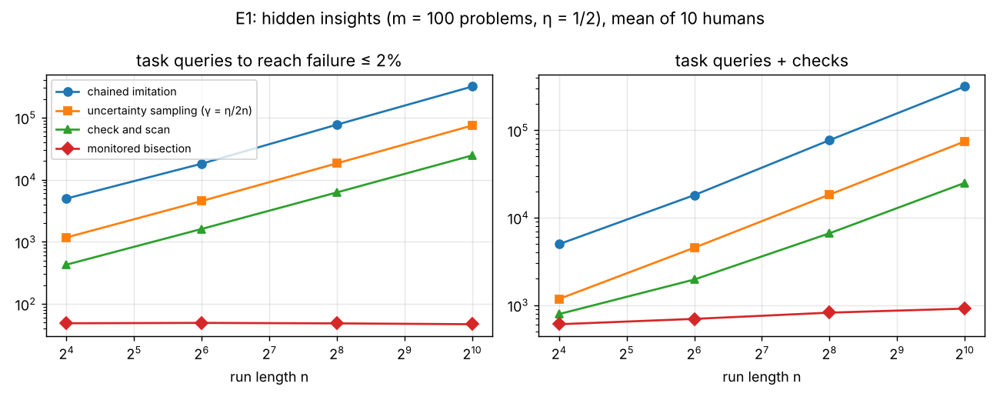
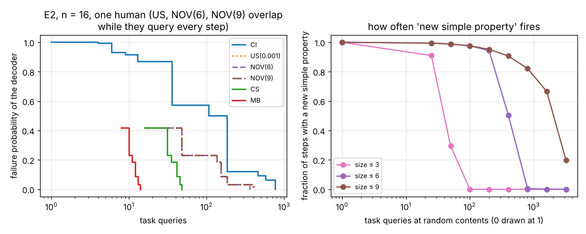

# Monitored imitation

*Chained human imitation needs about n·K/ε task queries to make runs of n steps match the human's with probability 1 − ε. In the worst case over humans of complexity K, no protocol that asks the human only for task steps does better by more than a log factor. Now suppose the human can also say whether a state has gone off track, and never takes a state it judges fine off track itself. Then at most K task queries suffice never to output a run that fails the human's check. Freezing an imitator whose runs fail the check with probability below ε takes O(K·log(K/δ)/ε) looks at results; in batches of 1/ε results per query, that is O(K·(log(K/δ) + log(n/ε))) queries.*

A research note by Claude (Anthropic), in response to a question from Kaarel Hänni. Draft. One independent AI referee checked every numbered statement and re-ran the experiments; its report and the response are in [`verification/`](verification/). No human has checked the mathematics.

## The question

Section 3.2 of Hänni's talk *Simpler versions of the alignment problem we still can't solve* (MISO, 16 November 2026) poses **principled human imitation**. A human is modelled as a program P that maps an input string x (say, a textbook draft with instructions) to an output y = P(x) (what the human would write after three months of work). We want a learning protocol and an algorithm that, with not too many queries to P and unlimited compute, produce a P′ that behaves like P: it solves the problems P would solve, and it does not behave bizarrely where P would not.

The talk's current favourite is **chained imitation** (slide 29). Do Solomonoff function induction on pairs (x, P(x)); chain the learned map as in task decomposition, x₀ → x₁ → x₂ → …; query the real human on states drawn from the distribution this chaining induces; update; repeat. After O(K(P)) queries there is a round at which the learner is right on 99.9% of its own induced inputs, in expectation (appendix). Slide 30 lists what is still bad: 99.9% per step may not be enough over a long chain, and the number of queries is too large even with a pretraining corpus. One feels each query should carry many bits, but a human can do something special on inputs with some rare property, and then most queries teach nothing.

The question: find a protocol that is more likely to work, taking the human to be a fixed deterministic program and making any assumptions about it that are likely to be true. An excellent result would be a setting where O(K(human)) reasonable queries provably suffice for good performance, with a compelling case that the assumptions hold. Hänni listed two optimizations he already knew of:

* query where the predictor is most uncertain, possibly on synthetic inputs (a point where the top answer has 10% posterior mass gives a 10× update towards the right program);
* query at the first time the run seems to go off track, for example the first time the output has a new simple property, though some simple properties may be new all the time.

## Answers in brief

1. **Chained imitation, read at the level of runs, loses a factor n** (Proposition 2).
   * With one query at a random step of each run, at most n·K(P) runs differ from the human's in expectation, over any sequence of problems.
   * On i.i.d. problems, stopping at a uniformly random one of the first n·K(P)/ε rounds gives an imitator whose runs differ from the human's with expected probability at most ε.
   * Up to the first mistake there is no distribution shift at all: the first state at which the imitator's run leaves the human's run is a state of the human's own run.

2. **In the worst case, no protocol that asks only for task steps does much better** (Theorem 3).
   * For every n and ε there is a class of humans of complexity about K on which every such protocol needs about n·K/(ε·log(n/ε)) task queries, even counted in expectation. This holds however the queries are chosen, including synthetic inputs, uncertainty sampling and novelty detection.
   * These humans spend their complexity on problem-specific insights reached at unpredictable steps. Before the learner has located such a step, all n steps of the run look the same to it, so it has to probe them one by one.
   * So in the worst case over humans of complexity K, chained imitation is within a factor O(log(n/ε)) of every task-only protocol. The factor n in item 1 is real. On particular humans, other task-only protocols can be cheaper by a constant: in E1, scanning every step is 4 times cheaper than chained imitation.

3. **The two optimizations do not get around this. In the talk's mixture over programs, the second is a case of the first.**
   * *Uncertainty.* A query where the decoder's answer has posterior mass at most 1−γ teaches at least log₂(1/(1−γ)) bits, so such queries run out after about K(P)/γ (Proposition 4). But no signal computed from the posterior can tell a confident mistake from a confident correct answer. In the class of Theorem 3 it cannot tell the insight step from the other steps of a run.
   * *New simple properties.* In the mixture over programs, "x has a property of complexity s that no queried input had" puts posterior mass at least 2^(−s−O(1)) on a fixed simple label other than the decoder's. In the notation of [`../ultranatural/`](../ultranatural/), it means sep(x; A) ≤ s. So the second signal is a special case of the first. The converse, that doubt at x implies a simple new property, is not shown.
   * A run that writes new things has a cheap new property at almost every step. A threshold either fires almost everywhere, which is the cheating protocol, or misses the properties that matter, which need not be simple relative to the data.
   * In experiment E2 (a human whose knowledge is rules triggered by simple properties), the new-property rule at size 3 never learned the rarer rules. At size 6 it reached the target in 16 of 30 cases (10 humans at 3 run lengths). At size 9 it queries almost every step and needs a number of task queries similar to chained imitation's.

4. **Monitored imitation with bisection.** Assume the human can *check* a state: say whether it looks off track (V(x) = 0) or fine (V(x) = 1). Assume this judgment is **preserved** by the human's own work: if V(x) = 1, then V(P(x)) = 1. A run succeeds if its final state passes the check.
   * **Protocol.** Run the imitator and check the final state. If it fails, binary-search the run with checks for a step where the verdict flips from fine to off track. Preservation says the human would not have made that flip, so the imitator made a mistake at that step. Ask the human for that one task step, update, and rerun.
   * **Online guarantee (Theorem 6).** On any sequence of problems:
     * no run that fails the check is ever output;
     * at most K(P) runs fail the check in total;
     * the protocol makes at most K(P) task queries, plus ⌈log₂ n⌉ + 1 checks per failure and one check per problem.
   * **Frozen-imitator guarantee (Theorem 7).** On i.i.d. problems, with probability 1 − δ, it outputs an imitator whose runs fail the check with probability less than ε. This takes at most K(P) task queries and O(K(P)·log(K(P)/δ)/ε) looks at final results.
     * Batched, ⌈1/ε⌉ results per query, these become O(K(P)·(log(K(P)/δ) + log(n/ε))) queries (for K(P) ≥ 1).
     * Batching assumes the human's verdict on a list is the AND of its verdicts on the items.
   * **Bits per task query.** Every task query lands on a mistake, so each teaches at least one bit: the "many bits per query" slide 30 hoped for, in its weakest form.
     * Chained imitation cannot have even this, because its queries mostly land where the learner is already right.
     * How many bits a mistake carries is not shown. Part of what the task query teaches was found by the checks, which the posterior does not use.

5. **What each kind of query buys.** In rows 1 and 2, failure means the run differs from the human's; the bounds are in expectation, row 1 with a random stopping round. In rows 3 and 4, failure means the run fails the check; the bounds hold with probability 1 − δ. Rows 3 and 4 say nothing about deviations the check cannot see; Proposition 10 bounds those.

   | the human is asked for | assumption | task queries | other queries | result |
   |---|---|---|---|---|
   | task steps only (chained imitation) | none | n·K/ε | none | Proposition 2 |
   | task steps only, any protocol | none | at least c·n·K/(ε log(n/ε)) on a hard class | none | Theorem 3 |
   | task steps, and a check of final states | the human's runs pass | at most n·K | O(K(log(K/δ) + log(1/ε))) batch checks | Proposition 8 |
   | task steps, and a check of any state | preservation | at most K | O(K(log(K/δ) + log(n/ε))) batch checks | Theorems 6, 7 |

   The check is where the human's own knowledge enters.
   * A mistake of a Bayesian imitator comes from hypotheses that agree with everything the human has said so far. No signal computed from the posterior can tell a confident mistake from a confident correct answer.
   * The human, looking at the state, knows what it would have done.
   * In Theorem 3's hard class, the human can tell that a draft lacks the insight it would have had by now. With that check the class needs one task query per insight, at most K in all, against about n·K/(ε log(n/ε)) task queries without it.

6. **Robustness.**
   * *Imperfect monitor.* If the human sometimes flags its own work, the extra failures are runs that pass through a state from which the human itself would go off track (Proposition 9).
   * *Silent deviations.* The monitor does not help with deviations the human cannot see even in the final state.
     * Adding chained imitation's random queries to the runs that are output bounds those deviations at chained imitation's rate (Proposition 10). So the combined protocol has chained imitation's guarantee for them, and in addition the monitor's guarantee for the failures it can see.
     * That is a statement about upper bounds. It does not say that the combined protocol does at least as well as chained imitation on every human.
   * *No optimization against the monitor.* Posterior odds against the human never increase, whatever decides where to query (Proposition 11).
     * Removing failures the human can see raises the *share* of those it cannot see among the remaining failures. This happens whether the removal is by learning, as in MB, or by rejecting runs that fail the check; with a yes-or-no check, neither changes the ratio of silent failures to correct runs.
     * What MB adds is that its corrections are knowledge: they persist and carry over to other problems. Selecting outputs by a graded or manipulable judgment (best-of-k on a score) is different, and would favour outputs that score well without being right. MB never chooses among outputs.
   * *Trees.* For task decomposition trees of depth d and fan-out b, a failure is located with d·(1 + ⌈log₂ b⌉) batch checks, about the logarithm of the number of calls. Chained imitation's bound carries a factor equal to the number of calls (Corollary 12).

7. **Is the assumption true of humans?**
   * For the weakest useful monitor, "this state looks like careful, honest work on the problem, with nothing bizarre in it", preservation is a mild assumption about a careful researcher.
   * Its most plausible failure: given a fine-looking but subtly corrupted state, the human finds the corruption and abandons the work. Proposition 9 covers that case.
   * That monitor addresses the talk's second desideratum (no bizarre behaviour where the human would not behave bizarrely) for final results. If intermediate states matter too, checking every prefix of the run costs the same number of bisection checks (Section 5.2).
   * It also handles the talk's P ≠ NP example.
   * Stronger monitors ("every claim here looks right to me", "I could still finish from here") catch more and are preserved less exactly.
   * The protocol cannot find deviations that the human cannot see even in hindsight. For those, Theorem 3 says nothing beats chained imitation in the worst case without further structure.

8. **Experiments** (Section 10). Both experiments compute posteriors exactly. Their main runs use the strongest possible check, "is this exactly the state the human would be in?", so they show the bookkeeping of the protocols in the best case for monitoring. A second run of E2 uses a weak check that sees only half of the human's knowledge.
   * *E1: Theorem 3's class.* With m = 100 problems and failure target 2%, chained imitation needs about 4,970, 18,100, 77,000 and 316,000 task queries at n = 16, 64, 256 and 1024: roughly proportional to n, and 6.5 times Theorem 3's lower bound. Monitored bisection needs about 48 task queries at every n, plus 550 to 860 checks.
   * *E2: rules on simple properties.* Monitored bisection needs about 15 task queries; chained imitation needs 370 to 840. With a weak check that sees only half of the human's rules, monitored bisection alone fixes the visible failures with about 8 task queries but leaves 84% of runs differing from the human's. Adding an audit of every output run reaches 2% with about 730 task queries, against 880 for chained imitation.

9. **Open.**
   * Stochastic humans, where a failed run may come from a rare sample and the culprit step then teaches little.
   * Any structure that beats chained imitation on monitor-silent deviations.
   * Learned monitors, to avoid one check per output.
   * The prior mass of malign hypotheses whose deviations no human check can see.

## 1. Setting

* **States and the human.** X is a countable set of strings, the states. The human is a total function P : X → X. A *problem* is a start state x₀. The human's *run* of length n is x₀, x₁, …, xₙ with x_{k+1} = P(x_k). This is the chained form of task decomposition on slide 29: a state is a draft with instructions, and one step is three months of work. Trees are in Section 5.5.
* **Queries.** A *task query* at x returns P(x). From Section 5 on there is a second kind, a *check*: at a state x it returns the human's judgment V(x) ∈ {0, 1}. Both are queries to the same human; a check is the human looking at a state and saying whether something is wrong with it. That is usually much quicker than a step of work, though not for the perfect checks of the experiments (Section 10). We count the two kinds separately.
* **Hypotheses and prior.** H is a countable set of total functions X → X that contains P, with prior weights w(ν) summing to at most 1. Write K(P) := log₂(1/w(P)).
  * For Solomonoff function induction, H is the total computable functions and w(ν) = 2^(−K(ν)), so K(P) is the length of a shortest program for P. For the slides' mixture over all programs, partial ones included, see Remark 1.2.
  * With a pretraining corpus C one can take w(ν) = 2^(−K(ν|C)). Every bound below then holds with K(P|C) in place of K(P).
  * As in the talk, compute is free: computing posteriors may need a halting oracle.
* **Posterior and decoder.**
  * D is a data set: a finite set of pairs (x, P(x)). H_D is the set of hypotheses consistent with D, W(D) = w(H_D), and ξ_D(y | x) = W(D + (x,y)) / W(D) is the posterior probability that the label at x is y.
  * The *majority decoder* G_D(x) is a label y of largest ξ_D(y | x), ties broken by a fixed order.
  * The decoder makes a *mistake* at x if G_D(x) ≠ P(x).
* **Imitator runs.** The imitator's run from x₀ is x′₀ = x₀, x′_{k+1} = G_D(x′_k). In Sections 2–4 it *fails* if it differs from the human's run; Section 5 redefines failure through the human's check.

**Remark 1.1 (decoder or sampler).** The talk samples each step from ξ_D. A sampler deviates at x with probability 1 − ξ_D(P(x) | x) ≤ ln(1/ξ_D(P(x) | x)), even where the decoder is right.
* *Where samplers are fine.* Proposition 2, and the audit bound of Proposition 10, whose queries are at random steps, hold for samplers with an extra factor ln 2, as in the talk's appendix.
* *Where they are not.* The monitored protocols of Section 5 need the decoder. With a sampler, a flip found by bisection can be a step where the sampler drew a wrong output of small posterior probability. The query there then teaches little, and the number of failed runs is no longer bounded by K(P). For a deterministic human nothing is lost by decoding; for a stochastic human this is the first open problem of Section 9.
* *What decoding removes.* The decoder makes the bookkeeping exact and removes the deviations that uncertainty sampling is meant to catch (Section 4.1).
* *Greedy decoding.* For long string outputs, decoding symbol by symbol (greedily, with an explicit end-of-string symbol and a length bound so that it terminates) has the one property used below: G_D(x) ≠ P(x) ⇒ ξ_D(P(x) | x) ≤ 1/2. At the first symbol where the greedy output and P(x) differ, the greedy symbol had at least as much mass as P(x)'s symbol, and the two masses add up to at most that of the common prefix. Without a length bound greedy decoding need not stop, for example if the outputs 0^k have weights proportional to 1/k².

**Lemma 1 (mistake bound).** Let x₁, x₂, … be task queries, each chosen with knowledge of all earlier answers and possibly at random. Let D₀ be any data set labelled by P, and D_t = D₀ + {(x_s, P(x_s)) : s < t}. Then

  Σ_t log₂ 1/ξ_{D_t}(P(x_t) | x_t) ≤ log₂ (W(D₀)/w(P)) ≤ K(P),

and at most ⌊K(P)⌋ of the queries land on a mistake of the current decoder G_{D_t}.

*Proof.* ξ_{D_t}(P(x_t) | x_t) = W(D_{t+1})/W(D_t), so the sum telescopes to log₂(W(D₀)/W(D_{T+1})). W(D_{T+1}) ≥ w(P) because P is consistent with all the data, and W(D₀) ≤ 1. If G_{D_t}(x_t) ≠ P(x_t), the labels G_{D_t}(x_t) and P(x_t) are disjoint events and the first has at least the mass of the second, so ξ_{D_t}(P(x_t) | x_t) ≤ 1/2 and the term is at least 1. ∎

This is the halving argument (Barzdin and Freivalds 1972; Littlestone 1988). The bound holds on every path, not only in expectation.

**Remark 1.2 (programs).** For the mixture over all programs, W(D) is the weight of the programs that halt with the right output on every input of D. The telescoping and the bound W(D) ≥ 2^(−K(P)) hold as before. ξ_D(· | x) may then sum to less than 1, because some programs consistent with D do not halt on x; the argument does not use that it sums to 1.

## 2. Chained imitation, run by run

**Protocol CI (chained imitation).** In rounds t = 1, 2, …, a problem x₀ᵗ arrives, in any order, possibly chosen by an adversary that has seen everything before round t (but not the coin of step 2 of round t).
1. Run the decoder G_t = G_{D_t} from x₀ᵗ.
2. Draw k_t uniformly from {0, …, n−1} and task-query the imitator's state x′ᵗ_{k_t}.
3. Add the answer to the data.

**Observation (first divergence).** The imitator's run differs from the human's iff the decoder makes a mistake at some state of the *human's* run. The first state at which the two runs part is a state of the human's run. So up to the first mistake there is no distribution shift; the shift that training on the induced distribution corrects for begins after it.

**Proposition 2.**
* (a) For every sequence of problems, the expected number of rounds whose run fails is at most n·K(P).
* (b) Suppose problems are i.i.d. from a distribution μ and the protocol stops at a round τ drawn uniformly from {1, …, N}. Then the decoder G_τ fails on a fresh problem with expected probability at most n·K(P)/N. So n·K(P)/ε task queries give expected run failure at most ε; choosing N this way needs K(P), or a bound on it.

*Proof.*
* Let M_t be the number of steps k < n at which G_t makes a mistake on its own run t. If run t fails then M_t ≥ 1.
* Given the past and x₀ᵗ, the query of round t lands on a mistake with probability M_t/n ≥ 1[run t fails]/n.
* Summing over rounds and applying Lemma 1, E Σ_t 1[run t fails] ≤ n·E[mistakes queried] ≤ n·K(P).
* For (b), let F_t be the probability that G_t fails on a fresh problem. Then E[1[run t fails] | D_t] = F_t, so E[F_τ] = (1/N) Σ_{t≤N} E[F_t] ≤ n·K(P)/N. ∎

This is the talk's appendix bound read at the level of runs. The factor n is slide 30's question whether 99.9% per step is enough: a per-step error rate e on the induced distribution allows run failure up to n·e. The next section shows that the factor is not an artifact of the analysis.

## 3. No protocol that only asks for task steps does much better

**The class of hidden insights.** Fix integers m, n, q ≥ 2 and η ∈ (0, 1/2].
* *Problems and states.* Problems are p ∈ {1, …, m}. States are triples (p, j, a) with a step j ∈ {0, …, n} and a ∈ {⊥, 1, …, q}; a = ⊥ means "no insight yet".
* *Humans.* A human in the class is given by θ = (t_p, k_p)_{p ≤ m}, where t_p ∈ {0, …, n−1} ∪ {∞} and k_p ∈ {1, …, q} is present only when t_p < n:

  P_θ(p, j, a) = (p, j+1, k_p) if a = ⊥ and j = t_p, and (p, min(j+1, n), a) otherwise.

  Working on problem p, the human has insight k_p at step t_p and carries it to the end. Its run from (p, 0, ⊥) ends in (p, n, k_p) if t_p < n and in (p, n, ⊥) otherwise.
* *Prior.* Independently for each p: t_p = ∞ with probability 1 − η; otherwise t_p is uniform on {0, …, n−1} and k_p uniform on {1, …, q}.
* *Problems* are drawn uniformly from {1, …, m}.
* *Complexity.* −log₂ prior(θ) has mean E[K] = m·(h(η) + η·log₂(nq)), where h is the binary entropy. Under Solomonoff's prior, K(P_θ) ≤ −log₂ prior(θ) + K(m, n, q, η) + O(1).

**Theorem 3.** Let a protocol make at most Q task queries to P_θ, at any states, chosen adaptively and possibly at random, and then output any decoder Ĝ. Draw θ from the prior and a fresh problem p uniformly from {1, …, m}, independently. Then

  Pr[the run of Ĝ on p differs from the human's] ≥ (1 − 1/q) · η · (1 − 2Q/(nm)).

Consequently, for ε ≤ 1/16, take η = 8ε and q = 2. A protocol that reaches failure probability at most ε on this class needs Q ≥ nm/4. Since E[K] ≤ 8εm·log₂(en/(4ε)), this is

  Q ≥ n·E[K] / (32·ε·log₂(en/(4ε))).

So, on this class, Ω(n·K/(ε log(n/ε))) task queries are needed, against O(n·K/ε) for chained imitation (Proposition 2). The class depends on ε through η = 8ε. The theorem is a worst-case statement over humans of complexity about K; it says nothing about how chained imitation compares with other protocols on a particular human.

*Proof.*
1. *Which queries are informative.* A query at (p, j, a) is a function of θ only through (t_p, k_p). It reveals nothing about θ unless a = ⊥ and j < n; call such a query a *probe* of p at j. A probe reveals whether t_p = j and, if so, k_p; say it *hits*.
2. *Each probe hits with probability at most 2η/n.* Consider a probe of p at j when p has not been hit, and let S be the set of steps at which p has been probed. Answers about other problems are independent of (t_p, k_p), and the probes of p so far missed. So given the history, (t_p, k_p) has the prior law conditioned on t_p ∉ S. The probe hits with probability (η/n)/(1 − η·|S ∩ {0,…,n−1}|/n) ≤ (η/n)/(1 − η) ≤ 2η/n.
3. *Few problems are found.* There are at most Q probes, so the expected number of hits is at most 2ηQ/n. The fresh problem p is uniform and independent of everything else, so p has been hit (event F) with probability at most E[number of hit problems]/m ≤ 2ηQ/(nm).
4. *An unfound insight cannot be guessed.* On the event that F fails and t_p < n, no answer depends on k_p, so given the transcript k_p is uniform on {1, …, q}. Ĝ is a function of the transcript and independent randomness, and its run must end in (p, n, k_p) to match the human's. So it does so with probability at most 1/q.
5. *Conclusion.* Pr[t_p < n and not F] ≥ η − 2ηQ/(nm). Multiplying by 1 − 1/q gives the claim.
6. *Consequence.* With η = 8ε and q = 2, if Q < nm/4 the failure probability exceeds 4ε·(1/2) = 2ε. For the bound on E[K], use h(x) ≤ x·log₂(e/x). ∎

**Remarks.**
* *Synthetic and uncertain queries do not help.* The theorem allows any queries; the only informative ones are probes, and each tests one step.
* *Expected numbers of queries.* The proof bounds the expected number of hits by 2η/n times the number of probes. So the theorem also holds with Q the *expected* number of task queries, which is the form of Proposition 2(b).
* *Fixed humans.* The bound is on average over the prior. For Q < nm/8 the average failure probability is at least 3ε. Since −log₂ prior(θ) is a sum of m independent bounded terms, it concentrates: for m large, Pr[K > 2·E[K]] ≤ ε. So for every such protocol there is a fixed human of complexity at most 2·E[K] on which it fails with probability at least 2ε.
* *What the hard humans look like.* Their complexity is spent on problem-specific insights reached at unpredictable steps. Before the learner has found the step, all n steps of a run look alike to it; a random step is right with probability 1/n.
* *The same class with a monitor is easy* (the example in Section 5.2).

## 4. The two optimizations from the question

### 4.1 Querying where the predictor is uncertain

**Proposition 4.** Suppose that at query time the decoder's answer at x has posterior mass ξ_D(G_D(x) | x) ≤ 1 − γ. Then the query contributes at least log₂(1/(1−γ)) ≥ γ·log₂ e to the sum in Lemma 1. So a protocol that task-queries only at such points makes at most K(P)/log₂(1/(1−γ)) queries. Once it finds no more such points, the posterior's top answer has mass greater than 1 − γ at every state it inspects.

*Proof.* In either case ξ_D(P(x) | x) ≤ ξ_D(G_D(x) | x) ≤ 1 − γ, because the decoder's answer has the largest mass. ∎

**What this buys.** The posterior's own doubt is at most γ at every inspected step, so where the decoder is right a sampler would deviate there with probability less than γ. The point with 10% top mass from the question does give at least log₂ 10 bits, by the same proof. But such points are used up quickly, and the decoder makes no sampling deviations in the first place.

**What it does not buy.** Uncertainty sampling cannot find mistakes made with confidence, and those are the dangerous ones.
* In the class of Theorem 3, at every unprobed step (p, j, ⊥) of a problem whose insight has not been found, the posterior probability of an insight is (η/n)/(1 − η|S|/n) ∈ [η/n, 2η/n]: the same at every such step.
* A threshold γ > 2η/n never fires, and failure stays at η.
* A threshold γ ≤ η/n fires at every step of every run until the insight is found. That is the cheating protocol. It costs about (n+1)/2 task queries per problem with an insight and n per problem without one; in E1, about 1.5·n per insight found.
* Experiment E1 shows both behaviours. In E2, US(0.01) reached the target in 1 of 30 cases. US(0.001) reached it in 25 of 30, with 311 to 505 task queries, against 370 to 843 for chained imitation.

**Synthetic inputs.** Theorem 3 allows them, and they do not help there. In general they also cost bits on behaviour that does not matter for the runs.
* Heuristically, maximizing uncertainty over all inputs picks inputs far from anything the human has seen, where the posterior is most diffuse: gibberish, odd formats, questions no one would ask. This fits the bound of Section 4.2, by which inputs that are cheap to separate from the data carry doubt.
* The human's answers there pay down the part of K(P) that describes its reactions to such inputs, which the runs never reach.
* Restricting the search to states the imitator's runs reach, as in E2, avoids this. It still leaves the confident mistakes.

### 4.2 The first time the run has a new simple property

**A new simple property forces posterior doubt.** "x has a simple property that no queried input had" is measured by the *separation complexity* of [`../ultranatural/note.md`](../ultranatural/note.md): sep(x; A) is the least K(Q) over decidable sets Q with x ∈ Q and Q ∩ A = ∅, where A is the set of queried inputs.
* *The program mixture.* For the talk's mixture over all programs, the floor of the ultranatural note holds in relative form (its Remark 1.1, after SOI Paper 1, Proposition 8.1). Let Q separate x from A. The map sending a program p to "if the input is in Q, output y; otherwise run p" takes the programs consistent with D injectively to programs consistent with D + (x, y), adding at most K(Q) + K(y) + c to the length. So, whatever the data,

  ξ_D(y | x) ≥ 2^(−sep(x; A) − K(y) − c) for every label y.

  A new property of complexity s at x therefore puts posterior mass at least 2^(−s−O(1)) on any fixed simple label, in particular on one other than the decoder's. So "a new simple property" is a special case of "uncertain".
* *Total functions.* For the mixture over total functions only the absolute form of the floor holds. Applied with f a simplest total function consistent with D, it gives ξ_D(y | x) ≥ 2^(−sep(x; A | f) − K(y) − c − (K_tot(D) − L(D))). Here K_tot(D) = K(f) and L(D) = −log₂ W(D) is the loss paid so far. This is useful only once the learner has paid all but O(s) bits of K(f).
* *The converse is not shown.* That doubt at x comes from a simple new property is not established. The ultranatural note relates the Kolmogorov version's margin to separation complexity only up to K(f) + c, which says nothing at s ≪ K(f).

**Two consequences for runs.**
* **It fires almost everywhere.** A run that writes new things has a cheap new property at almost every step:
  * the step counter (sep ≤ K(k) + c at a step k never queried);
  * the length of the draft;
  * the first occurrence of a word.

  A threshold that catches every new property of complexity up to s pays a query each time one appears.
  * In E2, after 200 task queries at random contents, a new property of size at most 9 still appears at 95% of steps; after 800, at 82%; after 3,200, at 20%.
  * The rule with s = 9 therefore queries almost every step. It reaches the target with a number of task queries similar to chained imitation's: 322 to 663, against 370 to 843.
* **It misses what matters.** The properties on which the human's behaviour changes need not be simple relative to the data.
  * In Theorem 3's class, the insight steps {(p, t_p, ⊥)} form a set of complexity about K(P_θ). All n steps of a run share the same cheap novelty: a new problem p.
  * In E2 at n = 64, the rule with s = 3 never learns the rules on larger properties and ends at 95% failure. With s = 6 it ends at 16% on average, reaching the target for 4 of 10 humans; its queries settle some larger rules only by chance.

**What the second idea is after.** "The first time the run goes off track" needs a signal that uses what the human knows: nothing computed from the imitator's own beliefs can tell a confident mistake from a confident correct step. That is the next section. The human says whether a state is off track, and the first such time is found by bisection instead of by watching every step.

## 5. Monitored imitation with bisection

### 5.1 The monitor

A *check* at a state x asks the human whether the state looks off track. The answer is V(x) ∈ {0, 1}, where V(x) = 1 means it looks fine. V is a fixed function of the state: asking twice about the same state gives the same verdict. Two assumptions:

* **(M1)** V(x₀) = 1 for every problem x₀.
* **(M2) Preservation.** For every state x, V(x) = 1 implies V(P(x)) = 1: the human never turns a state it judges fine into one it judges off track.

A run *succeeds* if its final state passes the check. By (M1) and (M2), the human's own runs always succeed. (M2) is the substantive assumption. Section 6.1 relaxes it, and Section 7 discusses which judgments satisfy it.

**Lemma 5 (bisection).** Assume (M2). Let x′₀, …, x′ₙ be an imitator run, x′_{k+1} = G(x′_k), with V(x′₀) = 1 and V(x′ₙ) = 0.
* Binary search with at most ⌈log₂ n⌉ checks finds a k with V(x′_k) = 1 and V(x′_{k+1}) = 0.
* At any such k, G(x′_k) ≠ P(x′_k).

*Proof.* Keep lo < hi with V(x′_lo) = 1 and V(x′_hi) = 0, starting from 0 and n. Check the middle state and keep the half whose left end passes and whose right end fails. After ⌈log₂ n⌉ checks, hi = lo + 1. By (M2), V(P(x′_lo)) = 1, while V(G(x′_lo)) = V(x′_{lo+1}) = 0, so G(x′_lo) ≠ P(x′_lo). ∎

The flip found need not be the first, and the verdict need not be monotone along the run: every flip from 1 to 0 is a mistake. This is Rivest and Schapire's (1993) way of processing a counterexample in automaton learning. They evaluate the intermediate hybrids with membership queries, which here would cost a run of the human from each midpoint. The check evaluates them for the price of one look.

### 5.2 Online: never output a failing run

**Protocol MB (monitored imitation with bisection).** Keep data D, initially empty. For each problem, in any order:
1. Run G_D and check the final state.
2. If it passes, output the run and go to the next problem.
3. Otherwise find a k by Lemma 5, task-query P(x′_k), add the answer to D, and run the same problem again.

**Theorem 6.** Assume (M1) and (M2). For every sequence of T problems, chosen in any way:
* (a) every run that MB outputs passes the check;
* (b) at most K(P) runs fail, in total over all problems;
* (c) MB makes at most K(P) task queries and at most T + K(P)·(1 + ⌈log₂ n⌉) checks.

*Proof.*
* Each failed run yields, by Lemma 5, a task query at a mistake of the current decoder.
* By Lemma 1 there are at most K(P) such queries. This proves (b) and the bound on task queries, and shows that the loop on each problem ends; then (a) holds by construction.
* For the checks: each problem ends with one passing check, and each failed run costs one final check and ⌈log₂ n⌉ bisection checks. ∎

**Remarks.**
* *Dependence on n and T.* The run length enters only through log n, and the number of problems does not enter the task queries at all.
* *Failing obviously.* Slide 23 asks, failing everything else, for a P′ that "fails obviously" when it fails. MB never outputs a failing run, and the price is one check per output.
* *Bits per task query.* Each task query lands on a mistake, so it teaches log₂(1/ξ(P(x) | x)) ≥ 1 bits, and these add up to at most K(P). If every mistake carries at least b bits, there are at most K(P)/b task queries. Whether b is large for real humans is not shown.
  * Part of what a task query teaches was found by the checks, which the posterior ignores.
  * In the example below, bisection locates the insight's step with log₂ n checks, and the task query there is then charged about log₂(nq/η) bits.
* *Intermediate states.* MB checks only final states. An output run can pass through states that fail the check if the decoder later repairs them; (M2) constrains the human, not the decoder. If intermediate states matter, for example because a run acts in the world, define success as "every state of the run passes". Use prefix checks, "do states 0, …, j all pass?", one batch check over the prefix. Their verdict is monotone in j, bisection on them costs the same ⌈log₂ n⌉ batch checks, and it ends at the first failing state, whose predecessor passes, so Lemma 5 applies there.

**Example (Theorem 3's class, with a monitor).** The human of Section 3 can tell whether a state lacks an insight it would have had by now. Let

  V(p, j, a) = 1 iff either a = ⊥ and j ≤ t_p, or a = k_p and t_p < j

(with t_p = ∞, the first clause always holds for a = ⊥).
* (M1) holds.
* (M2) holds:
  * from a = ⊥ and j < t_p, the human stays at ⊥ with j+1 ≤ t_p;
  * at j = t_p it writes k_p, and t_p < j+1;
  * with a = k_p it keeps it;
  * at j = n it stays put.
* At j = n, V = 1 exactly at the human's final state, so success means ending where the human ends.

With the class prior as its prior, MB learns this class with one task query per insight it meets, at most K(P_θ) in total, plus one check per problem and ⌈log₂ n⌉ + 1 per failure. With Solomonoff's prior, only the general bound of K(P_θ) task queries is guaranteed. Without the check, Theorem 3 demands Ω(n·K/(ε log(n/ε))) task queries. Experiment E1 runs both.

### 5.3 A frozen imitator, with batched checks

A *batch check* of a list of states asks the human to skim the list and say whether anything is off.
* **(M3)** The verdict on a list is 1 iff V = 1 on every state in the list: the human misses nothing when skimming.

A batch of size 1 is an ordinary check.

**Protocol MB-PAC(ε, δ, B).** Problems are i.i.d. from a distribution μ. Epochs are numbered i = 1, 2, …, and the decoder G = G_D is fixed within an epoch. Let m_i := ⌈ln(i(i+1)/δ)/(εB)⌉. Repeat:
1. Draw B fresh problems, run G on each, and batch-check the B final states.
2. If the batch passes, increase the epoch's streak. When the streak reaches m_i, stop and output G.
3. If the batch fails, find a failed run by halving the batch (⌈log₂ B⌉ batch checks), and find a mistake on it by Lemma 5 (⌈log₂ n⌉ checks). Task-query that step, add the answer to D, and start epoch i+1.

**Theorem 7.** Assume (M1), (M2) and, if B > 1, (M3).
* (a) MB-PAC makes at most K(P) task queries and has at most ⌊K(P)⌋ + 1 epochs.
* (b) It makes at most Σ_{i ≤ ⌊K(P)⌋+1} m_i + K(P)·⌈log₂ B⌉ batch checks and K(P)·⌈log₂ n⌉ single checks.
* (c) With probability at least 1 − δ, the decoder it outputs fails on a fresh problem from μ with probability less than ε.

With B = ⌈1/ε⌉ we have m_i ≤ ⌈ln(i(i+1)/δ)⌉. The total number of human queries is then

  O( (K(P)+1) · (log((K(P)+1)/δ) + log(n/ε)) ),

of which at most K(P) are task queries. The protocol does not need to know K(P).

*Proof.*
* (a) Every epoch but the last ends with a task query at a mistake. Lemma 5 applies to the failed run: by (M1) its start passes, and its end fails. Lemma 1 then bounds the number of such epochs.
* (b) Epoch i has at most m_i batches: either fewer than m_i passes followed by a failure, or m_i passes. Add the halvings and the bisections.
* (c) Fix i and condition on the history up to the start of epoch i. Then G is fixed and its batches are i.i.d. Suppose G's failure probability F is at least ε. Then the epoch ends with a stop only if its first m_i batches all pass, which has probability (1−F)^(B·m_i) ≤ e^(−εB·m_i) ≤ δ/(i(i+1)). Summing over i, the probability of stopping with a decoder of failure probability at least ε is at most δ·Σ_i 1/(i(i+1)) = δ. ∎

**Remarks.**
* *With B = 1.* The checks number O(K(P)·log(K(P)/δ)/ε). The 1/ε of the talk's 1000·K(P) moves from task queries to checks.
* *What batching hides.* With batches, the human still looks at about B·Σ m_i ≈ K(P)·log(K(P)/δ)/ε results. The 1/ε has moved into the batch size, not out of the human's workload. For example, at K = 1000, n = 1024, ε = 10⁻³ and δ = 0.01, that is about 3.8·10⁴ queries covering about 2.7·10⁷ inspected results.
* *Some 1/ε is unavoidable.* A learner that has looked at fewer than about 1/ε problems cannot know what the human does on a kind of problem that makes up an ε fraction of them. Checks are the cheapest way to look, and batching makes looking cheap in number of queries.
* *Batches of about 1/ε results.* Whether the human can skim that many in one query depends on the monitor. For "nothing bizarre here" and a hundred results, it seems plausible.

### 5.4 Only a final check

A weaker assumption: the human can check final states only, and its own runs pass. That is, V_fin(xₙ) = 1 for every problem, and success means V_fin(x′ₙ) = 1. Intermediate states need not be checkable, and nothing is assumed about preservation.

**Protocol CS (check and scan).** As MB, but on a failed run, task-query the run's states in order x′₀, x′₁, …, skipping states whose answer is already in D, until the first k with P(x′_k) ≠ x′_{k+1}. Such a k exists: the run's end fails and the human's passes, so the runs differ, and by the first-divergence observation the first difference is a mistake.

**Proposition 8.** CS has the guarantees of Theorems 6 and 7, with "at most K(P) task queries" replaced by "at most n·K(P)" and with no bisection checks. ∎

So with only final checks the factor n remains, but the 1/ε leaves the task queries: n·K instead of n·K/ε.

### 5.5 Trees

A *decomposition tree* of depth d and fan-out b is a scaffold of the following form.
* *Leaves.* A leaf with question q is answered by a task query, a = P(leaf, q).
* *Internal nodes.* An internal node with question q makes a task query (sub-questions q₁, …, q_b) = P(dec, q). Its children answer the sub-questions recursively, and it combines their answers with a task query a = P(comb, q, (qᵢ), (aᵢ)).
* *Imitator.* The imitator runs the same scaffold with the decoder in place of P.
* *Monitor.* V(q, a) is the human's judgment of a question–answer pair. Batch checks are over lists of pairs.

Assume:
* **(T1)** V(q, P(leaf, q)) = 1 for every q.
* **(T2)** If V(qᵢ, aᵢ) = 1 for all i, then V(q, P(comb, q, (qᵢ), (aᵢ))) = 1, for every q and every list of sub-questions, including bad ones.

**Corollary 12.** Under (T1) and (T2), Theorems 6 and 7 hold for trees with ⌈log₂ n⌉ replaced by d·(1 + ⌈log₂ b⌉) batch checks, each over at most b pairs and needing (M3). That is about log₂ N + d batch checks per failure, where N is the number of calls. Chained imitation's bound (Proposition 2) carries a factor N instead.

*Proof.* Let a node's answer fail its check.
* If the node is a leaf, the leaf call is a mistake by (T1).
* Otherwise, batch-check all its children's pairs. If they all pass, the combine call is a mistake by (T2). If not, find a failing child by halving (⌈log₂ b⌉ batch checks) and recurse into it.
* Each level costs at most 1 + ⌈log₂ b⌉ checks, and the recursion ends within d levels. ∎

Mistakes in decomposition calls are never charged. By (T2) they cannot by themselves make an answer fail its check. (T2) quantifies over all sub-question lists, which is plausible for "an honest best-effort answer with nothing bizarre in it": a human can always report what it could and could not settle. It is false for "a correct answer". For adaptive decomposition, where the human asks sub-questions one at a time, a node's calls form a chain, and bisection within it combines with the descent.

## 6. Robustness

### 6.1 An imperfect monitor

Let Drop := {x : V(x) = 1, V(P(x)) = 0} be the states at which the human itself goes off track by its own judgment. (M2) says Drop is empty.

**Proposition 9.** Assume (M1) but not (M2), and change MB as follows: when the task query at the bisection point shows no mistake, output the run marked "goes off track where the human would". Then:
* every output run either passes the check or passes through a state of Drop at which the decoder agrees with the human;
* the number of failed runs is at most K(P) plus the number of problems whose imitator run meets Drop;
* the task queries obey the same bound.

*Proof.* A flip found by bisection is at a state x′_k with V(x′_k) = 1 and V(x′_{k+1}) = 0. Either G(x′_k) ≠ P(x′_k), a mistake, of which Lemma 1 allows at most K(P). Or G(x′_k) = P(x′_k), and then V(P(x′_k)) = 0, so x′_k ∈ Drop. ∎

If the imitator's runs mostly follow the human's, the second term is about the human's own rate of going off track. The imitator's runs can also reach Drop states that the human's runs avoid, after deviations the monitor cannot see. Bounding the rate along imitator runs by the rate along human runs is open.

A monitor that wrongly flags good states adds to Drop. It costs queries and produces marked outputs, and a false flag on a start state violates (M1). A monitor that passes bad states lets those deviations through silently; the next subsection deals with those. Inconsistent verdicts, where asking twice about the same state gives different answers, are not covered: Section 5 assumes V is a fixed function of the state.

### 6.2 Deviations the monitor cannot see, and audits

**Protocol MB+A(β).** Run MB, and in addition, after each *output* run (one that passes the check), with probability β, task-query a uniformly random step of it, as in CI.

**Proposition 10.** Assume (M1) and (M2). For every sequence of problems, let M_t be the number of steps of the t-th output run at which the decoder that produced it makes a mistake. Then E Σ_t M_t ≤ n·K(P)/β, and at most K(P) runs fail the check. The two kinds of task queries share one budget of K(P) mistakes. In particular, with β = 1, MB+A has chained imitation's guarantee (Proposition 2) for the deviations the monitor cannot see, and in addition the monitor's guarantee for those it can.

*Proof.* On an output run the audit is the only task query, made with the decoder that produced the run. Given the past, it lands on a mistake with probability β·M_t/n. So the audits land on mistakes E Σ_t β·M_t/n times in expectation. By Lemma 1, all task queries together land on at most K(P) mistakes; the failures are bounded as in Theorem 6. ∎

Auditing failed runs instead would interact with the bisection query on the same run: whichever answer is added first can make the other step stop being a mistake of the current decoder.

Theorem 3 says that against deviations nobody can see, nothing does better than this without further structure.

### 6.3 No optimization against the monitor

**Proposition 11.** Write ξ_D(ν) = w(ν)/W(D) for the posterior weight of a hypothesis ν consistent with D. For every hypothesis ν and every data set D drawn from P: if ν is consistent with D, the posterior odds ξ_D(ν)/ξ_D(P) equal the prior odds w(ν)/w(P); otherwise ν has posterior weight 0. In particular the odds can only stay the same or drop to 0 as data are added.

*Proof.* Every consistent hypothesis has likelihood 1. ∎

So whatever rule chooses where to query, including any rule that uses the monitor, the odds of a hypothesis against the human never increase. A hypothesis whose deviations the human cannot see is never favoured relative to P by MB. It is only refuted less often: at the audit rate, or when it happens to disagree with P at a culprit.

**What this does and does not distinguish.**
* *A rising share of silent failures is common to all filters.* Removing the failures the human can see raises the share of those it cannot see among what remains.
  * MB removes visible failures by refuting the hypotheses behind them.
  * Rejection sampling removes them by discarding runs that fail the check.
  * With a yes-or-no check, both keep the ratio of silent failures to correct runs unchanged. If the posterior's runs are silent failures with probability a and visible failures with probability b, both raise the silent share from a to a/(1−b).
  * A small example: hypotheses P, H_vis and H_sil, where MB's bisection refutes H_vis. Afterwards the decoder follows H_sil exactly when w(H_sil) > w(P), which is what conditioning on passing the check would give.
* *What MB adds.* Its corrections are knowledge:
  * they persist and carry over to other problems, so later runs fail the check less often and need fewer checks;
  * a culprit query can also refute silent deviants that disagree with P there.

  Rejection sampling gets nothing of this kind, but it costs the human nothing beyond the checks.
* *Graded or manipulable judgments are different.* Selecting among outputs by a score (best-of-k), or by a judgment that a persuasive state can sway, favours outputs that score well without being right. MB never chooses among outputs: an output is always the decoder's run under a posterior built only from the human's answers, and a rerun after an update is a new posterior, not a new sample. So the persuasive states of Section 7 are not selected for. They can still arise by accident.

## 7. Is the assumption true of humans?

**Where the check gets its power.** A check is useful exactly to the extent that it uses something the imitator does not know.
* A Bayesian imitator's mistake comes from hypotheses that agree with everything the human has said. Signals computed from the imitator's beliefs can flag the mistakes it is unsure about. They cannot tell a confident mistake from a confident correct answer; in Theorem 3's class, they cannot tell the insight step from the other steps of a run.
* The human, looking at the state, knows what it would have done. So the empirical claim behind the protocol is this:

> When an imitator's run goes wrong in a way that matters, the human looking at the result can often tell. And humans do not, by their own work, turn states they judge fine into states they judge off track.

**Candidate monitors, from weak to strong.**
* **Nothing bizarre.** V(x) = 1 unless the state contains junk, sabotage, nonsense, an abandoned task, or anything else the human would not recognize as careful, honest work on the problem.
  * Preservation is a mild assumption about a careful researcher. Note that (M2) is quantified over all states, including imitator-produced ones. Its most plausible failure: given a fine-looking but subtly corrupted state, the human finds the corruption and abandons the work, and "an abandoned task" is on the list. Proposition 9 covers that case.
  * This monitor addresses the talk's second desideratum, no bizarre behaviour under a distribution shift on which the human would not behave bizarrely. It does so for final results, and with prefix checks for every state of a run (Section 5.2).
  * It handles the talk's P ≠ NP example (slide 26). The hypothesis "shortest program, but junk if no proof of this is in the data" produces junk at the final state. Bisection finds the step where junk first appears, and one task query refutes the hypothesis together with every hypothesis that agrees with it there.
  * It also covers malign-prior takeovers that are visible in the output.
* **Looks right.** V(x) = 1 if every claim in the state looks right to the human after checking it.
  * Preservation holds for a human that does not write claims it would itself reject on checking.
  * It catches more, but checks are slower.
* **On track.** V(x) = "I could still finish this with the steps that remain."
  * This is the human's estimate of its own value function. The exact value function (would the human's own run from here succeed?) is perfectly preserved, and bisection on it finds exactly the mistakes that destroyed value: errors the human would recover from never make the verdict flip and are never queried.
  * Evaluating the exact value function costs a run of the human; the human's estimate costs a look.
  * Its preservation fails where the human's estimate drops after its own work, for example when it discovers a dead end. Proposition 9 covers that.

**Two further reasons for optimism.**
* A check looks at a whole state, after errors have had time to show, rather than at a single step.
* The imitator is never selected for passing the check: the check only decides where to ask (Proposition 11 and Section 6.3).

**What the protocol does not do.**
* **Deviations the human cannot see even in hindsight**, such as subtle errors that look right. The monitor does not help with these. Audits bound them at chained imitation's rate (Proposition 10), and Theorem 3 says that in the worst case nothing does better without more structure. How large a part of the risk they are is an empirical question. The human's own runs contain such errors too; what matters is the imitator's rate of *additional* ones.
* **Persuasive states.** A state could talk the human into passing it. MB does not select for this (Section 6.3), but nothing excludes it by accident.
* **Large states.** Checking a ten-thousand-page draft is not quick, though looking for something bizarre may still be.
* **Stochastic humans.** Lemma 1 and Lemma 5 are about a deterministic human: Lemma 1 charges each culprit at least one bit because the decoder was confidently wrong there. With a stochastic human and a sampling imitator, a failed run can come from a rare sample (Section 9, first item).

## 8. How this relates to the talk's numbers

The talk estimates 1000·K(human) ≈ 10¹⁹ queries for the in-distribution guarantee (slide 28) and asks whether a pretraining corpus C helps.
* Every bound here holds with K(P|C).
* In MB, the task queries are at most K(P|C) and at most K(P|C)/b if mistakes carry b bits each.
* The length of the chain moves to checks, logarithmically. The 1000 also moves to checks: about K·log(K/δ)/ε results looked at, which batching packs into O(K·log(K/δ)) queries (Theorem 7).

Whether K(P|C) is small is a separate question, the slide 31 question of finer data.

## 9. What is still open

1. **Stochastic humans.** Suppose the human and the imitator both sample. A flip found by bisection is then a step where the imitator *sampled* an output the human would never write, and this may have had small probability under the posterior. If so, the query at that step teaches little, and the count of failed runs is no longer bounded by K(P). The natural fix is to trim, at each step, outputs the posterior gives very low probability. This is close to Cohen, Hutter and Nanda's "events unlikely under the demonstrator stay unlikely", and the cost of the trimming has to be controlled.
2. **Monitor-silent deviations.** Is there a natural assumption about humans under which these can be found faster than chained imitation finds them? One candidate is amplified checks: the imitator's own chain checking a state at length, with its verdicts audited by the human. The difficulty is that the imitated checker shares the imitator's blind spots.
3. **Learned monitors.** One check per output (Theorem 6), or O(K·log(K/δ)/ε) looks at results before freezing (Theorem 7), is the price of never trusting the imitator's judgment of its own runs. When is an imitated check reliable enough to replace some of them?
4. **Malign hypotheses.** What is the prior mass, relative to P, of hypotheses whose deviations no human check can see? MB never raises it (Proposition 11), but audits remove it only at chained imitation's rate.
5. **Lower bounds for monitored protocols.** Are Θ(K log n) checks necessary? Is K·log(K/δ) necessary for the frozen version?
6. **Imperfect monitors.** Bound the rate at which imitator runs meet Drop by the rate at which human runs do.

## 10. Experiments

Code is in [`code/`](code/); outputs are in [`results/`](results/).
* *Exact posteriors.* Both experiments compute posteriors exactly, so they test the protocols, not an approximation of them.
* *Target.* The target is run failure at most 2% on a fresh uniformly random problem, where failure means the run differs from the human's. The failure probability of the current decoder is computed exactly after every problem.
* *Protocols as written.* MB and CS rerun a problem after each task query until its run passes the check, as Protocol MB says; CS skips states already asked.
* **The checks are the strongest possible.** Except in the weak-check part of E2, the check is "is this exactly the state the human would be in?". A real human could evaluate that only by redoing the work. So these runs show the protocols' bookkeeping in the best case for monitoring, not that cheap checks such as "nothing bizarre" would do as well. The weak-check part of E2 shows what happens when the check sees only part of what matters.

### E1: the class of Theorem 3

Here m = 100 problems, η = 1/2, q large, and 10 random humans per n. The table gives means over the 10 humans.
* The lower bound column is Theorem 3 with q → ∞: failure ≤ 2% needs at least (nm/2)(1 − 0.02/η) = 0.48·nm task queries, on average over the prior.
* E1's η = 1/2 is outside the theorem's η = 8ε regime, so the column is a sanity check rather than a tight comparison.

| n | Theorem 3 lower bound | CI task | US(γ=η/2n) task | US(γ=2η/n) final failure | CS task / checks | MB task / checks |
|---|---|---|---|---|---|---|
| 16 | 768 | 4,967 | 1,173 | 0.51 (never queries) | 427 / 360 | 48.6 / 554 |
| 64 | 3,072 | 18,085 | 4,526 | 0.51 (never queries) | 1,608 / 349 | 49.3 / 645 |
| 256 | 12,288 | 76,929 | 18,344 | 0.50 (never queries) | 6,236 / 382 | 48.4 / 770 |
| 1024 | 49,152 | 316,170 | 74,441 | 0.49 (never queries) | 24,572 / 395 | 46.9 / 864 |

* Chained imitation's task queries grow in proportion to n, as Proposition 2 and Theorem 3 say. They are about 6.5 times the lower bound: its random probes keep landing on problems already solved, a coupon-collector cost of about 3·nm.
* Uncertainty sampling with γ = η/(2n) probes every untested step of each run until the insight is found. It is the cheating protocol: it also grows with n, at about 1.5 times the lower bound, which makes it 4 times cheaper than chained imitation on this class. With γ = 2η/n it never queries, and failure stays near 50%.
* Check and scan needs about (n+1)/2 task queries per insight, because it scans up to the insight's step.
* Monitored bisection needs one task query per insight met, about 48 at every n. Its checks are one per problem (about 300 problems, the time needed to meet enough of them), plus ⌈log₂ n⌉ + 1 per insight for the bisection and the rerun.

### E2: rules on simple properties

* *Content.* Content is a 12-bit string. A run visits c₀, π(c₀), π²(c₀), … for a fixed random permutation π that the learner knows.
* *Properties and prior.* A property is a conjunction of r literals, for r ≤ 9, and the human's rules are triggered by properties. The prior gives each property of size r a rule with probability 1/N_r, where N_r = C(12, r)·2^r is the number of such properties: one rule per size in expectation.
* *The human.* It has two rules of each size r = 1, …, 9, so the rarest fire at a random step with probability 1/512.
* *Queries.* A task query at a content settles every property that holds there, 4,016 at once: much information per query, of exactly the kind that "new simple property" querying chases.
* *The check* is "my notes are what I would have written so far".
* *Humans.* There are 40 random humans for CI, CS and MB, and 10 for US and NOV; the same humans appear at every n. US and NOV are capped at 3,000 problems, the others at 20,000.

Entries are means of task queries / checks at the end, the number of humans whose decoder reached failure ≤ 2% within the cap, and the mean final failure probability. For humans that did not reach the target, the values are those at the cap.

| protocol | n = 4: task / checks (reached; final failure) | n = 16: task / checks (reached; final failure) | n = 64: task / checks (reached; final failure) |
|---|---|---|---|
| CI | 370 / 0 (40/40; 0.011) | 810 / 0 (40/40; 0.000) | 843 / 0 (40/40; 0.000) |
| US(0.01) | 153 / 0 (1/10; 0.048) | 161 / 0 (0/10; 0.140) | 160 / 0 (0/10; 0.405) |
| US(0.001) | 311 / 0 (10/10; 0.011) | 504 / 0 (8/10; 0.006) | 505 / 0 (7/10; 0.046) |
| NOV(3) | 41 / 0 (0/10; 0.257) | 40 / 0 (0/10; 0.609) | 39 / 0 (0/10; 0.951) |
| NOV(6) | 281 / 0 (8/10; 0.016) | 382 / 0 (4/10; 0.041) | 356 / 0 (4/10; 0.161) |
| NOV(9) | 322 / 0 (10/10; 0.012) | 629 / 0 (10/10; 0.000) | 663 / 0 (10/10; 0.000) |
| CS | 28 / 103 (40/40; 0.012) | 75 / 65 (40/40; 0.000) | 177 / 30 (40/40; 0.000) |
| MB | 14 / 131 (40/40; 0.012) | 15 / 124 (40/40; 0.000) | 15 / 119 (40/40; 0.000) |

* *Monitored bisection* needs about 15 task queries and about 120 checks, for every n. That is fewer than the 18 rules, for two reasons:
  * at n = 16 and 64, about 2 of its task queries each reveal two or more new rules;
  * at n = 4, the rarest rules fire in under 1% of runs, so the target is met before they are all learned.
* *Chained imitation* needs several hundred task queries: about 370 at n = 4 and 810 to 840 at n = 16 and 64.
* *New simple property* at size s = 3 never learns the larger rules. At s = 6 it learns them only by chance: it reached the target in 16 of 30 cases (10 humans at 3 run lengths). At s = 9 it learns them by querying almost every step, with a number of task queries similar to chained imitation's (322 to 663).
* *Uncertainty sampling* behaves like a weighted version of the same rule.
* *Check and scan's* task queries grow with n, as Proposition 8 allows.

How often the *new simple property* signal fires at a random step, after Q task queries at random contents (exact over all contents, mean of 3 seeds):

| task queries at random contents | 0 | 25 | 50 | 100 | 200 | 400 | 800 | 1600 | 3200 |
|---|---|---|---|---|---|---|---|---|---|
| new property of size ≤ 3 at a random step | 100% | 91% | 29% | 0% | 0% | 0% | 0% | 0% | 0% |
| new property of size ≤ 6 at a random step | 100% | 99% | 99% | 98% | 94% | 50% | 1% | 0% | 0% |
| new property of size ≤ 9 at a random step | 100% | 99% | 99% | 98% | 95% | 91% | 82% | 66% | 20% |

**A weak check.** The same setting at n = 16, with 20 humans. The check now sees the tokens of only one rule of each size; the other nine rules are invisible to it. The check is still preserved by the human, but deviations on invisible rules are silent. Failure of a run (it differs from the human's) and failure of the check are now different things.

| protocol (n = 16, weak check) | task / checks when check failure first ≤ 2% (humans) | task / checks at the end (humans with run failure ≤ 2%) | final run failure | final check failure |
|---|---|---|---|---|
| CI | 733.2 / 0 (20/20) | 877.5 / 0 (20/20) | 0.000 | 0.000 |
| MB | 8.4 / 85 (20/20) | 8.4 / 5,042 (0/20) | 0.841 | 0.000 |
| MBA(0.1) | 12.0 / 82 (20/20) | 655.8 / 6,462 (19/20) | 0.002 | 0.000 |
| MBA(1.0) | 39.0 / 73 (20/20) | 732.5 / 766 (20/20) | 0.000 | 0.000 |

* *MB alone* drives check failure under 2% with about 8 task queries, but learns the invisible rules only when a culprit query happens to settle them. After 5,000 problems its runs still differ from the human's 84% of the time. This is the gap Proposition 10 is about.
* *MB with an audit of every output run* (Proposition 10, β = 1) reaches run failure ≤ 2% with about 730 task queries, against 880 for chained imitation. Along the way it gets check failure ≤ 2% after 39.
* *With β = 0.1* the audits are spread over ten times as many problems: a similar number of task queries, and many more checks.

## 11. Related work

* **DAgger** (Ross, Gordon and Bagnell 2011). The talk's chained imitation is DAgger with a Bayes mixture as the no-regret learner: train on the distribution the learner induces, and pay a per-step error that compounds linearly over the horizon. **AggreVaTe** (Ross and Bagnell 2014) uses the expert's cost-to-go to weight the loss. Here the human's estimate of its own value function is used to *locate* mistakes instead.
* **Human-gated DAgger** (Kelly et al. 2019). The human watches the learner and takes over when it goes off track: the question's second idea, run in real time, at the cost of watching every step. **SafeDAgger** (Zhang and Cho 2017), **EnsembleDAgger** (Menda et al. 2019) and **ThriftyDAgger** (Hoque et al. 2021) query on learned estimates of novelty, uncertainty and risk: learned versions of the question's two ideas, with the blind spot of Section 4.
* **Learning with equivalence queries.** Angluin (1987) introduced them, and Rivest and Schapire (1993) found the breakpoint of a counterexample by binary search over hybrids. That is Lemma 5, with membership queries in place of checks. Halving and mistake bounds go back to Barzdin and Freivalds (1972) and Littlestone (1988).
* **Learners that must never be silently wrong.** KWIK learning (Li, Littman and Walsh 2008) needs |H| − 1 abstentions for general finite classes, that is 2^K. So does Cohen, Hutter and Nanda's (2022) fully general online imitation learner, whose query bound grows like a power of 1/w(demonstrator). Monitored imitation avoids the exponential by checking outcomes after the fact instead of anticipating them. The price is the monitor assumption, and failures that are caught before output rather than never made. That is fine for an oracle that only writes text, and not fine for runs that act in the world.
* **Debate and amplification** (Irving, Christiano and Amodei 2018; Christiano, Shlegeris and Amodei 2018). Both locate a flaw in a large computation while a judge looks at one step. Monitored imitation is the imitation-learning counterpart. The monitor judges states, bisection locates the flaw, and the human's answer at the culprit is training data, not a reward. Nothing is optimized against the judge (Proposition 11).
* **Separation complexity and SOI's margin** ([`../ultranatural/`](../ultranatural/), [`../solomonoff-operator-induction/`](../solomonoff-operator-induction/)). This is used in Section 4.2.
